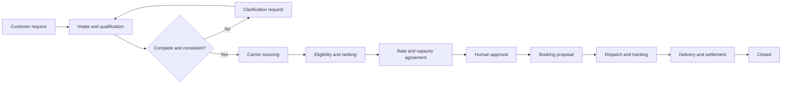

# 01 — Business Understanding

| Field | Value |
|---|---|
| Status | Approved (Phase 1.7.5 Architecture Remediation) |
| Contract version | 2.2 |
| Contract source | [Appendix A — Canonical Contracts](./03-requirements-specification.md#appendix-a--canonical-contracts) |
| Depends on | — |
| Last updated | 2026-11-25 |
| Audience | Product owner, architect, developer, reviewer |

> **This is a design document, not an operations manual.** Freight brokerage practices vary by company, region, mode, and customer. This document describes a common, simplified model so that software requirements can be written. It does not claim that every broker works this way.

## 1. Purpose and how to read this document

This document explains the freight brokerage business in plain language, defines the actors and vocabulary that the rest of the documentation set reuses, and separates:

- **Verified domain facts** — widely documented, mode-agnostic descriptions of how freight brokerage works. Labelled **Fact**.
- **Design assumptions** — choices we make to bound the project, labelled `ASM-xx`. These may be wrong for a specific broker and must be confirmed with real users before production use.
- **Recommendations** — our opinion on what to build. Labelled **Recommendation**.

Nothing here is based on a specific broker's data, and no financial or statistical claims are made about the industry. All examples are fictional.

### 1.1 Business objectives

These are the outcomes this project is designed to improve. They are **design objectives**, not measured results; no baseline data exists. Each links to the problems defined in [02](./02-problem-definition.md).

| ID | Objective | Addressed by |
|---|---|---|
| `BO-01` | Turn customer requests into structured shipment records with less manual re-keying | P-01, P-02 |
| `BO-02` | Make carrier selection consistent, explainable, and reproducible | P-04, P-05 |
| `BO-03` | Ensure consequential actions are authorized, recorded, and auditable | P-07, P-10 |
| `BO-04` | Prevent duplicate or partial booking side effects | P-09 |
| `BO-05` | Bound AI behavior so it cannot silently change a consequential decision | P-06, P-08 |

## 2. What freight brokerage is

**Fact.** Freight brokerage is the business of arranging the movement of goods between a party that needs transportation (the shipper) and a party that owns or operates the vehicle (the carrier). The broker does not usually own trucks. The broker's product is coordination: matching demand to capacity, agreeing a rate, documenting the arrangement, and handling exceptions until delivery.

A useful analogy is a travel agency for freight: the shipper says what needs to move, where, when, and under what conditions; the broker finds a suitable carrier, agrees commercial terms, and stays accountable for the shipment's administrative lifecycle.

### 2.1 The four core parties

| Party | Who they are | What they care about |
|---|---|---|
| **Shipper** | The business sending goods (manufacturer, distributor, retailer). | Pickup reliability, transit time, cost, cargo care, visibility. |
| **Broker** | The intermediary arranging transport. | Margin, carrier reliability, service level, speed of execution, risk. |
| **Carrier** | The trucking company or owner-operator moving the freight. | Load availability, rate per mile, deadhead (empty miles), schedule fit, payment terms. |
| **Consignee** | The business receiving the goods. | Delivery window, condition of goods, appointment compliance, paperwork. |

Additional actors:

- **Driver** — operates the vehicle. Communicates location and delays.
- **Dispatcher** — manages drivers for a carrier and negotiates load assignments.
- **Operations employee (broker-side)** — a person doing the day-to-day work this system supports. Also called an operator, load planner, or account coordinator depending on the company.
- **Operations manager** — supervises operators, handles escalations, and sets policy.

**Design assumption (`ASM-01`).** FreightOps AI targets a **broker-side operations team** for **truckload (TL) freight** in a single country/region, with a small carrier network and direct shipper customers. Less-than-truckload (LTL), intermodal, ocean, and air are out of scope for the MVP.

**Design assumption (`ASM-02`).** The broker maintains its own carrier master data. The MVP does not connect to external load boards, carrier onboarding services, or TMS vendors.

### 2.2 Customer vs. facility (shipper/consignee roles)

These terms are easy to confuse, and confusing them produces a bad database schema.

- A **Customer** is the broker's commercial account — the company that pays the invoice. One customer may ship for or receive at multiple facilities.
- A **Facility** is a physical location (plant, warehouse, distribution center, terminal) where freight is picked up or delivered.
- **Shipper** and **Consignee** are **operational roles** played by facilities on a specific shipment:
  - The facility where freight is picked up acts as the **shipper** (origin).
  - The facility where freight is dropped off acts as the **consignee** (destination).

A single warehouse can ship goods on Monday and receive goods on Wednesday. Modeling "shipper" and "consignee" as separate tables causes duplicate facility records and breaks multi-stop loads. FreightOps AI models commercial accounts in `customers` and physical locations in `facilities`. `shipment_stops` authoritatively tracks each pickup and delivery stop, linking each stop to a facility.

On incomplete draft intake submissions, customer and facility links are optional/nullable until validation.

## 3. How a typical truckload shipment works

**Fact.** A typical brokered truckload shipment follows a lifecycle similar to this (companies vary in naming and tooling):

1. **Demand capture.** A shipper or customer asks the broker to move freight. Requests arrive by email, phone, portal, EDI, or API. They contain origin, destination, pickup/delivery windows, commodity, weight, equipment needs, and often accessorial requirements.
2. **Qualification.** The broker checks that the request is complete and workable: are the dates feasible, is the equipment appropriate, is the cargo hazardous or temperature-sensitive, are appointments required?
3. **Capacity sourcing.** The broker searches its carrier base and/or load boards for carriers that serve the lane, have the right equipment, and have available capacity at the required time.
4. **Rate negotiation.** The broker agrees a buy rate with the carrier and compares it with the sell rate quoted to the customer. Margin depends on lane, urgency, seasonality, fuel, and market conditions.
5. **Booking/tender.** The broker confirms the arrangement with the carrier (often called tendering or booking) and records the assignment.
6. **Dispatch and tracking.** The carrier dispatches a driver, picks up the freight, and provides status updates. The broker monitors pickup, transit, and delivery.
7. **Exception handling.** Delays, breakdowns, weather, dock issues, and paperwork problems are resolved as they arise.
8. **Delivery and settlement.** Proof of delivery is collected, accessorials are reconciled, and the carrier is paid. The customer is invoiced.

### 3.1 What information is needed before arranging transportation

At minimum, a workable truckload request needs:

| Category | Typical fields |
|---|---|
| Parties | Customer, shipper/origin contact, consignee/destination contact |
| Stops | Origin and destination addresses; pickup and delivery windows; appointment requirements |
| Cargo | Commodity description, weight, piece count, dimensions if relevant |
| Equipment | Trailer type (dry van, reefer, flatbed), trailer length, special handling |
| Special requirements | Temperature range, hazmat, liftgate, team driver, permits, load locks, tarping |
| Commercial | Target sell rate, maximum buy rate or margin target, accessorial expectations |
| Operational | Reference numbers, PO numbers, special instructions |

**Fact.** Missing or contradictory information is a normal part of intake, not an exceptional case. A request may say "pickup Monday" while the delivery window is earlier, or ask for a reefer without a temperature range.

### 3.2 Rates, capacity, and routes

- A **lane** is an origin–destination pair (for example, "Chicago, IL → Dallas, TX"). Lanes are the main unit of pricing and carrier familiarity.
- A **rate** is the price for moving the shipment. **Spot rates** apply to one-off moves; **contract rates** are agreed over a period. The broker's **margin** is the difference between the sell rate to the customer and the buy rate to the carrier.
- **Capacity** is the available truck space at a given time on a given lane. Capacity is perishable: a truck that is idle today may be committed tomorrow.
- **Routes** matter because distance, tolls, geography, congestion, and backhaul opportunities change both cost and carrier interest. A carrier may serve a lane outbound but not want the return leg.
- **Deadhead** is empty mileage to reach a pickup. It affects the carrier's effective rate and willingness to accept.

**Design assumption (`ASM-03`).** In the MVP, rates are **operator-provided** commercial boundaries (target sell rate, maximum buy rate) compared against **recorded synthetic carrier lane rates** (`carrier_lane_rates`) maintained in carrier master data. The system does **not** invent market rates and does not call external rate feeds.

## 4. What a Transportation Management System (TMS) is

**Fact.** A TMS is software that records and coordinates shipment lifecycle activities: orders, load planning, carrier assignment, tendering, tracking, document management, settlement, and reporting. Commercial TMS products vary widely in scope and integration.

**Design assumption (`ASM-04`).** FreightOps AI is **not** a full TMS and does not replace one in the MVP. It is an operations assistant focused on intake, validation, carrier recommendation, and approval. It is designed so that a TMS integration could be added later, but no TMS integration exists in this project.

**Design assumption (`ASM-05`).** The system stores its own shipment records in PostgreSQL. Those records are the system of record for this application, not for the broker's entire business.

## 5. How brokers source and select carriers (common patterns)

**Fact.** Brokers typically build a carrier network over time. Selection usually combines:

- **Contract/partner carriers** with negotiated rates and recurring lanes.
- **Spot-market carriers** found through load boards, referrals, or outbound calls.
- **Onboarding checks**: operating authority, insurance certificates, safety scores, and fraud checks. The exact checks and their rigor vary by company and jurisdiction.
- **Operational fit**: equipment, lane familiarity, availability, communication responsiveness, and past performance.
- **Commercial fit**: rate, accessorials, payment terms, and fuel surcharge.

**Fact.** Carrier selection is often informal and person-dependent. Experienced operators carry knowledge of which carriers are reliable on which lanes, which ones answer the phone, and which ones handle temperature-sensitive freight well.

**Design assumption (`ASM-06`).** The MVP maintains **carrier master data manually** (or via synthetic seed data): status, equipment types, service regions, availability windows, insurance expiry, and a limited set of historical performance indicators. It does not verify authority or insurance with external sources.

**Design assumption (`ASM-07`).** Carrier availability in the MVP is a **recorded availability window**, not a live GPS or telematics feed. It can be stale. The UI and documentation must say so.

## 6. Where brokerage operations get hard

The following difficulties are widely recognized operationally and are stated qualitatively, without statistical claims:

- **Unstructured intake.** Requests arrive as prose, forwarded threads, PDFs, and screenshots. Important details are buried or implied.
- **Incomplete information.** Operators spend time asking customers and shippers for missing details before they can source capacity.
- **Contradictions.** Dates, addresses, weights, and equipment requirements can conflict within the same request.
- **Speed vs. accuracy.** Capacity is perishable, so operators feel pressure to act before details are verified.
- **Carrier data quality.** Carrier records go stale. Availability, insurance, and contact details change.
- **Explainability.** Two operators may rank the same carriers differently, and the reasoning is rarely written down.
- **Auditability.** Decisions made over phone or email are hard to reconstruct later.
- **Duplicate work.** The same request may arrive twice, or two operators may source the same load.
- **Exception volume.** A small number of shipments consume a large share of attention.

## 7. Business lifecycle

*Diagram D-01 — simplified business lifecycle. Exception paths and document handling are omitted for clarity.*

## 8. Repetitive activities suitable for automation

Ranked roughly from most deterministic to least:

| Activity | Why it is a candidate | Suggested owner |
|---|---|---|
| Reading a request and copying fields into a form | Tedious, error-prone, text-shaped | AI extraction with human review |
| Checking required fields and contradictions | Rule-based | Deterministic validation |
| Filtering carriers by equipment, region, status, insurance, availability | Rule-based over structured data | Deterministic eligibility |
| Ranking eligible carriers by configured weights | Arithmetic | Deterministic scoring |
| Drafting a clarification message *(Post-MVP — FR-047)* | Text generation | Template first; LLM optional |
| Explaining why a carrier was recommended | Summarization of recorded facts | Template + optional LLM narration |
| Recording decisions and approvals | Workflow | Human action, system records |
| Detecting duplicate submissions | Hashing/idempotency | Deterministic |
| Monitoring workflow outcomes | Metrics | Deterministic instrumentation |
| Negotiating rates | Requires judgment and relationships | Human (out of MVP scope) |

**Recommendation.** Automate the deterministic steps first. Use AI for the text-to-structure boundary and for narration, and keep humans as the decision authority for consequential actions. This keeps the system testable and auditable.

## 9. Fact, assumption, and recommendation ledger

| ID | Type | Statement | Revisit trigger |
|---|---|---|---|
| `ASM-01` | Assumption | Broker-side, single-region truckload focus. | Expansion to other modes or regions. |
| `ASM-02` | Assumption | Carrier master data is maintained in-system; no external carrier APIs. | Integration request from a real broker. |
| `ASM-03` | Assumption | Rates combine operator boundaries and synthetic recorded carrier lane rates; no market rate feed. | Rate-feed integration in a later phase. |
| `ASM-04` | Assumption | The product is an assistant, not a full TMS. | TMS replacement scope requested. |
| `ASM-05` | Assumption | PostgreSQL is the application's system of record. | Multi-system synchronization requirement. |
| `ASM-06` | Assumption | Carrier data is manually maintained/synthetic; no authority or insurance verification. | Onboarding-integration project. |
| `ASM-07` | Assumption | Availability is a recorded window, not live telematics. | Telematics integration. |
| `ASM-08` | Assumption | Users access the app through a browser on a desktop-class device. | Mobile field use requirement. |
| `ASM-09` | Assumption | Shipments have one customer but may have multiple stops and parties. | Multi-customer consolidated shipments. |

## 10. Non-goals for Phase 1

- Replacing a commercial TMS.
- Real carrier onboarding, authority verification, or insurance verification.
- Automated rate negotiation or automated tendering.
- Live tracking, telematics, or driver mobile apps.
- EDI, load-board, or TMS integrations.
- Multi-tenant SaaS operation.
- Financial settlement, invoicing, or payments.

## 11. Glossary pointer

All canonical terms, enumerations, entity names, workflow node names, API resources, and ID ranges are frozen in [Appendix A — Canonical Contracts](./03-requirements-specification.md#appendix-a--canonical-contracts). This document uses those terms but does not redefine them. See also [02 — Problem Definition](./02-problem-definition.md) for the operational problems derived from this business model.
