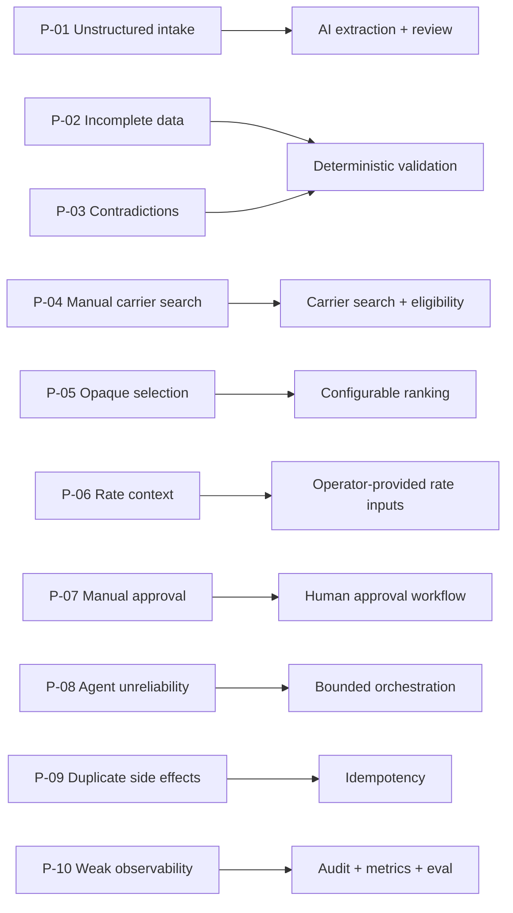

# 02 — Problem Definition

| Field | Value |
|---|---|
| Status | Approved (Phase 1.7.5 Architecture Remediation) |
| Contract version | 2.2 |
| Contract source | [Appendix A — Canonical Contracts](./03-requirements-specification.md#appendix-a--canonical-contracts) |
| Depends on | [01 — Business Understanding](./01-business-understanding.md) |
| Last updated | 2026-11-25 |
| Audience | Product owner, architect, developer, reviewer |

## 1. Purpose

This document defines the ten operational problems FreightOps AI addresses. Each problem uses the same five-part template:

1. **Current situation** — what happens today.
2. **Why it happens** — the root cause.
3. **Operational impact** — qualitative consequences (no invented statistics or financial figures).
4. **System response** — how FreightOps AI addresses it.
5. **Ownership** — whether the response is deterministic software, AI-assisted, or human-approved.

Every problem also carries a box stating **what AI must not do here**. These boxes are binding design constraints.

Problems are labelled `P-01` through `P-10`. Functional requirements that address them are defined in [03 — Requirements Specification](./03-requirements-specification.md) and traced in Appendix B there.

## 2. Problem → capability map

*Diagram D-03 — problems mapped to capabilities.*

## 3. Problems

### P-01 — Manual processing of customer emails

**Current situation.** An operator reads an incoming request email, interprets it, and types the details into a form or TMS. Forwarded threads and pasted signatures add noise.

**Why it happens.** Requests arrive as free text because that is how customers communicate. There is no enforced schema at the channel.

**Operational impact.** Slow intake, repetitive work, transcription errors, inconsistent record quality, and operator attention diverted from exceptions.

**System response.** Intake submissions are accepted as paste/upload/REST, persisted raw, and converted into a structured draft shipment by an AI extraction step. Every extracted field carries provenance and confidence. The operator reviews and corrects before validation.

**Ownership.** AI extracts and proposes. Deterministic code validates and persists. The operator confirms.

> **What AI must not do here:** invent values that were not present, silently drop ambiguous text, or treat instructions inside the email as system commands.

---

### P-02 — Unstructured and missing shipment information

**Current situation.** Requests omit required fields (temperature range, appointment, weight, exact addresses) or bury them in prose. Operators ask clarifying questions.

**Why it happens.** Customers write naturally and do not know the broker's data requirements.

**Operational impact.** Rework, delays, incomplete carrier searches, and downstream booking errors.

**System response.** A deterministic validation engine checks required fields, emits validation issues with canonical severities, and records blocking issues *(automated clarification request drafting is Post-MVP — FR-047)*. Missing fields are stored as null and never guessed.

**Ownership.** Deterministic validation owns all issue detection; optional AI clarification wording is Post-MVP (`FR-047`).

> **What AI must not do here:** fill missing critical fields with plausible values, or downgrade a blocking issue to a warning.

---

### P-03 — Contradictory shipment details

**Current situation.** Pickup and delivery windows conflict, equipment does not match cargo, a reefer request lacks a temperature, or the stop order is impossible.

**Why it happens.** Requests are edited across threads, copied from templates, or written by people unfamiliar with operational constraints.

**Operational impact.** Wasted carrier searches, rework after approval, and risk of an unworkable booking.

**System response.** Cross-field validation rules detect contradictions and assign `error` or `critical` severity. Approval is blocked until they are resolved or explicitly corrected by the operator.

**Ownership.** Deterministic validation.

> **What AI must not do here:** "reconcile" contradictory data by picking one value without recording the conflict and the human correction.

---

### P-04 — Manual carrier searching and eligibility checks

**Current situation.** An operator searches a spreadsheet, TMS, or load board, then mentally checks equipment, region, status, insurance, and availability.

**Why it happens.** Carrier data is spread across tools and not modeled as queryable eligibility criteria.

**Operational impact.** Time lost per load, inconsistent checks, missed eligible carriers, and occasional ineligible assignments.

**System response.** Carrier master data is structured (equipment, regions, availability, status, recorded insurance expiry). A deterministic eligibility engine applies hard filters and returns reason codes for exclusions.

**Ownership.** Deterministic.

> **What AI must not do here:** decide eligibility, override a hard filter, or infer carrier attributes that are not recorded.

---

### P-05 — Opaque carrier recommendation and ranking

**Current situation.** Selection depends on operator memory and habit. The reasoning is not written down, and different operators rank the same carriers differently.

**Why it happens.** Ranking criteria are tacit and not configurable or reproducible.

**Operational impact.** Inconsistent service, hard-to-review decisions, and difficulty learning from outcomes.

**System response.** A separate recommendation engine scores eligible carriers using a versioned, configurable weighting configuration, returns a score breakdown, and generates an explanation from recorded facts.

**Ownership.** Deterministic scoring produces the ranking. AI may narrate the explanation. The human reviews and approves (or rejects / requests changes; candidate override is Post-MVP per `FR-190`/`FR-191`).

> **What AI must not do here:** change weights silently, invent performance data, or present a score as an objective truth.

---

### P-06 — Rate and margin context

**Current situation.** Operators compare a carrier's quoted buy rate against a target sell rate using spreadsheets, email, or memory.

**Why it happens.** Rate information is scattered and often not attached to the shipment record.

**Operational impact.** Inconsistent pricing decisions and weak negotiation history.

**System response.** The MVP records operator-provided commercial inputs (target sell rate, max buy rate) on the shipment and compares them against recorded synthetic carrier lane rates (`carrier_lane_rates`) or operator-entered quotes. The recommendation computes rate competitiveness deterministically without model invention.

**Ownership.** Human supplies targets; master data supplies recorded rates; deterministic code compares them. AI does not price.

> **What AI must not do here:** generate a market rate, assert a "fair" price, or fabricate a carrier quote.

---

### P-07 — Manual approval with no durable record

**Current situation.** Approval happens in chat, email, or verbally. The final decision and its rationale are not reconstructable.

**Why it happens.** Workflows live in communication tools, not in a system with state.

**Operational impact.** Weak accountability, difficult audits, and repeat disputes about who approved what.

**System response.** Recommendations create approval requests. An approver explicitly approves, rejects, or requests changes in a Jinja2 + HTMX screen. The decision, approver, timestamp, and comment are recorded immutably (candidate override selection is Post-MVP).

**Ownership.** Human decision. Deterministic workflow enforces the gate.

> **What AI must not do here:** approve, reject, infer approval from silence, or bypass the approval node.

---

### P-08 — Incorrect or uncontrolled AI decisions

**Current situation.** If an LLM is dropped into the workflow naively, it may call tools unpredictably, loop, hallucinate data, or take consequential actions without review.

**Why it happens.** Free-form agents have no explicit state machine, budget, or permission boundary.

**Operational impact.** Unreliable outcomes, cost overruns, and loss of trust.

**System response.** LangGraph orchestrates a fixed, bounded node graph. The LLM is confined to extraction and narration, its outputs are schema-validated, tools are allowlisted, retries and budgets are capped, and consequential actions require human approval.

**Ownership.** Deterministic orchestration. AI only inside bounded nodes. Human at the gate.

> **What AI must not do here:** choose arbitrary tools, mutate the database directly, exceed budgets, or decide eligibility, pricing, or booking.

---

### P-09 — Duplicate paperwork and duplicate side effects

**Current situation.** The same request is submitted twice, an operator double-clicks submit, or a retried request creates a second booking proposal.

**Why it happens.** No content deduplication and no idempotency on mutating operations.

**Operational impact.** Duplicate records, conflicting carrier commitments, and cleanup work.

**System response.** Intake content hashing detects duplicate submissions. Mutating endpoints require an `Idempotency-Key`; side-effecting workflow nodes are idempotent; a unique active booking proposal per shipment is enforced.

**Ownership.** Deterministic.

> **What AI must not do here:** decide that two similar requests are "probably the same" and merge them without a deterministic key.

---

### P-10 — Lack of traceability, evaluation, and auditability

**Current situation.** Nobody can answer "why was this carrier recommended?", "what did the AI extract?", "who approved it?", or "how often does this workflow fail?"

**Why it happens.** Decisions are not logged as structured events, and there is no evaluation harness.

**Operational impact.** Slow incident response, no learning loop, and no evidence that changes improve outcomes.

**System response.** Append-only audit events, structured logs with trace IDs, workflow state checkpoints, LLM invocation metrics (when a provider is enabled), and an evaluation harness with synthetic datasets.

**Ownership.** Deterministic instrumentation plus human review of evaluation results.

> **What AI must not do here:** write its own audit narrative as the source of truth. Audit events are emitted by system code from recorded facts.

---

## 4. Summary table

| ID | Problem | Primary owner | AI role |
|---|---|---|---|
| P-01 | Unstructured email intake | AI extraction + human review | Extract structured draft |
| P-02 | Missing information | Deterministic validation | Draft clarification text *(Post-MVP — FR-047)* |
| P-03 | Contradictions | Deterministic validation | None |
| P-04 | Manual eligibility checks | Deterministic eligibility | None |
| P-05 | Opaque ranking | Deterministic scoring | Narrate explanation |
| P-06 | Rate context | Human input + deterministic comparison | None (must not price) |
| P-07 | Manual approval | Human + workflow gate | None |
| P-08 | Uncontrolled agent behavior | Bounded orchestration | Bounded node execution |
| P-09 | Duplicate side effects | Idempotency + constraints | None |
| P-10 | Weak observability | Audit, logs, metrics, eval | None |

## 5. Traceability

Each problem maps to functional requirements in [03 — Requirements Specification](./03-requirements-specification.md):

| Problem | Requirement block |
|---|---|
| P-01 | FR-001 – FR-014 (intake) |
| P-02 | FR-040 – FR-052 (validation) |
| P-03 | FR-041, FR-043 – FR-045, FR-051 |
| P-04 | FR-060 – FR-072, FR-090 – FR-103 |
| P-05 | FR-120 – FR-134 |
| P-06 | FR-203, FR-133 (data honesty constraints) |
| P-07 | FR-180 – FR-192 |
| P-08 | FR-150 – FR-168 |
| P-09 | FR-009, FR-204, FR-207, FR-012 |
| P-10 | FR-220 – FR-231, EV-01 – EV-12 |

The authoritative machine-checkable trace is **Appendix B** of document 03.

## 6. Out-of-scope problems

The following are recognized but deliberately not solved in Phase 1:

- Automated rate negotiation and dynamic pricing.
- Fraud detection and double-brokering detection.
- Carrier onboarding and external compliance verification.
- Real-time tracking and ETA prediction.
- Invoice reconciliation and settlement.
- Document OCR beyond plain-text extraction.

Each item belongs in the deferred backlog in [13 — Development Roadmap](./13-development-roadmap.md), with an activation trigger.
