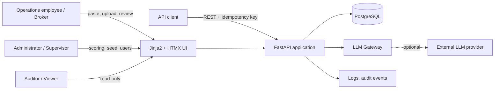
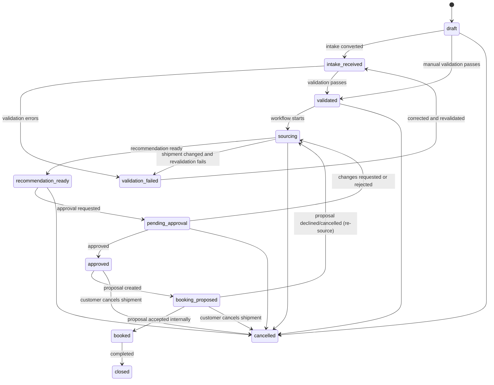
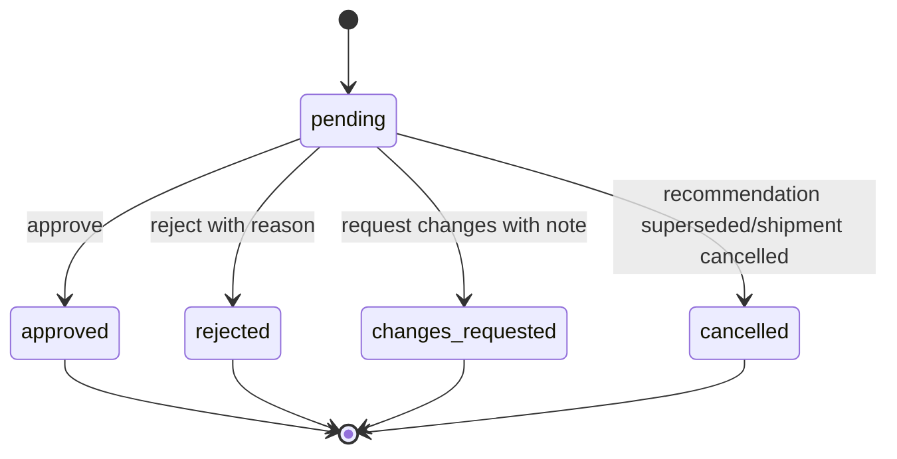

# 03 — Software Requirements Specification

| Field | Value |
|---|---|
| Status | Approved (Phase 1.7.5 Remediation) |
| Contract version | 2.2 |
| Contract source | This document, Appendix A (authoritative) |
| Depends on | [01 — Business Understanding](./01-business-understanding.md), [02 — Problem Definition](./02-problem-definition.md) |
| Last updated | 2026-11-25 |
| Audience | Product owner, architect, developer, reviewer |

## 1. Purpose and scope

This document specifies what FreightOps AI must do in its first version (MVP), who uses it, how correctness will be judged, and the canonical vocabulary every other document must obey.

It is a **requirements document**, not an implementation plan. API shapes are defined in [09 — API Design](./09-api-design.md); tables in [06 — Database Design](./06-database-design.md); workflow nodes in [07 — Agent Workflow](./07-agent-workflow.md). Where this document conflicts with those, **Appendix A wins for vocabulary**, and the precedence order in §1.2 applies.

### 1.1 Scope statement

FreightOps AI is a **broker-side freight operations assistant**. It accepts shipment requests, converts unstructured text into a structured Shipment draft, validates completeness and consistency, filters and ranks carriers deterministically, produces an explained Recommendation, and gates Booking Proposals behind explicit human Approval. It records append-only audit events and evaluation metrics.

### 1.2 Precedence on conflict

1. Appendix A (vocabulary, enumerations, identifiers)
2. [06 — Database Design](./06-database-design.md) (schema truth)
3. [09 — API Design](./09-api-design.md) (wire truth)
4. [07 — Agent Workflow](./07-agent-workflow.md) (workflow truth)
5. Descriptive prose in any document.

### 1.3 MVP cut line (authoritative — copied verbatim in 04 and 13)

> **In MVP**
>
> - Target runtime: Python 3.12 (standardized; unverified planned packages subject to Phase 1 adoption gate)
> - Local user accounts, session cookie login with CSRF protection, RBAC with `admin`, `broker`, `viewer` (bearer token auth deferred to Post-MVP via FR-252)
> - Facilities master data CRUD (consolidating physical shippers and receivers into `facilities`)
> - Intake via pasted unstructured text and REST API; intake submission persisted with parse metadata (manual entry deferred to Post-MVP via FR-004)
> - Shipment read/update before approval, first-class `equipment_type` (`dry_van`, `reefer`, `flatbed`), multi-stop pickup and delivery stops (`shipment_stops`), and structured requirements stored as validated `jsonb`
> - Unresolved/nullable customer, facility, and `equipment_type` references on draft intake shipments, resolved prior to validation
> - Deterministic validation engine with severity gating and a validation results endpoint returning `validation_run_id` and `rules_version`
> - Synthetic carrier fixtures, equipment types, service regions, availability windows, and synthetic lane rates (`carrier_lane_rates`); interactive carrier CRUD deferred to Post-MVP (FR-060, FR-063–065)
> - Deterministic hard-eligibility filtering (7 canonical filters) with canonical reason codes
> - Rule-based configurable scoring baseline with top-N recommendations, score breakdowns, and factual rate competitiveness
> - Template-based explanations; LLM narration behind the gateway with automatic template fallback
> - Single LangGraph workflow with bounded transient retries (FR-156), durable PostgreSQL checkpoints, and exactly one human approval interrupt
> - Simplified workflow execution: human decision resumes the graph; automatic TTL sweeps and outbox workers deferred
> - Re-sourcing state transition: declined or cancelled booking proposals return shipment to `sourcing` rather than terminal cancellation
> - Jinja2 + HTMX approval screens supporting approve, reject, and request changes; candidate selection override deferred to Post-MVP (FR-190, FR-191)
> - Booking proposal records with frozen JSONB snapshots (no external tender or confirmation)
> - Append-only audit events with database-level immutability enforcement and correlation IDs
> - PostgreSQL persistence and Alembic migrations
> - Structured JSON logs, request/trace IDs, unauthenticated health endpoint
> - pytest unit/integration tests and an evaluation harness skeleton
> - Dockerfile and Docker Compose for app + database (development)
> - Synthetic seed data only (facilities, customers, carriers, lane rates, shipments)
> - Target scope: 95 prioritized requirements (Contract 2.2 / Phase 1.7.5 Remediation)
>
> **Deferred (Post-MVP and Future)**
>
> - Manual shipment entry without intake (FR-004) and pre-validation extraction review screen (FR-011)
> - Interactive carrier profile and attribute CRUD endpoints (FR-060, FR-063, FR-064, FR-065) and operator carrier list UI (FR-068)
> - Scoring configuration versioning and activation APIs (FR-280, FR-281, FR-285)
> - Bearer token API authentication (FR-252)
> - Broker candidate selection override on approval (FR-190, FR-191)
> - Multi-user optimistic locking on shipments (FR-023) and separate warning review flow (FR-045)
> - Secondary query endpoints and redundant metadata (FR-008, FR-031, FR-205, FR-255)
> - Scoring nuance penalties and config lineage tracking (FR-128, FR-129)
> - Redundant re-validation, exclusion formatting, and rate rules (FR-048, FR-050, FR-067, FR-102, FR-126, FR-133)
> - Automatic approval TTL expiration sweeps and background worker schedulers (Celery/ARQ/APScheduler)
> - Transactional outbox event dispatcher and message brokers
> - Real carrier, load-board, TMS, EDI, or telematics integrations
> - Plain text and JSON file uploads (Post-MVP); inbound email ingestion (.eml parsing, IMAP polling, inbound webhooks) and document OCR (Future)
> - External rate feeds, live market benchmarks, automated pricing, or automated tendering
> - ML ranking, vector databases (Pinecone/pgvector), Sentence Transformers, scikit-learn models
> - Multi-tenant organization isolation and fine-grained object-level ACLs
> - Kubernetes, autoscaling, service mesh
> - Dedicated observability backend (OpenTelemetry Collector, Prometheus, Grafana)
> - SSO/OAuth/MFA and separation-of-duties enforcement
> - Notifications and outbound email
> - React SPA or mobile application
> - High-availability clustering and automated failover
> - Fraud detection and automated double-brokering checks

## 2. Stakeholders and personas

| Persona | Role | Goals | Frustrations |
|---|---|---|---|
| Dana, freight operations employee | `broker` | Move loads quickly with fewer manual steps; trust the recommendations | Retyping emails, hunting for carriers, unclear rules |
| Morgan, operations supervisor | `admin` | Consistent decisions, accountability, system configuration | Inconsistent selections, no audit trail, no outcome metrics |
| Sam, reviewer/auditor | `viewer` | Read-only traceability of decisions | Decisions that cannot be reconstructed |
| System | `system` | Execute bounded workflow steps and record audit events | — |

**Design assumption (`ASM-10`).** One broker organization per deployment in the MVP. Multi-tenancy is deferred.

## 3. Roles and permissions

| Capability | `admin` | `broker` | `viewer` |
|---|---|---|---|
| Manage users | ✅ | — | — |
| Create/edit intake submissions and shipments | ✅ | ✅ | — |
| Read shipments/intake | ✅ | ✅ | ✅ |
| Manage facilities and customer master data | ✅ | ✅ | — |
| Manage carrier master data and lane rates | ✅ | ✅ | — |
| Trigger validation and recommendations | ✅ | ✅ | — |
| Approve / reject / request changes | ✅ | ✅ | — |
| Create booking proposals (post-approval) | ✅ | ✅ | — |
| View audit events | ✅ | ✅ | ✅ |
| Manage scoring configuration | ✅ | — | — |
| Seed / reset synthetic data (non-production) | ✅ | — | — |

`system` is an audit actor type, not a login role. Separation of duties (`FR-188`) is deferred to post-MVP.

## 4. System context



*Diagram D-04 — system context. The LLM provider is optional and swappable via the mock provider.*

## 5. Functional requirements

Conventions:
- **Scope Status:**
  - `MVP`: Must be delivered in Phase 1–5.
  - `Post-MVP`: High value, deferred to v1.1.
  - `Future`: Long-term product vision.
  - `Merged / Removed`: Pruned or consolidated into core requirements (traceability retained).
- Each requirement retains its canonical ID, component, phase, and acceptance criterion.

### 5.1 Intake and capture (FR-001 – FR-019)

| ID | Requirement | Status | Phase | Component | Acceptance criterion / Note |
|---|---|---|---|---|---|
| FR-001 | The system shall accept an intake submission as pasted plain text. | MVP | PH-2 | Intake Service | A pasted request creates a persisted submission. |
| FR-002 | The system shall accept an intake submission as an uploaded `.txt` or `.json` file. | Post-MVP | Post-MVP | Intake Service | Deferred `.eml` MIME parsing to Future; plain text and JSON file upload in Post-MVP. |
| FR-003 | The system shall accept an intake submission through `POST /api/v1/intake/submissions`. | MVP | PH-2 | API Layer | A valid JSON body creates a submission and returns 201. |
| FR-004 | The system shall support manual shipment entry without an intake submission. | Post-MVP | Post-MVP | Shipment Service | Deferred to Post-MVP in Phase 1.7.4 scope challenge: UI convenience fallback: manual shipment entry without intake; core workflow is automated intake extraction. |
| FR-005 | The system shall persist the raw intake content with channel, received timestamp, content hash, and submitter. | MVP | PH-2 | Intake Service | Raw content is retrievable and hash is stored. |
| FR-006 | The system shall produce a structured draft Shipment from intake text, recording per-field provenance and confidence. | MVP | PH-5 | LLM Gateway | Extracted fields carry provenance and confidence. |
| FR-007 | The system shall leave absent fields null and shall never invent missing shipment values. | MVP | PH-2 | Intake Service | Absent fields remain null on draft and trigger validation warnings/issues. |
| FR-008 | The system shall preserve the original raw text alongside the structured record. | Post-MVP | Post-MVP | Intake Service | Deferred to Post-MVP in Phase 1.7.4 scope challenge: Redundant requirement: preserving raw text alongside structured record; raw content is already durably persisted in intake_submissions (FR-005). |
| FR-009 | The system shall detect duplicate submissions by idempotency key or content hash and return the existing submission. | MVP | PH-2 | Intake Service | Replaying the same submission creates no duplicate row. |
| FR-010 | The system shall link each intake submission to the Shipment draft it created. | MVP | PH-2 | Intake Service | The submission stores a non-null `shipment_id` after conversion. |
| FR-011 | The system shall allow an operator to review and correct extracted fields before validation. | Post-MVP | Post-MVP | API / UI | Deferred to Post-MVP in Phase 1.7.4 scope challenge: UI convenience: pre-validation extraction review screen; operators edit draft shipments directly via PATCH /shipments/{id}. |
| FR-012 | The system shall record extraction metadata (model identifier, prompt version) without requiring a real provider. | Post-MVP | Post-MVP | LLM Gateway | Deferred detailed model telemetry; basic metadata in MVP. |
| FR-013 | The system shall reject unsupported media types and oversized uploads with a structured error. | Merged | Merged | API Layer | Merged into standard Pydantic/FastAPI request validation (`ERR-008`/`ERR-009`). |
| FR-014 | The system shall treat intake text as untrusted data and shall not execute instructions contained in it. | MVP | PH-5 | LLM Gateway | Injection payloads do not alter tool selection or system prompts. |

### 5.2 Shipment lifecycle and model (FR-020 – FR-039)

| ID | Requirement | Status | Phase | Component | Acceptance criterion / Note |
|---|---|---|---|---|---|
| FR-020 | The system shall create a Shipment draft with identifier and status `draft`. | MVP | PH-1 | Shipment Service | Created shipment is retrievable with status `draft`. Party FKs and stop address fields nullable on draft (DEF-01). |
| FR-021 | The system shall support one or more pickup and delivery Stops per Shipment via `shipment_stops`. | MVP | PH-1 | Shipment Service | At least one pickup and one delivery stop can be stored and sequenced. Stop address fields nullable on draft (DEF-01). |
| FR-022 | The system shall store Shipment Requirements as a validated JSONB structure on the Shipment. | MVP | PH-1 | Shipment Service | Temperature, hazmat, trailer length, etc., round-trip through JSONB model. |
| FR-023 | The system shall allow Shipment updates before booking with optimistic concurrency (`version`). | Post-MVP | Post-MVP | Shipment Service | Deferred to Post-MVP in Phase 1.7.4 scope challenge: Concurrent multi-user editing: optimistic locking on shipments via version column; MVP operates as a single-broker operator portfolio demo. |
| FR-024 | The system shall retrieve a Shipment with its Stops, Requirements, and current status. | MVP | PH-1 | Shipment Service | Detail response includes nested stops and requirements. |
| FR-025 | The system shall enforce Shipment status transitions according to the canonical state machine. | MVP | PH-1 | Shipment Service | Illegal transitions return `ERR-005`. Supports return to `sourcing` on proposal decline. |
| FR-026 | The system shall derive the Lane from the first pickup and last delivery stop. | MVP | PH-1 | Shipment Service | Lane origin and destination fields are derived and populated. |
| FR-027 | The system shall validate stop sequencing: at least one pickup, at least one delivery, pickup before delivery. | MVP | PH-1 | Validation Engine | Violations produce `error` issues. |
| FR-028 | The system shall store Customer and Facility references distinctly. | Merged | Merged | Shipment Service | Merged into `facilities` and `customers` schema design. |
| FR-029 | The system shall prevent hard deletion of booked Shipments and support cancellation with an audit trail. | Post-MVP | Post-MVP | Shipment Service | Defer hard-delete constraint checks; soft cancellation supported in MVP. |
| FR-030 | The system shall list and filter Shipments by status, lane, customer, and date range. | Post-MVP | Post-MVP | Shipment Service | Basic pagination in MVP; multi-parameter filtering in Post-MVP. |
| FR-031 | The system shall record the Shipment source (`intake_submission` or `manual`). | Post-MVP | Post-MVP | Shipment Service | Deferred to Post-MVP in Phase 1.7.4 scope challenge: Redundant metadata: shipment source column on shipments table; source channel and submitter are already tracked in intake_submissions (FR-005). |
| FR-032 | The system shall prevent modification of fields frozen after approval or booking. | MVP | PH-4 | Shipment Service | Post-approval edits to frozen fields return `ERR-005`. |

### 5.3 Validation (FR-040 – FR-059)

| ID | Requirement | Status | Phase | Component | Acceptance criterion / Note |
|---|---|---|---|---|---|
| FR-040 | The system shall validate required fields for booking readiness (customer, stops, commodity, weight). | MVP | PH-2 | Validation Engine | Missing required fields (customer, complete stop addresses and sequencing, commodity, weight) produce `error` issues (DEF-01). |
| FR-041 | The system shall detect contradictory values across fields (e.g. delivery before pickup, weight exceeds limits). | MVP | PH-2 | Validation Engine | Seeded contradictions produce `error`/`critical` issues. |
| FR-042 | The system shall emit Validation Issues with canonical severity values (`info`, `warning`, `error`, `critical`). | MVP | PH-2 | Validation Engine | No severity outside Appendix A is emitted. |
| FR-043 | The system shall compute a Validation result status of `passed`, `passed_with_warnings`, or `failed`. | MVP | PH-2 | Validation Engine | Result matches severity composition rules. |
| FR-044 | The system shall block Approval while any `error` or `critical` issue exists. | MVP | PH-2 | Validation Engine | Approval request refused with `ERR-013`. |
| FR-045 | The system shall permit review of `warning` issues without blocking Approval. | Post-MVP | Post-MVP | Validation Engine | Deferred to Post-MVP in Phase 1.7.4 scope challenge: Non-blocking warning review: separate warning-only review flow; validation engine pass/fail gating (FR-043/FR-044) is sufficient for MVP demo. |
| FR-046 | The system shall return Validation results through `GET /api/v1/shipments/{id}/validation`. | MVP | PH-2 | API Layer | Response includes `validation_run_id`, `rules_version`, and issues list. |
| FR-047 | The system shall produce a clarification request listing blocking issues. | Post-MVP | Post-MVP | Validation Engine | List of blocking issues in validation response is MVP; automated drafting is Post-MVP. |
| FR-048 | The system shall support re-validation after correction. | Post-MVP | Post-MVP | Validation Engine | Deferred to Post-MVP in Phase 1.7.4 scope challenge: Redundant workflow rule: re-validation after correction; inherently supported by re-invoking idempotent POST /shipments/{id}/validation. |
| FR-049 | The system shall persist validation runs with timestamp and rules version. | MVP | PH-2 | Validation Engine | Runs stored in `validation_runs` table. |
| FR-050 | The system shall not auto-fill missing critical fields during validation. | Post-MVP | Post-MVP | Validation Engine | Deferred to Post-MVP in Phase 1.7.4 scope challenge: Negative design constraint: do not auto-fill missing fields; deterministic validation engine inherently validates fields without side-effect mutation. |
| FR-051 | The system shall validate numeric ranges and formats for weights, dates, and temperatures. | MVP | PH-2 | Validation Engine | Out-of-range values produce issues. |
| FR-052 | The system shall validate equipment/requirement compatibility. | MVP | PH-2 | Validation Engine | Incompatible combinations produce `error` issues. |

### 5.4 Carrier management and rates (FR-060 – FR-089)

| ID | Requirement | Status | Phase | Component | Acceptance criterion / Note |
|---|---|---|---|---|---|
| FR-060 | The system shall create, read, update, and deactivate Carrier profiles. | Post-MVP | Post-MVP | Carrier Service | Deferred to Post-MVP in Phase 1.7.4 scope challenge: Administrative feature: interactive Carrier profile CRUD endpoints; carrier profiles are loaded idempotently via synthetic seed fixtures. |
| FR-061 | The system shall store Carrier status using canonical values (`active`, `inactive`, `suspended`). | MVP | PH-3 | Carrier Service | Status round-trips and invalid values are rejected. |
| FR-062 | The system shall store recorded insurance expiry and authority indicators without claiming external verification. | MVP | PH-3 | Carrier Service | Fields store operator-entered dates/flags. |
| FR-063 | The system shall manage Equipment Types per Carrier. | Post-MVP | Post-MVP | Carrier Service | Deferred to Post-MVP in Phase 1.7.4 scope challenge: Administrative feature: interactive Carrier Equipment CRUD endpoints; equipment types are populated via seed fixtures. |
| FR-064 | The system shall manage Service Regions per Carrier with origin operating presence semantics. | Post-MVP | Post-MVP | Carrier Service | Deferred to Post-MVP in Phase 1.7.4 scope challenge: Administrative feature: interactive Service Region CRUD endpoints; operating regions are populated via seed fixtures. |
| FR-065 | The system shall manage Availability windows per Carrier. | Post-MVP | Post-MVP | Carrier Service | Deferred to Post-MVP in Phase 1.7.4 scope challenge: Administrative feature: interactive Availability Window CRUD endpoints; capacity windows are populated via seed fixtures. |
| FR-066 | The system shall search Carriers by equipment, region, and availability. | Post-MVP | Post-MVP | Carrier Service | Workflow queries directly in MVP; general search endpoint in Post-MVP. |
| FR-067 | The system shall treat inactive or suspended Carriers as ineligible. | Post-MVP | Post-MVP | Eligibility Engine | Deferred to Post-MVP in Phase 1.7.4 scope challenge: Redundant filter check: carrier status filter; identical check is enforced by Eligibility Engine status filter (FR-094). |
| FR-068 | The system shall list Carrier data for operators. | Post-MVP | Post-MVP | API / UI | Deferred to Post-MVP in Phase 1.7.4 scope challenge: UI convenience: operator carrier profile list view; carrier matching runs headlessly inside the workflow. |
| FR-069 | The system shall support importing synthetic Carrier and Lane Rate seed data. | MVP | PH-1 | Config / Seed Tool | Seed import populates carriers and rates idempotently. |
| FR-070 | The system shall record `last_verified_at` for Carrier attributes. | Post-MVP | Post-MVP | Carrier Service | Deferred detailed provenance metadata. |
| FR-071 | The system shall reject invalid region or equipment values. | Merged | Merged | API Layer | Handled by Pydantic enum validation. |
| FR-072 | The system shall show Carrier eligibility context on the carrier profile. | Post-MVP | Post-MVP | UI Renderer | Advanced profile UI feature deferred. |
| FR-073 | The system shall store synthetic Carrier Lane Rates (`carrier_lane_rates`) for pricing comparison. | MVP | PH-3 | Carrier Service | Solves CRIT-03 & DEF-04; rates stored with `flat_rate`, `rate_per_mile`, and `source = 'synthetic'`. Unique active rate per carrier/lane/equipment. |

### 5.5 Eligibility and capacity (FR-090 – FR-119)

| ID | Requirement | Status | Phase | Component | Acceptance criterion / Note |
|---|---|---|---|---|---|
| FR-090 | The system shall run deterministic hard filters for a validated Shipment. | MVP | PH-3 | Eligibility Engine | Only carriers passing all filters are eligible. |
| FR-091 | The system shall filter by Equipment Type match. | MVP | PH-3 | Eligibility Engine | Mismatch yields `equipment_mismatch`. |
| FR-092 | The system shall filter by Service Region coverage (matching origin stop state/region). | MVP | PH-3 | Eligibility Engine | Non-coverage yields `region_not_served`. |
| FR-093 | The system shall filter by recorded Availability window. | MVP | PH-3 | Eligibility Engine | No window yields `no_capacity`. |
| FR-094 | The system shall filter by Carrier status. | MVP | PH-3 | Eligibility Engine | Inactive yields `carrier_inactive`. |
| FR-095 | The system shall filter by recorded insurance validity against pickup date. | MVP | PH-3 | Eligibility Engine | Expired insurance yields `insurance_expired`. |
| FR-096 | The system shall filter by hazmat authorization when Shipment requires hazmat. | MVP | PH-3 | Eligibility Engine | Missing auth yields `hazmat_not_authorized`. |
| FR-097 | The system shall filter by temperature capability when Shipment requires temperature control. | MVP | PH-3 | Eligibility Engine | Missing capability yields `temperature_not_supported`. |
| FR-098 | The system shall emit canonical ineligibility reason codes. | MVP | PH-3 | Eligibility Engine | Codes match Appendix A §A.2. |
| FR-099 | The system shall distinguish `insufficient_data` from `ineligible`. | MVP | PH-3 | Eligibility Engine | Missing carrier attributes produce `insufficient_data`. |
| FR-100 | The system shall make eligibility decisions only in deterministic code, never in the LLM. | MVP | PH-3 | Eligibility Engine | Non-negotiable architectural safety constraint. |
| FR-101 | The system shall persist eligibility evaluation results per Recommendation candidate. | MVP | PH-3 | Recommendation Engine | Candidates store eligibility status and reason codes. |
| FR-102 | The system shall provide human-readable eligibility reasons for exclusions. | Post-MVP | Post-MVP | Eligibility Engine | Deferred to Post-MVP in Phase 1.7.4 scope challenge: Redundant presentation rule: human-readable eligibility reasons for exclusions; canonical ineligibility reason codes are emitted via FR-098. |
| FR-103 | The system shall make eligibility rules configurable without model retraining. | Future | Future | Config Service | Dynamic rule modification deferred to Future roadmap. |

### 5.6 Recommendation and scoring (FR-120 – FR-149)

| ID | Requirement | Status | Phase | Component | Acceptance criterion / Note |
|---|---|---|---|---|---|
| FR-120 | The system shall generate a Recommendation for a validated Shipment on request. | MVP | PH-4 | Recommendation Engine | Recommendation reaches status `ready`. |
| FR-121 | The system shall rank eligible Carriers using the active Scoring Configuration. | MVP | PH-4 | Recommendation Engine | Ranking is reproducible for identical inputs. |
| FR-122 | The system shall produce a score breakdown per scoring component. | MVP | PH-4 | Recommendation Engine | Component scores sum to total within rounding. |
| FR-123 | The system shall return the top-N ranked candidates (default 5). | MVP | PH-4 | Recommendation Engine | Top-N limit respected. |
| FR-124 | The system shall transition Recommendation status through canonical values. | MVP | PH-4 | Recommendation Engine | Canonical transitions enforced. |
| FR-125 | The system shall generate an Explanation citing deterministic facts with optional LLM narration. | MVP | PH-4 | LLM Gateway | Template fallback used when narration disabled/fails. |
| FR-126 | The system shall ensure explanations cite only recorded facts and introduce no new claims. | Post-MVP | Post-MVP | LLM Gateway | Deferred to Post-MVP in Phase 1.7.4 scope challenge: Redundant ground-truth rule: ensure explanations cite only recorded facts; already guaranteed by FR-125 deterministic template fallback. |
| FR-127 | The system shall return `no_eligible_carriers` when filtering yields zero eligible candidates. | MVP | PH-4 | Recommendation Engine | Status and reason returned without approval interrupt. Eligible-but-zero-rankable outcomes use `no_rankable_candidates` (D-033) and are never reported as `no_eligible_carriers`. |
| FR-128 | The system shall degrade gracefully when carrier data is incomplete (`insufficient_data`). | Post-MVP | Post-MVP | Recommendation Engine | Deferred to Post-MVP in Phase 1.7.4 scope challenge: Nonessential scoring nuance: incomplete data ranking penalty; incomplete carriers are already safely flagged insufficient_data by FR-099. |
| FR-129 | The system shall store the Scoring Configuration version used. | Post-MVP | Post-MVP | Recommendation Engine | Deferred to Post-MVP in Phase 1.7.4 scope challenge: Nonessential configuration tracking: dynamic config version linkage on recommendations; MVP uses single active seed configuration. |
| FR-130 | The system shall supersede prior active Recommendations when Shipment changes. | Post-MVP | Post-MVP | Recommendation Engine | Prior recommendation superseding handled in Post-MVP. |
| FR-131 | The system shall expire stale Recommendations after a configurable TTL. | Post-MVP | Post-MVP | Recommendation Engine | Deferred per ADR Decision 5 (simplified scheduling). |
| FR-132 | The system shall provide recommendation detail including candidates and score breakdowns. | MVP | PH-4 | API Layer | Detail endpoint returns full breakdown. |
| FR-133 | The system shall use only operator-provided target rates and recorded carrier lane rates. | Post-MVP | Post-MVP | Recommendation Engine | Deferred to Post-MVP in Phase 1.7.4 scope challenge: Redundant rate-sourcing rule: use only recorded carrier lane rates; already enforced by FR-073 and FR-134 deterministic ranking. |
| FR-134 | The system shall rank deterministically for identical inputs, config, and data snapshot. | MVP | PH-4 | Recommendation Engine | Identical inputs produce identical candidate ordering. |

### 5.7 Agent orchestration and tools (FR-150 – FR-179)

| ID | Requirement | Status | Phase | Component | Acceptance criterion / Note |
|---|---|---|---|---|---|
| FR-150 | The system shall start a Workflow Execution for a Shipment. | MVP | PH-5 | Agent Orchestrator | Execution record created with status `queued`/`running`. |
| FR-151 | The system shall execute the canonical 16-node graph with conditional edges. | MVP | PH-5 | Agent Orchestrator | Execution matches Diagram D-13. |
| FR-152 | The system shall persist Workflow state and node checkpoints in PostgreSQL. | MVP | PH-5 | Agent Orchestrator | State survives process restart via checkpointer. |
| FR-153 | The system shall enforce maximum attempts, LLM calls, and execution timeout. | MVP | PH-5 | Agent Orchestrator | Bounded execution terminates safely on budget limit. |
| FR-154 | The system shall pause at the human approval interrupt and record `waiting_for_human`. | MVP | PH-5 | Agent Orchestrator | Graph pauses before any booking proposal is created. |
| FR-155 | The system shall resume from the interrupt using the recorded human decision. | MVP | PH-5 | Agent Orchestrator | Resumes graph safely without duplicate database inserts; claims execution lease atomically from `resumption_pending`. |
| FR-156 | The system shall retry transient failures within the configured budget. | MVP | PH-5 | Agent Orchestrator | Promoted to MVP in Phase 1.7.5 (Decision A1); bounded retries (max 3 attempts, exponential backoff with jitter) enforced within 900s compute budget. |
| FR-157 | The system shall route unrecoverable failures to `handle_failure`. | MVP | PH-5 | Agent Orchestrator | Failure node runs, records error, marks execution `failed` or `timed_out`, emits `workflow.failed` terminal audit event directly, and terminates at `[*]` directly without passing to `finalize_execution` (DEF-02). |
| FR-158 | The system shall never create a Booking Proposal without a valid Approval. | MVP | PH-5 | Agent Orchestrator | Hard architectural gate. |
| FR-159 | The system shall expose Workflow status via `GET /api/v1/workflows/{id}`. | MVP | PH-5 | API Layer | Status, current node, and error returned. |
| FR-160 | The system shall record a node-level audit event for key milestone node executions. | Post-MVP | Post-MVP | Audit Service | Node-level audit logging deferred to Post-MVP; milestone audit in MVP. |
| FR-161 | The system shall make every side-effecting node idempotent. | MVP | PH-5 | Agent Orchestrator | Node re-execution creates no duplicate records. |
| FR-162 | The system shall validate tool-call payloads with Pydantic schemas. | Merged | Merged | Tool Registry | Enforced by standard Python typed function signatures. |
| FR-163 | The system shall restrict tool invocation to a hardcoded allowlist. | Merged | Merged | Tool Registry | Enforced by deterministic LangGraph node graph. |
| FR-164 | The system shall provide a mock LLM provider for tests and local development. | MVP | PH-5 | LLM Gateway | Full test suite runs offline without API keys. |
| FR-165 | The system shall record LLM invocation telemetry (tokens, latency) when enabled. | Post-MVP | Post-MVP | LLM Gateway | Telemetry table and tracking in Post-MVP. |
| FR-166 | The system shall allow cancellation of a running or waiting Workflow. | Post-MVP | Post-MVP | Agent Orchestrator | Manual cancel endpoint deferred to Post-MVP. |
| FR-167 | The system shall detect and stop repeated no-progress loops. | Removed | Removed | Agent Orchestrator | Removed: The graph is acyclic; no-progress loops cannot occur. |
| FR-168 | The system shall preserve Workflow state across process restarts. | MVP | PH-5 | Agent Orchestrator | PostgreSQL checkpointer enables restart recovery; bounded startup recovery check inspects decided approvals (`resumption_pending` / expired lease) while preserving undecided pending approvals; 60s configurable idempotency and execution lease recovery (DEF-05). |

### 5.8 Human approval (FR-180 – FR-199)

| ID | Requirement | Status | Phase | Component | Acceptance criterion / Note |
|---|---|---|---|---|---|
| FR-180 | The system shall create an Approval request from a `ready` Recommendation. | MVP | PH-4 | Approval Service | Status initialized to `pending`. |
| FR-181 | The system shall display recommendation, scores, explanation, and warnings to the approver. | MVP | PH-5 | UI Renderer | Approval screen displays all four elements. |
| FR-182 | The system shall allow an authorized user to approve an Approval. | MVP | PH-4 | Approval Service | Status becomes `approved`; actor and timestamp recorded. |
| FR-183 | The system shall allow rejection with a required reason. | MVP | PH-4 | Approval Service | Status becomes `rejected`; reason stored; shipment to `sourcing`. |
| FR-184 | The system shall allow requesting changes with a required note. | MVP | PH-4 | Approval Service | Status becomes `changes_requested`; shipment to `sourcing`. |
| FR-185 | The system shall enforce role permission for approval actions. | MVP | PH-4 | Approval Service | Unauthorized roles receive `ERR-003`. |
| FR-186 | The system shall record approver, timestamp, decision, comment, and selected candidate immutably. | MVP | PH-4 | Audit / Approval | Approval decision records cannot be modified or deleted. |
| FR-187 | The system shall expire Approvals after a configurable TTL. | Post-MVP | Post-MVP | Approval Service | Deferred per ADR Decision 5 (no scheduler sweep). |
| FR-188 | The system shall enforce separation of duties between preparer and approver. | Future | Future | Approval Service | Optional four-eyes check deferred to Future roadmap. |
| FR-189 | The system shall make approval decisions idempotent. | MVP | PH-4 | Approval Service | Replaying the same decision returns the same result; reclaims execution lease if resumption was interrupted. |
| FR-190 | The system shall allow the approver to select a different eligible candidate than rank 1. | Post-MVP | Post-MVP | Approval Service | Deferred to Post-MVP in Phase 1.7.4 scope challenge: Secondary broker convenience: candidate selection override; MVP workflow approves top-ranked recommendation candidate; re-sourcing handled via reject/changes. |
| FR-191 | The system shall record the selected candidate on the Approval. | Post-MVP | Post-MVP | Approval Service | Deferred to Post-MVP in Phase 1.7.4 scope challenge: Secondary broker convenience: recording overridden candidate on approval; coupled with FR-190 candidate override. |
| FR-192 | The system shall refuse approval when the Recommendation is superseded or cancelled. | Post-MVP | Post-MVP | Approval Service | Coupled with recommendation superseding; Post-MVP. |

### 5.9 Booking proposal (FR-200 – FR-219)

| ID | Requirement | Status | Phase | Component | Acceptance criterion / Note |
|---|---|---|---|---|---|
| FR-200 | The system shall create a Booking Proposal only after an `approved` Approval. | MVP | PH-4 | Booking Proposal Service | Creation without valid approval returns `ERR-013`. |
| FR-201 | The system shall snapshot approved Shipment, Facility, and Carrier data into the Proposal. | MVP | PH-4 | Booking Proposal Service | Stored in `snapshot jsonb`; insulated from later edits. |
| FR-202 | The system shall transition Booking Proposal status through canonical values. | MVP | PH-4 | Booking Proposal Service | Status begins at `proposed`. |
| FR-203 | The system shall not tender externally or claim carrier confirmation in the MVP. | MVP | PH-4 | Booking Proposal Service | Internal record only; no outbound API/EDI calls. |
| FR-204 | The system shall make Booking Proposal creation idempotent. | MVP | PH-4 | Booking Proposal Service | Replaying returns the existing proposal. |
| FR-205 | The system shall retrieve and list Booking Proposals. | Post-MVP | Post-MVP | API Layer | Deferred to Post-MVP in Phase 1.7.4 scope challenge: Secondary query: general booking proposals list endpoint; created proposal is returned directly by workflow finalization. |
| FR-206 | The system shall refuse proposal creation when Approval is invalid or rejected. | Merged | Merged | Booking Proposal Service | Merged with FR-200. |
| FR-207 | The system shall prevent more than one active Booking Proposal per Shipment. | MVP | PH-4 | Booking Proposal Service | Enforced by PostgreSQL partial unique index. |
| FR-208 | The system shall record audit events for proposal creation and status changes. | MVP | PH-4 | Audit Service | Events queryable in audit log. |
| FR-209 | The system shall allow a proposal to be declined or cancelled, returning the Shipment to `sourcing`. | MVP | PH-4 | Booking Proposal Service | Solves CRIT-04; unlocks shipment re-sourcing. |

### 5.10 Audit, monitoring, and evaluation (FR-220 – FR-249)

| ID | Requirement | Status | Phase | Component | Acceptance criterion / Note |
|---|---|---|---|---|---|
| FR-220 | The system shall append audit events for state-changing operations in the caller's transaction. | MVP | PH-6 | Audit Service | Mutations commit with an audit event. |
| FR-221 | The system shall use canonical audit event types from Appendix A. | MVP | PH-6 | Audit Service | Valid event types enforced. |
| FR-222 | The system shall correlate audit events by trace_id, workflow_execution_id, and shipment_id. | MVP | PH-6 | Audit Service | Cross-cutting event correlation works. |
| FR-223 | The system shall expose an audit query endpoint with filters. | Post-MVP | Post-MVP | API Layer | Basic database logging in MVP; rich query API in Post-MVP. |
| FR-224 | The system shall deny update and delete of audit events via PostgreSQL trigger. | MVP | PH-6 | Database / Audit | Solves F-SEC-03; database trigger blocks UPDATE/DELETE. |
| FR-225 | The system shall emit structured JSON logs with request and trace IDs. | MVP | PH-6 | Observability | Logs parse as JSON and carry correlation IDs. |
| FR-226 | The system shall expose an unauthenticated health endpoint. | MVP | PH-6 | API Layer | `GET /api/v1/health` returns status without auth. |
| FR-227 | The system shall record workflow latency and failure metrics. | Post-MVP | Post-MVP | Observability | OpenTelemetry metric counters in Post-MVP. |
| FR-228 | The system shall record LLM token and cost metrics. | Post-MVP | Post-MVP | LLM Gateway | Detailed cost reporting in Post-MVP. |
| FR-229 | The system shall record evaluation run results. | Post-MVP | Post-MVP | Evaluation Harness | Offline script reports in MVP; in-database eval rows in Post-MVP. |
| FR-230 | The system shall redact sensitive contact and credential fields from logs. | MVP | PH-6 | Observability | Log filter strips PII and passwords. |
| FR-231 | The system shall audit configuration changes. | Post-MVP | Post-MVP | Config Service | Config audit in Post-MVP. |

### 5.11 Access control (FR-250 – FR-279)

| ID | Requirement | Status | Phase | Component | Acceptance criterion / Note |
|---|---|---|---|---|---|
| FR-250 | The system shall maintain local user accounts. | MVP | PH-1 | Auth Service | Users created and listed by admin. |
| FR-251 | The system shall authenticate UI users with a secure session cookie. | MVP | PH-1 | Auth Service | Session established on login; cleared on logout. |
| FR-252 | The system shall authenticate API clients with a bearer token. | Post-MVP | Post-MVP | API Layer | Session auth for UI/API in MVP; dedicated token auth in Post-MVP. |
| FR-253 | The system shall implement canonical RBAC roles (`admin`, `broker`, `viewer`). | MVP | PH-1 | Auth Service | Role check enforced on protected operations. |
| FR-254 | The system shall enforce permissions on every REST endpoint. | MVP | PH-1 | API Layer | Unauthorized calls return `ERR-003`. |
| FR-255 | The system shall enforce permissions on every UI route. | Post-MVP | Post-MVP | UI Renderer | Deferred to Post-MVP in Phase 1.7.4 scope challenge: Redundant authorization layer: dedicated UI route permission checks; server-side REST API permission enforcement (FR-254) protects all endpoints. |
| FR-256 | The system shall deny unauthenticated access to all endpoints except health. | MVP | PH-1 | API Layer | Unauthenticated calls return `ERR-002`. |
| FR-257 | The system shall store passwords using a salted password hash (Argon2 / bcrypt). | MVP | PH-1 | Auth Service | Plaintext passwords are never stored or logged. |
| FR-258 | The system shall expire sessions after an idle period. | Future | Future | Auth Service | Idle session sweeping deferred to Future. |
| FR-259 | The system shall allow administrators to manage users and roles. | Post-MVP | Post-MVP | Auth Service | Seed script handles users in MVP; admin management UI in Post-MVP. |
| FR-260 | The system shall audit authentication failures. | Future | Future | Audit Service | Security telemetry deferred to Future. |

### 5.12 Configuration, seed, and administration (FR-280 – FR-299)

| ID | Requirement | Status | Phase | Component | Acceptance criterion / Note |
|---|---|---|---|---|---|
| FR-280 | The system shall version Scoring Configurations. | Post-MVP | Post-MVP | Config Service | Deferred to Post-MVP in Phase 1.7.4 scope challenge: Administrative feature: scoring configuration versioning API; MVP activates a single validated configuration from seed. |
| FR-281 | The system shall activate exactly one Scoring Configuration at a time. | Post-MVP | Post-MVP | Config Service | Deferred to Post-MVP in Phase 1.7.4 scope challenge: Administrative feature: multi-config activation endpoint; single configuration is active in MVP. |
| FR-282 | The system shall load synthetic seed data only. | MVP | PH-1 | Seed Tool | No real carrier, facility, or rate data used. |
| FR-283 | The system shall support resetting and reseeding a non-production database. | MVP | PH-1 | Seed Tool | Reset requires an explicit non-production flag. |
| FR-284 | The system shall expose canonical enum metadata (`GET /api/v1/meta/enums`). | Post-MVP | Post-MVP | API Layer | Introspection endpoint in Post-MVP. |
| FR-285 | The system shall validate configuration weights sum to 1.0 before activation. | Post-MVP | Post-MVP | Config Service | Deferred to Post-MVP in Phase 1.7.4 scope challenge: Administrative feature: configuration weight validation endpoint; seed configuration weights are validated offline. |
| FR-286 | The system shall provide a feature flag to toggle LLM narration on or off. | MVP | PH-5 | Config Service | When off, template explanations are used with zero LLM calls. |
| FR-287 | The system shall provide an administrator system status view. | Future | Future | UI Renderer | System dashboard deferred to Future. |

---

### Scope Summary Matrix

```
========================================================================================
                          REVISED REQUIREMENT BREAKDOWN
========================================================================================
Category                                Count    Percentage    Target Phase
----------------------------------------------------------------------------------------
MVP (Must Deliver)                         95       60.9%       PH-1 through PH-6
Post-MVP (Deferred)                        49       31.4%       v1.1 Release
Future Backlog                              5        3.2%       Roadmap Backlog
Merged or Removed                           7        4.5%       Consolidated / Pruned
----------------------------------------------------------------------------------------
Total Functional Requirements             156      100.0%
========================================================================================
```

## 6. Use cases

### UC-01 — Submit a shipment request (paste or REST)
- **Actor:** `broker` or API client.
- **Preconditions:** User is authenticated.
- **Main flow:** The operator pastes text or POSTs to `/api/v1/intake/submissions`. The system persists the raw submission, computes a content hash, and returns the submission with its identifier. Customer and facility references remain null/unresolved.
- **Alternate:** A duplicate content hash returns the existing submission (`200`, no new row).
- **Postconditions:** Intake Submission record is persisted in `intake_submissions` with `content_hash` and linked `shipment_id`.

### UC-02 — Review and correct an extracted draft
- **Actor:** `broker`.
- **Preconditions:** Intake submission exists; extraction has run.
- **Main flow:** The operator opens the draft shipment, reviews extracted stops and requirements, links the Customer and Facility references, corrects values, and saves.
- **Postconditions:** Shipment transitions from `draft` to `intake_received`.

### UC-03 — Validate a shipment and resolve blocking issues
- **Actor:** `broker`.
- **Preconditions:** Shipment exists with stops and requirements.
- **Main flow:** The operator triggers validation. The system returns `validation_run_id`, `rules_version`, and issues. If no `error`/`critical` issue exists, status becomes `validated`.
- **Alternate:** Warnings only → `passed_with_warnings`, still approvable.
- **Exception:** Blocking issues → status `validation_failed`; clarification list returned.

### UC-04 — Maintain carrier lane rates (and Post-MVP carrier master CRUD)
- **Actor:** `broker` or `admin`.
- **Preconditions:** User has carrier permissions.
- **Main flow:** In MVP, synthetic Carrier profiles, Equipment Types, Service Regions, and Availability windows are seeded via `FR-069`, while operators inspect and maintain synthetic `carrier_lane_rates` via API. Interactive Carrier CRUD (`FR-060`, `FR-063`–`FR-065`) is Post-MVP.
- **Postconditions:** Carrier master data and lane rates stored with audit events.

### UC-05 — Generate carrier recommendations
- **Actor:** `broker` (trigger); `system` (execution).
- **Preconditions:** Shipment is `validated`.
- **Main flow:** The operator requests recommendations. The workflow starts, loads shipment, normalizes requirements, resolves carrier candidates, filters hard eligibility, scores candidates with active config and lane rates, renders explanation (with template fallback), and persists a `ready` Recommendation.
- **Alternate:** No eligible carriers → status `no_eligible_carriers` with reasons. Eligible carriers but none rankable → status `no_rankable_candidates` with explicit null scores/ranks (D-033).

### UC-06 — Review a recommendation
- **Actor:** `broker`.
- **Preconditions:** Recommendation is `ready`.
- **Main flow:** The operator views ranked candidates, component scores, rate quotes, eligibility reasons, and the explanation.

### UC-07 — Approve, reject, or request changes
- **Actor:** `broker` or `admin`.
- **Preconditions:** Approval is `pending`; recommendation is `ready`; no blocking validation issues.
- **Main flow:** The approver reviews the recommendation and approves the top-ranked candidate, rejects with reason, or requests changes (candidate selection override deferred to Post-MVP via `FR-190`, `FR-191`).
- **Postconditions:** Approval record is immutable. Graph resumes.

### UC-08 — Create a booking proposal
- **Actor:** `system`, triggered by approval resumption.
- **Preconditions:** Approval is `approved`; shipment is frozen.
- **Main flow:** The system snapshots shipment, stops, facility, carrier, and rate data into `booking_proposals.snapshot`, sets status `proposed`, and commits.
- **Alternate:** If carrier declines or proposal is cancelled, shipment transitions back to `sourcing` for re-selection.

### UC-09 — Inspect workflow execution and audit trail
- **Actor:** `admin`, `broker`, or `viewer`.
- **Main flow:** The user retrieves workflow execution status and queries append-only audit events by shipment or trace ID.

### UC-10 — Seed synthetic data (and Post-MVP scoring config management)
- **Actor:** `admin`.
- **Main flow:** In MVP, the admin runs the synthetic seed/reset tool (`FR-282`, `FR-283`) to load a single validated active Scoring Configuration and synthetic freight fixtures. Interactive Scoring Configuration versioning/activation APIs (`FR-280`, `FR-281`, `FR-285`) are Post-MVP.

---

## Appendix A — Canonical Contracts

**Authority.** This appendix is the single source of truth for vocabulary, enumerations, identifiers, entity names, workflow node names, and API resource names. Contract version: 2.2 (2026-11-25).

### A.1 Glossary (canonical terms)

| Term | Definition | Notes |
|---|---|---|
| Shipment | The system entity representing freight to be moved. | Central business aggregate (`shipments`). |
| Facility | Physical location (plant, warehouse, DC) where freight is picked up or delivered. | Replaces separate Shipper/Consignee tables (`facilities`). |
| Customer | Commercial account paying for the shipment. | Stored in `customers`. |
| Carrier | Trucking company or owner-operator. | Stored in `carriers`. |
| Carrier Lane Rate | Synthetic recorded pricing baseline per carrier, region, and equipment. | Stored in `carrier_lane_rates` (solves CRIT-03). |
| Stop | A pickup or delivery location in a Shipment. | `shipment_stops` (authoritative for stops). |
| Lane | Origin–destination pair derived from stops. | Derived string, not a table. |
| Equipment Type | Trailer category (`dry_van`, `reefer`, `flatbed`). | Canonical enum. |
| Booking Proposal | Internal record of an approved carrier assignment. | Stored in `booking_proposals`. |
| Intake Submission | Raw request plus parse metadata. | Stored in `intake_submissions`. |
| Validation Issue | One rule finding with severity, field, and message. | Structured in `validation_runs`. |
| Recommendation | Ranked candidate set plus explanation. | Stored in `recommendations`. |
| Approval | Human decision on a Recommendation. | Stored in `approvals`. |
| HITL | Human-in-the-loop interrupt. | Exactly one in the MVP workflow. |
| Workflow Execution | One run of the canonical 16-node graph. | Stored in `workflow_executions`. |
| Checkpoint | Durable snapshot of workflow state in PostgreSQL. | Managed by LangGraph checkpointer. |
| LLM Gateway | Provider-agnostic abstraction for extraction and narration. | Mock provider for testing. |
| Audit Event | Append-only record of a state change. | Stored in `audit_events`. |
| Scoring Configuration | Versioned weights for candidate ranking. | Stored in `scoring_configs`. |

### A.2 Canonical enumerations

All values are lowercase `snake_case`.

- **Shipment status:** `draft`, `intake_received`, `validation_failed`, `validated`, `sourcing`, `recommendation_ready`, `pending_approval`, `approved`, `booking_proposed`, `booked`, `cancelled`, `closed`.
- **Validation severity:** `info`, `warning`, `error`, `critical`.
- **Validation result status:** `passed`, `passed_with_warnings`, `failed`.
- **Recommendation status:** `pending`, `computing`, `ready`, `no_eligible_carriers`, `no_rankable_candidates`, `failed`, `superseded`.
- **Candidate eligibility:** `eligible`, `ineligible`, `insufficient_data`.
- **Approval status:** `pending`, `approved`, `rejected`, `changes_requested`, `cancelled`.
- **Workflow execution status:** `queued`, `running`, `waiting_for_human`, `resumption_pending`, `completed`, `failed`, `cancelled`, `timed_out`.
- **Booking proposal status:** `proposed`, `accepted`, `declined`, `cancelled`.
- **Carrier status:** `active`, `inactive`, `suspended`.
- **Equipment type (MVP):** `dry_van`, `reefer`, `flatbed`.
- **Role:** `admin`, `broker`, `viewer`.
- **Audit actor type:** `user`, `system`, `llm`.
- **Intake channel:** `paste`, `upload`, `rest_api`, `manual`.
- **Stop type:** `pickup`, `delivery`.
- **Facility type:** `warehouse`, `plant`, `distribution_center`, `cross_dock`, `cold_storage`, `other`.

**Approval Command to State Mapping (INC-03):**

| API / UI Command (`action`) | Database Approval State (`status`) | Workflow & Aggregate Consequence |
|---|---|---|
| `approve` | `approved` | Approval Service records `approval.granted` and sets shipment to `approved` (`frozen_at = NOW()`); resumes graph to Node 12/13; advances shipment to `booking_proposed` (frozen terms); creates internal booking proposal via `INSERT ... ON CONFLICT (approval_id) DO NOTHING`. |
| `reject` | `rejected` | Approval Service records `approval.rejected` and resets shipment to `sourcing`; resumes graph to Node 12/14 (`workflow.completed`: `outcome = rejected`); finalizes execution cleanly without proposal; cleanly unlocks shipment for carrier re-sourcing under D-05. |
| `request_changes` | `changes_requested` | Approval Service records `approval.changes_requested`, records change notes in comment, and resets shipment to `sourcing` deterministically; resumes graph to Node 12/14 (`workflow.completed`: `outcome = changes_requested`); finalizes execution cleanly without proposal. |
- **Shipment requirement keys (JSONB):** `temperature_range`, `hazmat`, `liftgate`, `appointment`, `team_driver`, `trailer_length_ft`, `weight_limit_lbs`, `permit`, `notes`.
- **Region type:** `state`, `metro`, `radius_miles`, `postal_prefix`.
- **Ineligibility reason code:** `equipment_mismatch`, `region_not_served`, `no_capacity`, `insurance_expired`, `carrier_inactive`, `carrier_suspended`, `hazmat_not_authorized`, `temperature_not_supported`, `missing_data`.
- **Score components:** `equipment_fit`, `lane_familiarity`, `capacity_timing`, `rate_competitiveness`, `reliability`, `data_completeness`.
- **Audit event types:** `shipment.created`, `shipment.updated`, `intake.received`, `intake.parsed`, `validation.completed`, `validation.failed`, `recommendation.generated`, `recommendation.superseded`, `approval.requested`, `approval.granted`, `approval.rejected`, `approval.changes_requested`, `approval.cancelled`, `booking_proposal.created`, `booking_proposal.status_changed`, `workflow.started`, `workflow.paused_for_human`, `workflow.completed`, `workflow.failed`, `llm.invoked`, `config.updated`.

### A.3 Canonical entity and table names (21 tables)

`users`, `customers`, `facilities`, `carriers`, `carrier_equipment_types`, `carrier_service_regions`, `carrier_availability`, `carrier_lane_rates`, `shipments`, `shipment_stops`, `validation_runs`, `intake_submissions`, `recommendations`, `recommendation_candidates`, `booking_proposals`, `approvals`, `workflow_executions`, `audit_events`, `scoring_configs`, `idempotency_keys`, `llm_invocations` (PH-5).

*Consolidations / Removals:*
- `shippers` and `consignees` are consolidated into `facilities`.
- `shipment_requirements` table is removed; requirements are stored in `shipments.requirements jsonb`.
- `outbox_events` is removed from the MVP.

### A.4 Canonical workflow node names (16 nodes)

1. `start_execution`
2. `load_shipment`
3. `validate_shipment`
4. `decide_validation_outcome`
5. `normalize_requirements` *(renamed from `extract_requirements`)*
6. `resolve_carrier_candidates`
7. `filter_eligible_carriers`
8. `score_candidates`
9. `generate_explanation`
10. `persist_recommendation`
11. `request_human_approval`
12. `apply_human_decision`
13. `create_booking_proposal`
14. `record_audit_event`
15. `finalize_execution`
16. `handle_failure`

### A.5 Canonical API resources

**Active MVP REST Resources (23 operations across 18 resource paths; see [09 §5](./09-api-design.md#5-endpoint-catalog)):**
- `/api/v1/intake/submissions` (`POST`)
- `/api/v1/intake/submissions/{submission_id}` (`GET`)
- `/api/v1/facilities` (`POST`, `GET`)
- `/api/v1/facilities/{facility_id}` (`GET`, `PATCH`)
- `/api/v1/shipments` (`GET`)
- `/api/v1/shipments/{shipment_id}` (`GET`, `PATCH`)
- `/api/v1/shipments/{shipment_id}/validation` (`POST`, `GET`)
- `/api/v1/shipments/{shipment_id}/recommendations` (`POST`, `GET`)
- `/api/v1/recommendations/{recommendation_id}` (`GET`)
- `/api/v1/approvals` (`GET`)
- `/api/v1/approvals/{approval_id}` (`GET`)
- `/api/v1/approvals/{approval_id}/decision` (`POST`)
- `/api/v1/booking-proposals/{booking_proposal_id}` (`GET`)
- `/api/v1/booking-proposals/{booking_proposal_id}/cancel` (`POST`)
- `/api/v1/carriers/{carrier_id}/lane-rates` (`GET`, `POST`)
- `/api/v1/workflows/{workflow_execution_id}` (`GET`)
- `/api/v1/health` (`GET`)

**Deferred Post-MVP REST Resources (not active in MVP):**
- `/api/v1/shipments` (`POST` manual entry — `FR-004`)
- `/api/v1/booking-proposals` (`GET` list — `FR-205`; `POST` remains internal to workflow Node 13)
- `/api/v1/carriers` (`POST`, `GET` — `FR-060`, `FR-068`) and `/api/v1/carriers/{carrier_id}` (`GET` — `FR-060`)
- `/api/v1/carriers/{carrier_id}/availability`, `/equipment-types`, `/service-regions` (`FR-063`–`FR-065`)
- `/api/v1/scoring-configs`, `/api/v1/scoring-configs/{config_id}`, `/api/v1/scoring-configs/{config_id}/activate` (`FR-280`, `FR-281`, `FR-285`)
- `/api/v1/workflows/{workflow_execution_id}/cancel` (`FR-166`)
- `/api/v1/audit-events` (`GET` — `FR-223`)
- `/api/v1/meta/enums` (`GET` — `FR-284`)

### A.6 Identifier ranges

Same prefixes (`BO-`, `P-`, `ASM-`, `FR-`, `NFR-`, `UC-`, `ADR-`, `DF-`, `ERR-`, `RISK-`, `EV-`, `PH-`).

### A.7 Contract changelog

| Version | Date | Change | Affected docs |
|---|---|---|---|
| 1.0 | 2026-11-22 | Initial Phase 1 contract freeze. | All |
| 2.0 | 2026-11-22 | Phase 1.6 Revision: Consolidated shippers/consignees into `facilities`; replaced EAV requirements with JSONB; added `carrier_lane_rates` table; removed `outbox_events`; simplified scheduling (deferred approval TTL sweeps); renamed Node 5 to `normalize_requirements`; added scoring configuration API endpoints; updated shipment state machine for proposal decline re-sourcing; standardized on Python 3.12. | All |
| 2.1 | 2026-11-23 | Phase 1.7 Defect Correction: Corrected draft stop address nullability (DEF-01); separated failure sink from successful finalization in workflow (DEF-02); reconciled requirement inventory to 120 MVP, 24 Post-MVP, 5 Future, 7 Merged/Removed (DEF-03); standardized `flat_rate`, `rate_per_mile`, and `source` on carrier lane rates (DEF-04); defined crash recovery scenarios, row locking, and 60s lease timeout (DEF-05); harmonized facilities and approval command contracts; confirmed pure Python fallback as architectural contingency. | All |
| 2.2 | 2026-11-25 | Phase 1.7.4/1.7.5 Remediation: Reconciled final MVP scope to 95 MVP, 49 Post-MVP, 5 Future, 6 Merged, 1 Removed = 156 total (promoted FR-156 to MVP per Decision A1; kept FR-252 Post-MVP with session-cookie+CSRF auth per Decision B2); standardized 7 hard eligibility filters excluding `safety_rating` (Decision C1); added `workflow_execution_id` FK correlation on `recommendations` and `approvals` (Decision D1); added first-class `shipments.equipment_type` column; fixed execution-budget/lease SQL, Node 13–15 transaction boundaries, `pending_approval -> approved -> booking_proposed` transition sequence, and synchronized all documents and canonical API inventory. | All |

---

## Appendix B — Traceability and State Machines

### B.1 Shipment lifecycle (D-05)



*Note on CRIT-04 resolution:* `booking_proposed --> sourcing` allows the broker to re-source capacity if a carrier declines an award, preventing terminal state lockouts.

### B.2 Approval lifecycle (D-06)



*Note on simplified scheduling:* Automatic TTL expiry sweeps are deferred. Pending approvals remain pending until an operator submits a decision or cancels the workflow.