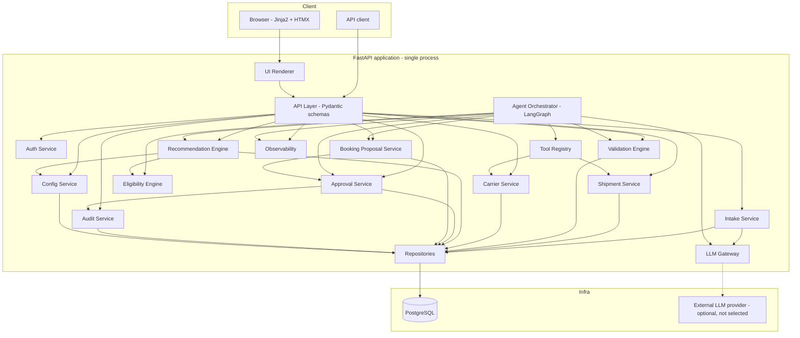
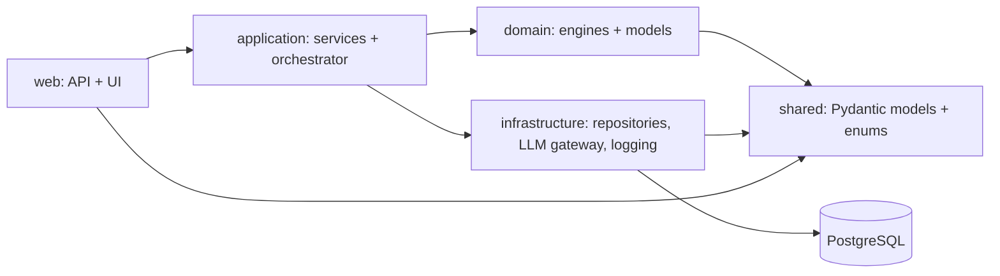
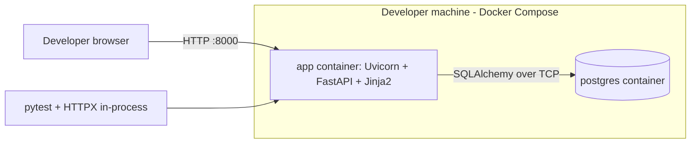

# 04 — System Architecture

| Field | Value |
|---|---|
| Status | Approved (Phase 1.7.5 Remediation) |
| Contract version | 2.2 |
| Contract source | [Appendix A](./03-requirements-specification.md#appendix-a--canonical-contracts) |
| Depends on | [03 — Requirements Specification](./03-requirements-specification.md) |
| Last updated | 2026-11-25 |
| Audience | Architect, developer, reviewer |

## 1. Purpose

This document describes the high-level structure of FreightOps AI: its components, their responsibilities, the allowed dependency directions, and what runs in the MVP. It deliberately chooses a **modular monolith** and explains why.

## 2. Architectural drivers

1. **One developer learning while building.** Operational simplicity beats theoretical scalability.
2. **Correctness and auditability over autonomy.** Deterministic rules and human approval are first-class.
3. **A bounded AI role.** The LLM is an adapter at the text boundary, never the decision authority.
4. **Portfolio clarity.** A reviewer should be able to trace a request from HTTP to database to workflow and back.
5. **Cheap local development.** One process, one database, no cloud dependency.

## 3. Why a modular monolith

A modular monolith is one deployable application with **enforced internal module boundaries**. It gives us:

- One transaction boundary for shipment, validation, recommendation, approval, and booking records.
- One process to run, log, test, and debug.
- No network calls between modules, so no distributed transactions, message brokers, or service discovery.
- Easy refactoring while the domain model is still being learned.

**Rejected alternative: microservices.** Separate services would add network failure modes, duplicate schemas, deployment orchestration, and distributed tracing before there is any proven scaling need. See ADR-001 in [10 — Technology Decisions](./10-technology-decisions.md).

**Enforcement.** Modules communicate through typed application-service interfaces. Cross-module imports follow the dependency rules in §5. A future split is possible because boundaries are explicit, but it is not planned for the MVP.

## 4. Container view

*Diagram D-07 — containers within the modular monolith. Solid arrows are in-process calls; the dashed arrow is optional and disabled by default.*

## 5. Module dependency rules

*Diagram D-08 — allowed dependency direction. Arrows mean "may import".*

Rules:

1. `domain` must not import `web`, `application`, or `infrastructure`. Engines are pure and unit-testable.
2. `application` may import `domain` and `infrastructure`; it orchestrates. It must not import `web`.
3. `infrastructure` implements interfaces declared by `application`/`domain`; it must not import `web`.
4. `web` is the only layer that knows about HTTP, sessions, templates, and request/response schemas.
5. Shared Pydantic models and canonical enums live in `shared`; everyone may import them.
6. The LLM Gateway is an infrastructure adapter. Only the Intake Service and the Agent Orchestrator may call it in the MVP.
7. No module may import another module's repository. Cross-module access goes through an application service.

## 6. Component responsibilities (summary)

Detailed contracts are in [05 — Component Architecture](./05-component-architecture.md).

| Component | Responsibility | MVP? |
|---|---|---|
| API Layer | HTTP routing, request/response schemas, auth dependency, error mapping | Yes |
| UI Renderer | Jinja2 templates + HTMX fragments for operator screens | Yes |
| Auth Service | Users, sessions, RBAC checks (`admin`, `broker`, `viewer`) | Yes |
| Intake Service | Accept, persist, deduplicate intake; coordinate extraction | Yes |
| Shipment Service | Shipment, stops, JSONB requirements, facilities, status transitions | Yes |
| Validation Engine | Deterministic required-field and cross-field rules | Yes |
| Carrier Service | Carrier master data, equipment, regions, availability, lane rates | Yes |
| Eligibility Engine | Deterministic hard filters and reason codes | Yes |
| Recommendation Engine | Baseline scoring, ranking, deterministic explanation facts, rates | Yes |
| Agent Orchestrator | Bounded LangGraph execution, PostgreSQL checkpointer, HITL interrupt | Yes |
| Tool Registry | Allowlisted, schema-validated tool calls | Yes |
| LLM Gateway | Provider-agnostic interface + mock provider; extraction and narration | Yes |
| Approval Service | Approval requests, immutable human decisions | Yes |
| Booking Proposal Service | Post-approval proposal snapshots; re-sourcing on decline | Yes |
| Audit Service | Append-only audit events with database trigger protection | Yes |
| Config Service | Scoring configuration, feature flags, enum metadata | Yes |
| Repositories | PostgreSQL persistence, transactions, migrations | Yes |
| Observability | Structured JSON logs, trace IDs, health check | Yes |
| Seed Tool | Synthetic data generation/reset (facilities, carriers, lane rates) | Yes |
| Outbox Event Dispatcher | Transactional outbox table and message broker dispatch | **No — deferred** |
| Background Scheduler | Scheduled approval TTL expiry sweeps (APScheduler/Celery beat) | **No — deferred** |
| Vector index | Knowledge/policy retrieval | **No — deferred** |
| External integrations (TMS, load boards, email) | Ingestion and tendering | **No — deferred** |
| External task queue | Celery / ARQ / Redis worker | **No — deferred** |

## 7. Request walkthrough

A typical validated-shipment flow:

1. The API Layer authenticates the request and validates the body with Pydantic.
2. The Shipment Service loads the Shipment, Stops, and Requirements.
3. The Agent Orchestrator creates a Workflow Execution and begins at `start_execution`.
4. `validate_shipment` calls the deterministic Validation Engine.
5. `normalize_requirements` prepares the eligibility profile from `shipments.equipment_type` and `shipments.requirements` JSONB; `resolve_carrier_candidates` queries Carrier Service; `filter_eligible_carriers` calls the Eligibility Engine.
6. `score_candidates` calls the Recommendation Engine with the active Scoring Configuration and recorded `carrier_lane_rates`.
7. `generate_explanation` renders a deterministic explanation and may request LLM narration through the LLM Gateway; failure falls back to the template.
8. `persist_recommendation` writes the Recommendation and candidate rows in one transaction.
9. `request_human_approval` creates an Approval and interrupts the workflow.
10. The approver acts in the UI; `apply_human_decision` resumes the graph.
11. `create_booking_proposal` snapshots approved data and writes the proposal.
12. `record_audit_event` appends events; `finalize_execution` closes the run.

Every step writes an audit event with the trace and execution identifiers.

## 8. MVP runtime topology

*Diagram D-09 — MVP deployment. One application container, one PostgreSQL container, no external services required.*

- The runtime environment targets **Python 3.12** (standardized across dev and container).
- The workflow executes as a bounded LangGraph state machine. Graph state is durably persisted after every node in PostgreSQL via LangGraph's PostgreSQL checkpointer.
- **Simplified execution model & Durability Boundary (DEF-05):** No external worker (Celery/ARQ), no Redis, and no separate background scheduler (APScheduler/cron) are run in the MVP.
  - The workflow runs nodes 1 through 11 upon invocation.
  - At Node 11 (`request_human_approval`), the graph pauses via LangGraph's native `interrupt()`, recording `waiting_for_human`.
  - Resumption is strictly an event-driven HTTP action: the operator submits a decision via `POST /api/v1/approvals/{id}/decision`, which commits the decision in PostgreSQL (setting `workflow_executions.status = 'resumption_pending'`), acquires an execution lease (`lease_token`, `lease_epoch`, `lease_owner`, `lease_expires_at`, `attempt_started_at`, bounded by `attempt_count <= 3` and `cumulative_compute_seconds < 900`), and resumes the thread via `graph.invoke(Command(resume=decision), config=...)`.
  - FastAPI background tasks are strictly in-process and non-durable; durability across process restarts is guaranteed by PostgreSQL checkpoint persistence and the startup recovery protocol.
  - Automatic TTL sweeps are deferred. Pending approvals remain pending until explicitly decided or the shipment is cancelled.
- Tests use the mock LLM provider; no external network access is required.
- Production deployment, TLS termination, and automated backups are out of scope for the MVP (manual runbook only).

## 9. Failure domains and degradation

| Failure | Effect | Degradation |
|---|---|---|
| LLM provider unavailable | Extraction/narration unavailable | Raw draft editing (`PATCH /shipments/{id}`) and template explanations still work; workflow completes |
| No provider configured | Same as above | Mock provider in tests; template path in dev |
| PostgreSQL unavailable | All persistence fails | API returns `ERR-011`; workflow cannot start |
| Process crash mid-workflow | Execution pauses | Resume from last checkpoint on restart (DEF-05) |
| Recommendation engine raises | Recommendation fails | Workflow routes to `handle_failure`; no approval created (DEF-02) |
| Audit write fails | Transaction rolls back | No state change without its audit event |
| Duplicate request | Same key replays | Existing result returned |

## 10. MVP vs postponed (verbatim cut line)

> **In MVP**
>
> - Target runtime: Python 3.12 (standardized; unverified planned packages subject to Phase 1 adoption gate)
> - Local user accounts, session cookie login with CSRF protection, RBAC with `admin`, `broker`, `viewer` (bearer token auth deferred to Post-MVP via FR-252)
> - Facilities master data CRUD (consolidating physical shippers and receivers into `facilities`)
> - Intake via pasted unstructured text and REST API; intake submission persisted with parse metadata (manual entry deferred to Post-MVP via FR-004)
> - Shipment read/update before approval, first-class `equipment_type` (`dry_van`, `reefer`, `flatbed`), multi-stop pickup and delivery stops (`shipment_stops`), and structured requirements stored as validated `jsonb`
> - Unresolved/nullable customer, facility, and `equipment_type` references on draft intake shipments, resolved prior to validation
> - Deterministic validation engine with severity gating and a validation results endpoint returning `validation_run_id` and `rules_version`
> - Synthetic carrier fixtures, equipment types, service regions, availability windows, and synthetic lane rates (`carrier_lane_rates`); interactive carrier CRUD deferred to Post-MVP (FR-060, FR-063–065)
> - Deterministic hard-eligibility filtering (7 canonical filters) with canonical reason codes
> - Rule-based configurable scoring baseline with top-N recommendations, score breakdowns, and factual rate competitiveness
> - Template-based explanations; LLM narration behind the gateway with automatic template fallback
> - Single LangGraph workflow with bounded transient retries (FR-156), durable PostgreSQL checkpoints, and exactly one human approval interrupt
> - Simplified workflow execution: human decision resumes the graph; automatic TTL sweeps and outbox workers deferred
> - Re-sourcing state transition: declined or cancelled booking proposals return shipment to `sourcing` rather than terminal cancellation
> - Jinja2 + HTMX approval screens supporting approve, reject, and request changes; candidate selection override deferred to Post-MVP (FR-190, FR-191)
> - Booking proposal records with frozen JSONB snapshots (no external tender or confirmation)
> - Append-only audit events with database-level immutability enforcement and correlation IDs
> - PostgreSQL persistence and Alembic migrations
> - Structured JSON logs, request/trace IDs, unauthenticated health endpoint
> - pytest unit/integration tests and an evaluation harness skeleton
> - Dockerfile and Docker Compose for app + database (development)
> - Synthetic seed data only (facilities, customers, carriers, lane rates, shipments)
> - Target scope: 95 prioritized requirements (Contract 2.2 / Phase 1.7.5 Remediation)
>
> **Deferred (Post-MVP and Future)**
>
> - Manual shipment entry without intake (FR-004) and pre-validation extraction review screen (FR-011)
> - Interactive carrier profile and attribute CRUD endpoints (FR-060, FR-063, FR-064, FR-065) and operator carrier list UI (FR-068)
> - Scoring configuration versioning and activation APIs (FR-280, FR-281, FR-285)
> - Bearer token API authentication (FR-252)
> - Broker candidate selection override on approval (FR-190, FR-191)
> - Multi-user optimistic locking on shipments (FR-023) and separate warning review flow (FR-045)
> - Secondary query endpoints and redundant metadata (FR-008, FR-031, FR-205, FR-255)
> - Scoring nuance penalties and config lineage tracking (FR-128, FR-129)
> - Redundant re-validation, exclusion formatting, and rate rules (FR-048, FR-050, FR-067, FR-102, FR-126, FR-133)
> - Automatic approval TTL expiration sweeps and background worker schedulers (Celery/ARQ/APScheduler)
> - Transactional outbox event dispatcher and message brokers
> - Real carrier, load-board, TMS, EDI, or telematics integrations
> - Plain text and JSON file uploads (Post-MVP); inbound email ingestion (.eml parsing, IMAP polling, inbound webhooks) and document OCR (Future)
> - External rate feeds, live market benchmarks, automated pricing, or automated tendering
> - ML ranking, vector databases (Pinecone/pgvector), Sentence Transformers, scikit-learn models
> - Multi-tenant organization isolation and fine-grained object-level ACLs
> - Kubernetes, autoscaling, service mesh
> - Dedicated observability backend (OpenTelemetry Collector, Prometheus, Grafana)
> - SSO/OAuth/MFA and separation-of-duties enforcement
> - Notifications and outbound email
> - React SPA or mobile application
> - High-availability clustering and automated failover
> - Fraud detection and automated double-brokering checks

## 11. Requirements traceability

| Requirement block | Architectural home |
|---|---|
| FR-001 – FR-019 | API Layer, Intake Service, LLM Gateway |
| FR-020 – FR-039 | Shipment Service, Validation Engine |
| FR-040 – FR-059 | Validation Engine |
| FR-060 – FR-089 | Carrier Service |
| FR-090 – FR-119 | Eligibility Engine |
| FR-120 – FR-149 | Recommendation Engine, Config Service, LLM Gateway |
| FR-150 – FR-179 | Agent Orchestrator, Tool Registry |
| FR-180 – FR-199 | Approval Service, UI Renderer |
| FR-200 – FR-219 | Booking Proposal Service |
| FR-220 – FR-249 | Audit Service, Observability |
| FR-250 – FR-279 | Auth Service, API Layer, UI Renderer |
| FR-280 – FR-299 | Config Service, Seed Tool |

## 12. Open questions

1. Should the workflow execute synchronously inside the request for small datasets, or always as an in-process background task? **Recommendation:** background task with polling from the UI, because approval interrupts make synchronous execution impractical.
2. Should LangGraph checkpoints use the Postgres saver from day one? **Recommendation:** yes for restart safety; verify library support at implementation time.
3. What is the exact idle-session timeout? Deferred to configuration in PH-1.
