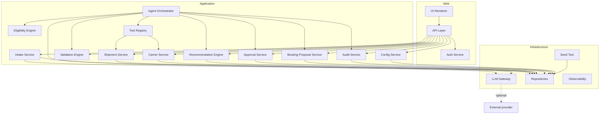
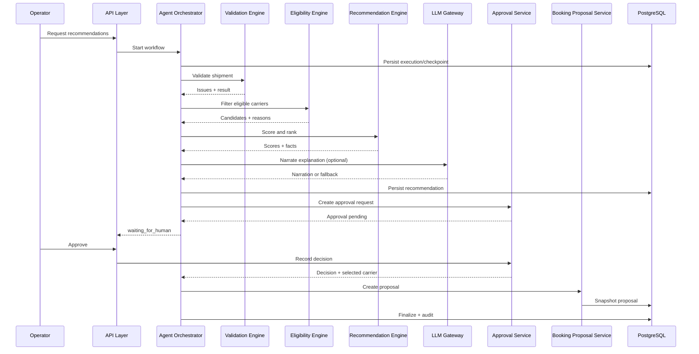

# 05 — Component Architecture

| Field | Value |
|---|---|
| Status | Approved (Phase 1.7.5 Architecture Remediation) |
| Contract version | 2.2 |
| Contract source | [Appendix A](./03-requirements-specification.md#appendix-a--canonical-contracts) |
| Depends on | [03 — Requirements Specification](./03-requirements-specification.md), [04 — System Architecture](./04-system-architecture.md) |
| Last updated | 2026-11-25 |
| Audience | Architect, developer |

## 1. Purpose

This document specifies each component's responsibility, inputs, outputs, dependencies, operations, error conditions, and security considerations. It also fixes the boundary between **LLM reasoning** and **deterministic business logic**.

Every component is classified as one of:

- **Deterministic** — pure rules, arithmetic, or persistence; must be unit-testable without network or LLM.
- **LLM-assisted** — may call the LLM Gateway, but only within a schema-validated, bounded operation.
- **Human** — a person makes the decision; software records it.
- **Infrastructure** — transport, storage, or observability.

## 2. Component map

*Diagram D-10 — component relationships. Arrows are in-process calls.*

## 3. LLM vs deterministic boundary (authoritative matrix)

Every later document must cite this table instead of restating it.

| Decision / operation | Owner | Why | Failure behavior |
|---|---|---|---|
| Parse intake text into candidate field values | **LLM-assisted** (schema-validated) | Text is unstructured; rules cannot cover all phrasings | Flag missing/unparsed fields for validation remediation; never guess (direct `POST /shipments` manual entry is Post-MVP per `FR-004`) |
| Decide which fields are required | **Deterministic** | Business policy | Block with `error` issues |
| Detect contradictions between fields | **Deterministic** | Testable business rules | Block approval |
| Assign validation severity | **Deterministic** | Policy must be consistent | Block approval |
| Decide carrier eligibility | **Deterministic** | Hard filters must be explainable and testable | Exclude carrier with reason code |
| Compute rank scores | **Deterministic** | Arithmetic over configured weights | Recommendation fails |
| Choose scoring weights | **Human** (admin/manager) | Business policy | Keep previous active config |
| Select the carrier | **Human** | Commercial judgment | Workflow waits |
| Approve a recommendation | **Human** | Consequential action | Workflow waits or expires |
| Create a booking proposal | **Deterministic** after approval | Enforce the gate | Refuse with `ERR-013` |
| Generate explanation facts | **Deterministic** | Must cite recorded data | Template only |
| Narrate an explanation | **LLM-assisted**, facts-constrained | Readability | Template fallback |
| Choose which tool to call | **Deterministic orchestrator** | Allowlist + graph | Fail node, bounded retry |
| Mutate eligibility/pricing/booking state | **Never LLM** | Auditability and safety | N/A |

**Rule of thumb:** if a mistake would be legally, financially, or operationally consequential, a deterministic rule and/or a human must decide. The LLM may only transform text.

## 4. Components

### 4.1 API Layer

**Type:** Infrastructure / transport.

- **Responsibility:** Route HTTP requests, validate bodies with Pydantic, authenticate, authorize, translate application results into HTTP responses, map errors to `ERR-###`.
- **Inputs:** HTTP requests (JSON, form data, files).
- **Outputs:** JSON responses, `application/problem+json` errors, redirects for UI routes.
- **Dependencies:** Auth Service, application services, shared schemas.
- **Main operations:** CRUD routing, pagination, idempotency-key handling, `GET /api/v1/health`, `GET /api/v1/meta/enums` *(Post-MVP — FR-284)*.
- **Error conditions:** `ERR-001` validation, `ERR-002` unauthenticated, `ERR-003` forbidden, `ERR-004` not found, `ERR-005` conflict, `ERR-006` duplicate, `ERR-008` media type, `ERR-009` too large, `ERR-011` dependency unavailable, `ERR-015` internal.
- **Security:** No business logic; never logs bodies containing secrets or full PII; enforces auth on every route except health.

### 4.2 UI Renderer (Jinja2 + HTMX)

**Type:** Infrastructure / presentation.

- **Responsibility:** Render operator screens and HTMX fragments: shipment list/detail, recommendation review, approval queue, carrier profile, audit view.
- **Inputs:** HTTP GET/POST from browser sessions; view models from the API layer.
- **Outputs:** HTML, HTMX fragments, redirects.
- **Dependencies:** API Layer, Auth Service.
- **Main operations:** List/detail pages, approval actions, form submissions, polling for workflow status.
- **Error conditions:** Unauthorized → login; forbidden → 403 page; not found → 404 page.
- **Security:** Server-rendered only; autoescaping on; CSRF protection for state-changing forms; no sensitive data in URLs.

### 4.3 Auth Service

**Type:** Deterministic / infrastructure.

- **Responsibility:** Local users, password hashing, sessions, API credentials, RBAC.
- **Inputs:** Credentials, user records, role assignments.
- **Outputs:** Authenticated principal, session cookie, permission decisions.
- **Dependencies:** Repositories, Config Service.
- **Main operations:** Create/deactivate user, login/logout, session validate/expire, role check, API key check.
- **Error conditions:** `ERR-002`, `ERR-003`, account disabled.
- **Security:** Salted password hashing; no plaintext credentials; constant-time comparisons where applicable; failed attempts audited without credentials.

### 4.4 Intake Service

**Type:** Deterministic orchestration + LLM-assisted extraction.

- **Responsibility:** Accept and persist intake submissions, deduplicate, coordinate extraction into a Shipment draft, preserve raw text and provenance.
- **Inputs:** Paste text, uploaded `.txt`/`.eml`/`.json`, REST JSON body, submitter, idempotency key.
- **Outputs:** Intake Submission record; optionally a Shipment draft with per-field provenance/confidence.
- **Dependencies:** Repositories, LLM Gateway, Shipment Service, Audit Service.
- **Main operations:** Persist raw; hash; dedupe; extract; map to draft; record parse metadata.
- **Error conditions:** `ERR-007` unprocessable, `ERR-008` unsupported type, `ERR-009` too large, `ERR-006` duplicate.
- **Security:** Intake text is untrusted data; never interpolated into system instructions; prompt-injection defenses in the LLM Gateway.

### 4.5 Shipment Service

**Type:** Deterministic.

- **Responsibility:** Shipment, Stop (`shipment_stops`), Facility, and JSONB Requirement persistence; status transitions; frozen-field enforcement.
- **Inputs:** Shipment commands (create/update/cancel), stop data, requirement payload, status transition requests.
- **Outputs:** Shipment aggregates, state changes, audit events.
- **Dependencies:** Repositories, Validation Engine, Audit Service.
- **Main operations:** Create draft (with nullable party links and nullable stop address fields, DEF-01), update with optimistic concurrency, derive Lane, transition status per D-05 (including return to `sourcing` on proposal decline), freeze after approval.
- **Error conditions:** `ERR-001`, `ERR-004`, `ERR-005`, `ERR-006`.
- **Security:** Authorization per role; no hard delete of booked records.

### 4.6 Validation Engine

**Type:** Deterministic.

- **Responsibility:** Required-field, format, range, sequencing, and compatibility rules; emit structured issues, rules version, and result status. Strictly enforce complete stop addresses and sequencing before allowing transition to `validated` (DEF-01).
- **Inputs:** Shipment aggregate snapshot.
- **Outputs:** Ordered Validation Issues, `validation_run_id`, `rules_version`, result status *(clarification list is Post-MVP — FR-047)*.
- **Dependencies:** Shared rules/config; no repositories for decisions (pure).
- **Main operations:** Run rule set; classify severity; compute result *(clarification items are Post-MVP — FR-047)*.
- **Error conditions:** Rule evaluation errors are surfaced as `critical` internal issues and audited; never silently pass.
- **Security:** No LLM; deterministic and unit-tested; rules are data-driven where practical.

### 4.7 Carrier Service

**Type:** Deterministic.

- **Responsibility:** Carrier master data, equipment types, service regions, availability windows, synthetic lane rates (`carrier_lane_rates`), recorded insurance/authority indicators.
- **Inputs:** Carrier commands, associations, rate entries, search queries.
- **Outputs:** Carrier records, lane rates (`flat_rate`, `rate_per_mile`, `source = 'synthetic'`, DEF-04), eligibility inputs.
- **Dependencies:** Repositories, Audit Service.
- **Main operations:** Maintain lane rates in MVP (`FR-069`); full carrier CRUD (`FR-060`/`FR-068`), equipment/region association, and availability management are Post-MVP (enforcing unique active benchmark rate per carrier/lane/equipment), provenance updates.
- **Error conditions:** `ERR-001` invalid enums/regions, `ERR-004`, `ERR-005`.
- **Security:** No external verification claims; provenance visibly recorded.

### 4.8 Eligibility Engine

**Type:** Deterministic. **The LLM may never influence this component.**

- **Responsibility:** Apply hard filters and produce eligibility status plus canonical reason codes.
- **Inputs:** Shipment requirements (from JSONB) and stops; carrier attributes; current time.
- **Outputs:** Per-candidate `eligible`/`ineligible`/`insufficient_data` with reason codes and human-readable reasons.
- **Dependencies:** Carrier Service data snapshot; Config Service rules.
- **Main operations:** Equipment match, region coverage (origin stop state matching), availability, status, insurance, hazmat, temperature; reason aggregation.
- **Error conditions:** Missing carrier attributes → `insufficient_data` + `missing_data`; evaluation errors fail the recommendation safely.
- **Security:** No LLM; rules versioned; every exclusion explainable and reproducible.

### 4.9 Recommendation Engine

**Type:** Deterministic (facts) with optional LLM narration delegated to the orchestrator.

- **Responsibility:** Rank eligible candidates with the active Scoring Configuration and recorded `carrier_lane_rates`, produce component scores, top-N, deterministic explanation facts, and recommendation status.
- **Inputs:** Shipment, eligibility results, active scoring config, recorded carrier lane rates.
- **Outputs:** Recommendation, candidate scores, rate quotes, deterministic explanation sections.
- **Dependencies:** Eligibility Engine, Carrier Service, Config Service, Repositories, Audit Service.
- **Main operations:** Normalize components, weighted sum, deterministic tie-break, top-N selection, status transitions.
- **Error conditions:** No eligible candidates → `no_eligible_carriers`; invalid config → `failed`; incomplete data → `insufficient_data` flags.
- **Security:** Factual rates from `carrier_lane_rates`; deterministic ordering; config version recorded.

### 4.10 LLM Gateway

**Type:** Infrastructure adapter; **LLM-assisted only**.

- **Responsibility:** Provider-agnostic interface for two operations: (a) structured extraction, (b) constrained explanation narration. Enforce schemas, timeouts, budgets, and redaction.
- **Inputs:** Operation name, untrusted text, fact bundle, response schema, budget.
- **Outputs:** Validated structured output or a typed failure.
- **Dependencies:** Provider adapter (none selected), Config Service, Observability.
- **Main operations:** `extract_shipment_fields`, `narrate_explanation`, mock provider, invocation metadata recording.
- **Error conditions:** Timeout, schema validation failure, provider error, budget exceeded → typed failure; caller falls back.
- **Security:** Treats all input text as data; no tools; no database access; output validated before use; prompt-injection tests required.

### 4.11 Agent Orchestrator (LangGraph)

**Type:** Deterministic state machine.

- **Responsibility:** Execute the canonical 16-node graph, persist state/checkpoints in PostgreSQL via LangGraph checkpointer, enforce budgets, pause for human approval, resume on decision, and route failures.
- **Inputs:** Workflow start command, shipment ID, idempotency keys, approval decision payload.
- **Outputs:** Workflow execution state, recommendation/approval/proposal side effects via services, audit events.
- **Dependencies:** Validation, Eligibility, Recommendation, Approval, Booking Proposal, Audit, Tool Registry, LLM Gateway, Repositories.
- **Main operations:** Node dispatch (Node 5 is `normalize_requirements`), conditional edges, checkpointing, retry/budget enforcement, interrupt/resume. Unrecoverable failures route to `handle_failure` (Node 16), which records error, emits `workflow.failed`, and terminates at `[*]` directly without passing to `finalize_execution` (DEF-02).
- **Error conditions:** Budget exceeded → `timed_out`/`failed`; tool error → bounded retry then `handle_failure`; no partial booking.
- **Security:** Allowlisted tools only; no free-form agent that can invent tools; no approval bypass; all inputs validated.

### 4.12 Tool Registry

**Type:** Deterministic.

- **Responsibility:** Expose a fixed allowlist of callable tools with schemas; validate arguments; enforce permissions and timeouts.
- **Inputs:** Tool name, arguments, execution context.
- **Outputs:** Tool result or typed error.
- **Dependencies:** Application services (Shipment, Carrier, Validation, Recommendation, Audit).
- **Main operations:** Schema validation, authorization, invocation, result normalization, error mapping.
- **Error conditions:** Unknown tool → refused; invalid args → `ERR-001`-style typed error; timeout → retryable failure.
- **Security:** No arbitrary code execution, no raw SQL, no filesystem access; least-privilege tools.

### 4.13 Approval Service

**Type:** Deterministic gate + human decision record.

- **Responsibility:** Create approval requests, record immutable human decisions, trigger graph resumption *(candidate override selection is Post-MVP — FR-190/191)*.
- **Inputs:** Recommendation snapshot, decision command (approve/reject/request changes), actor.
- **Outputs:** Approval record, status transition (`approved`, `rejected`, `changes_requested`, INC-03), audit events.
- **Dependencies:** Repositories, Audit Service, Auth Service, Recommendation Engine.
- **Main operations:** Create, decide idempotently in ACID transaction, enforce role, acquire row lock on `workflow_executions` and resume graph (DEF-05). (Note: Automatic TTL expiration sweeps are deferred).
- **Error conditions:** `ERR-003`, `ERR-013` invalid, `ERR-006` duplicate decision.
- **Security:** Decisions immutable; approver identity recorded; zero LLM involvement.

### 4.14 Booking Proposal Service

**Type:** Deterministic.

- **Responsibility:** Create and manage internal booking proposal snapshots after approval; support re-sourcing on decline.
- **Inputs:** Approved Approval, Shipment, selected Carrier.
- **Outputs:** Booking Proposal record with frozen JSONB snapshot; audit events.
- **Dependencies:** Approval Service, Shipment Service, Carrier Service, Repositories, Audit Service.
- **Main operations:** Validate approval, snapshot, create idempotently, enforce one active proposal, transition status (including re-sourcing transition to `sourcing` on decline).
- **Error conditions:** `ERR-013`, `ERR-006`, `ERR-005`.
- **Security:** Refuses creation without approval; no external tender call; no claims of confirmation.

### 4.15 Audit Service

**Type:** Deterministic infrastructure.

- **Responsibility:** Append-only event recording and query, protected by PostgreSQL trigger against UPDATE/DELETE.
- **Inputs:** Event type, actor, entity references, correlation IDs, payload (redacted).
- **Outputs:** Persisted audit events; filtered query results.
- **Dependencies:** Repositories.
- **Main operations:** Append within the caller's transaction; query by shipment/execution/trace/time; deny update/delete. Domain services record inline lifecycle events atomically; Node 14 records terminal completion events (`workflow.completed`), and Node 16 records terminal failure events (`workflow.failed`) (INC-04).
- **Error conditions:** Write failure rolls back the business transaction.
- **Security:** No mutation path; payload redaction; access restricted by role.

### 4.16 Config Service

**Type:** Deterministic.

- **Responsibility:** Seeded active scoring configuration, feature flags, configurable limits and TTLs *(versioned scoring config CRUD/activation endpoints and enum metadata endpoint are Post-MVP — FR-280/281/284/285)*.
- **Inputs:** Config commands, activation requests.
- **Outputs:** Active config, versioned history, enum metadata.
- **Dependencies:** Repositories, Audit Service.
- **Main operations:** Create/validate/activate, feature-flag read, limit read.
- **Error conditions:** `ERR-001` invalid weights; activation failure preserves previous config.
- **Security:** Only `admin`; every change audited.

### 4.17 Observability

**Type:** Infrastructure.

- **Responsibility:** Structured JSON logs, request/trace IDs, OpenTelemetry API hooks, redaction.
- **Inputs:** Log records, spans, metrics.
- **Outputs:** Log lines, metric counters/histograms, trace context.
- **Dependencies:** OpenTelemetry API (installed); no backend required.
- **Main operations:** Request middleware, workflow instrumentation, LLM call metadata, redaction filter.
- **Error conditions:** Logging failure must not crash a request; it is reported to stderr.
- **Security:** Redacts contact, credential, and raw-intake fields.

### 4.18 Seed Tool

**Type:** Deterministic development tool.

- **Responsibility:** Generate and reset synthetic carriers, customers, shipments, and scoring configs.
- **Inputs:** Seed profile, non-production confirmation flag.
- **Outputs:** Seeded rows with deterministic identifiers where useful.
- **Dependencies:** Repositories.
- **Main operations:** Seed, reset, verify counts.
- **Error conditions:** Refuses to run without the non-production flag.
- **Security:** Never contains real data; cannot run against production configuration.

## 5. Interaction sequence (happy path)

*Diagram D-13a — happy-path collaboration. The authoritative workflow graph is D-13 in [07](./07-agent-workflow.md).*

## 6. Error handling conventions

- Application services raise typed domain errors; the API Layer maps them to `ERR-###`.
- The orchestrator distinguishes **retryable** (timeout, transient tool failure) from **terminal** (validation failure, no approval, schema violation) errors.
- Legacy-style broad exceptions are not allowed to escape the workflow; every failure ends in `handle_failure` with an audit event.
- No component swallows an error without recording it.

## 7. Security summary per component

| Component | Primary control |
|---|---|
| API Layer | Authentication, Pydantic validation, idempotency |
| UI Renderer | Session auth, CSRF, autoescaping |
| Auth Service | Password hashing, RBAC, audit of failures |
| Intake Service | Untrusted-text handling, upload limits |
| Shipment Service | Role checks, frozen fields, no hard delete |
| Validation Engine | Deterministic, no I/O |
| Carrier Service | Input enums, no external verification claims |
| Eligibility Engine | LLM exclusion, explainability |
| Recommendation Engine | No invented rates, versioned config |
| LLM Gateway | Schema validation, redaction, no tools, budgets |
| Agent Orchestrator | Allowlist, budgets, HITL gate, idempotency |
| Tool Registry | Allowlist, least privilege, schema validation |
| Approval Service | Immutable decisions, role checks |
| Booking Proposal Service | Approval gate, one active proposal |
| Audit Service | Append-only, restricted query |
| Config Service | Role-restricted, audited |
| Observability | Redaction |

## 8. Open questions

1. Should the LLM Gateway also host an embedding interface? **Recommendation:** no in the MVP; add when vector retrieval is scoped.
2. Should the Intake Service write the Shipment draft or delegate to the Shipment Service? **Recommendation:** delegate; the Shipment Service owns shipment writes.
3. Where do scoring weight validation rules live? **Recommendation:** Config Service, with the same Pydantic models used by the Recommendation Engine.
