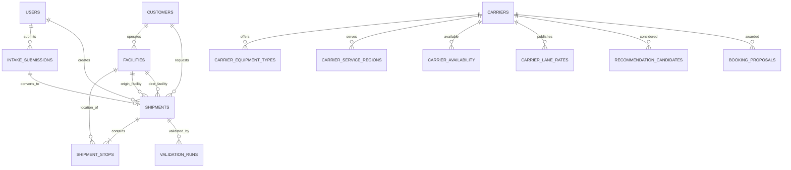
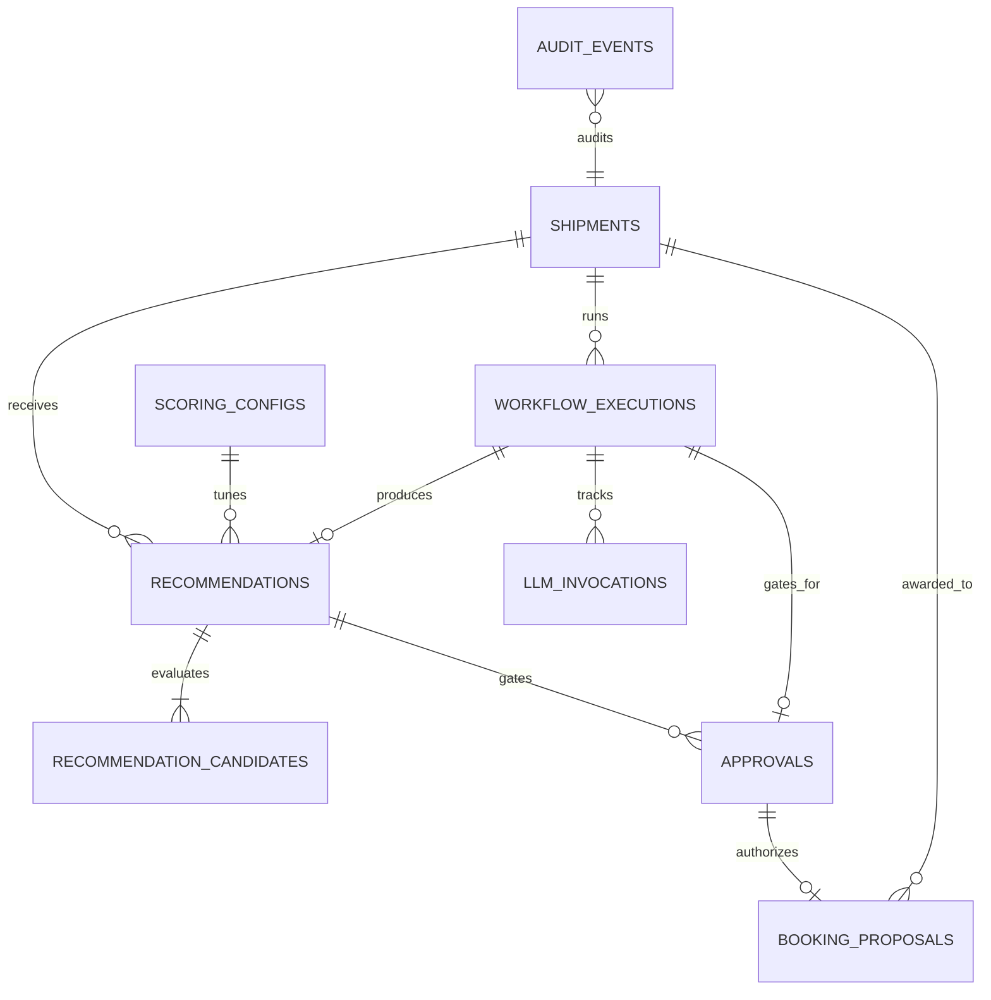

# 06 — Database Design

| Field | Value |
|---|---|
| Status | Approved (Phase 1.7.5 Remediation) |
| Contract version | 2.2 |
| Contract source | [Appendix A](./03-requirements-specification.md#appendix-a--canonical-contracts) |
| Depends on | [03 — Requirements Specification](./03-requirements-specification.md), [05 — Component Architecture](./05-component-architecture.md) |
| Last updated | 2026-11-25 |
| Audience | Developer, reviewer |

## 1. Purpose and principles

This document defines the revised PostgreSQL schema for FreightOps AI (Contract Version 2.2). It addresses the database findings from the Phase 1 independent architecture review (`docs/14-architecture-review.md`), consolidating entities, eliminating dead code, resolving nullability deadlocks, and adding legitimate carrier rate modeling.

Principles:

1. **PostgreSQL is the single system of record** for all operational state.
2. **Normalize queryable relationships; use `jsonb` for snapshots and flexible structured attributes.**
3. **Use UUID primary keys** for business entities (`gen_random_uuid()`); use monotonic identifiers (`bigserial`) for append-only audit streams.
4. **All timestamps are `timestamptz` in UTC.**
5. **Money is `numeric(12,2)` with an explicit currency** (default `USD`).
6. **Enumerations mirror Appendix A §A.2.**
7. **No hard delete of business records.** Cancel or soft-deactivate instead.
8. **Audit writes share the caller's database transaction**, reinforced with database-level triggers against update and deletion.
9. **Draft intake tolerance:** Allow draft shipment records to store incomplete or unresolved party links until validation.

Canonical tokens: All table names from Appendix A §A.3, all enum values from §A.2.

## 2. Conventions

| Concern | Convention |
|---|---|
| Naming | `snake_case` tables (plural) and columns |
| Primary keys | `id uuid default gen_random_uuid()` |
| Foreign keys | `<entity>_id`, `ON DELETE RESTRICT` unless explicitly cascading |
| Timestamps | `created_at`, `updated_at` (`timestamptz not null default now()`) |
| Soft state | Status columns, `is_active` flags; no hard deletion |
| Concurrency | `shipments.version integer` (column reserved; optimistic locking API `FR-023` deferred to Post-MVP) |
| Enums | `varchar` + `CHECK` constraints (simple to evolve across phases) |
| JSON | `jsonb` for requirements, snapshots, scores, provenance, and audit payloads |
| Indexes | Foreign keys indexed; common query filters indexed |
| Migrations | Alembic, one migration per logical change |

**Design assumption (`ASM-12`).** Single PostgreSQL database, single schema, single tenant.

---

## 3. Entity catalog (21 tables)

### 3.1 `users`
**Purpose:** Local operator accounts and roles.

| Column | Type | Constraints |
|---|---|---|
| `id` | uuid | PK |
| `email` | citext/text | unique, not null |
| `password_hash` | text | not null |
| `display_name` | text | not null |
| `role` | text | not null, CHECK in `admin`, `broker`, `viewer` |
| `is_active` | boolean | not null default true |
| `last_login_at` | timestamptz | null |
| `created_at`, `updated_at` | timestamptz | not null default now() |

**Relationships:** Referenced by `intake_submissions.submitter_id`, `shipments.created_by`, `approvals.{requested_by, decided_by}`, `scoring_configs.created_by`.

---

### 3.2 `customers`
**Purpose:** Commercial accounts paying for transportation.

| Column | Type | Constraints |
|---|---|---|
| `id` | uuid | PK |
| `name` | text | not null |
| `reference_code` | text | unique, not null |
| `contact_name`, `contact_email`, `contact_phone` | text | null |
| `notes` | text | null |
| `is_active` | boolean | not null default true |
| `created_at`, `updated_at` | timestamptz | not null default now() |

**Relationships:** Referenced by `facilities.customer_id` (optional), `shipments.customer_id`.

---

### 3.3 `facilities` *(Consolidates `shippers` and `consignees` per ADR Decision 3)*
**Purpose:** Physical locations (warehouses, plants, distribution centers, cross-docks) where freight is picked up or delivered.

| Column | Type | Constraints |
|---|---|---|
| `id` | uuid | PK |
| `customer_id` | uuid | FK → `customers.id`, null (null if shared/third-party facility) |
| `name` | text | not null |
| `code` | text | unique, null (facility lookup code) |
| `facility_type` | text | not null default `warehouse`, CHECK in `warehouse`, `plant`, `distribution_center`, `cross_dock`, `cold_storage`, `other` |
| `address_line1` | text | not null |
| `address_line2` | text | null |
| `city` | text | not null |
| `state` | text | not null |
| `postal_code` | text | not null |
| `country` | text | not null default `US` |
| `timezone` | text | not null default `UTC` |
| `contact_name`, `contact_email`, `contact_phone` | text | null |
| `operating_hours` | text | null |
| `appointment_required` | boolean | not null default false |
| `is_active` | boolean | not null default true |
| `created_at`, `updated_at` | timestamptz | not null default now() |

**Relationships:** Optional link to customer; referenced by `shipment_stops.facility_id`, `shipments.origin_facility_id`, `shipments.destination_facility_id`.

---

### 3.4 `carriers`
**Purpose:** Carrier master profiles. Data is manually maintained or synthetic; no external verification claimed.

| Column | Type | Constraints |
|---|---|---|
| `id` | uuid | PK |
| `legal_name` | text | not null |
| `dba_name` | text | null |
| `mc_number` | text | null (recorded, unverified) |
| `dot_number` | text | null (recorded, unverified) |
| `status` | text | not null, CHECK in `active`, `inactive`, `suspended` |
| `authority_status_recorded` | text | null |
| `insurance_expiry_date` | date | null |
| `hazmat_authorized` | boolean | not null default false |
| `temperature_capable` | boolean | not null default false |
| `primary_contact_name`, `primary_contact_email`, `primary_contact_phone` | text | null |
| `data_source` | text | not null default `synthetic` |
| `last_verified_at` | timestamptz | null |
| `notes` | text | null |
| `created_at`, `updated_at` | timestamptz | not null default now() |

**Relationships:** One-to-many `carrier_equipment_types`, `carrier_service_regions`, `carrier_availability`, `carrier_lane_rates`, `recommendation_candidates`, `booking_proposals`.

---

### 3.5 `carrier_equipment_types`
**Purpose:** Trailers/equipment operated by each carrier.

| Column | Type | Constraints |
|---|---|---|
| `id` | uuid | PK |
| `carrier_id` | uuid | FK → `carriers.id`, not null |
| `equipment_type` | text | not null, CHECK in `dry_van`, `reefer`, `flatbed` |
| `max_weight_lbs` | integer | null, CHECK > 0 |
| `trailer_lengths_ft` | integer[] | null |
| `is_active` | boolean | not null default true |
| `created_at` | timestamptz | not null default now() |

**Constraint:** unique (`carrier_id`, `equipment_type`).

---

### 3.6 `carrier_service_regions`
**Purpose:** Geographic operating presence for carriers.

| Column | Type | Constraints |
|---|---|---|
| `id` | uuid | PK |
| `carrier_id` | uuid | FK → `carriers.id`, not null |
| `region_type` | text | not null, CHECK in `state`, `metro`, `radius_miles`, `postal_prefix` |
| `region_value` | text | not null (e.g. `IL`, `TX`) |
| `is_active` | boolean | not null default true |
| `created_at` | timestamptz | not null default now() |

**Semantics note (solves F-DB-04):** In the MVP, a carrier service region represents an **origin operating presence**. A carrier serving region `IL` is eligible to pick up shipments originating in Illinois.

**Constraint:** unique (`carrier_id`, `region_type`, `region_value`).

---

### 3.7 `carrier_availability`
**Purpose:** Recorded capacity windows (synthetic, not live telematics).

| Column | Type | Constraints |
|---|---|---|
| `id` | uuid | PK |
| `carrier_id` | uuid | FK → `carriers.id`, not null |
| `available_from` | timestamptz | not null |
| `available_until` | timestamptz | not null, CHECK > `available_from` |
| `origin_region` | text | null |
| `destination_region` | text | null |
| `equipment_type` | text | null |
| `notes` | text | null |
| `created_at` | timestamptz | not null default now() |

---

### 3.8 `carrier_lane_rates` *(NEW — Solves CRIT-03 & DEF-04)*
**Purpose:** Synthetic recorded rates per carrier, lane/region, and equipment type, providing factual benchmark data for `rate_competitiveness` scoring.

| Column | Type | Constraints |
|---|---|---|
| `id` | uuid | PK |
| `carrier_id` | uuid | FK → `carriers.id`, not null |
| `origin_region` | text | not null (e.g. `IL` or `Chicago, IL`) |
| `destination_region` | text | not null (e.g. `TX` or `Dallas, TX`) |
| `equipment_type` | text | not null, CHECK in `dry_van`, `reefer`, `flatbed` |
| `flat_rate` | numeric(12,2) | null, CHECK >= 0 |
| `rate_per_mile` | numeric(8,2) | null, CHECK >= 0 |
| `min_rate` | numeric(12,2) | null, CHECK >= 0 |
| `currency` | char(3) | not null default `USD` |
| `source` | text | not null default `synthetic` |
| `effective_date` | date | null |
| `expiration_date` | date | null |
| `is_active` | boolean | not null default true |
| `created_at` | timestamptz | not null default now() |

**Constraints:**
- Check constraint: `chk_lane_rates_has_rate: flat_rate IS NOT NULL OR rate_per_mile IS NOT NULL`.
- Partial unique index: `UNIQUE (carrier_id, origin_region, destination_region, equipment_type) WHERE is_active = true` (guarantees exactly one active synthetic benchmark rate per carrier, lane, and equipment combination; historical rate records deferred to Post-MVP).

---

### 3.9 `shipments`
**Purpose:** Central business aggregate.

| Column | Type | Constraints |
|---|---|---|
| `id` | uuid | PK |
| `customer_id` | uuid | FK → `customers.id`, **null on draft** (solves CRIT-01) |
| `origin_facility_id` | uuid | FK → `facilities.id`, **null on draft** (convenience summary) |
| `destination_facility_id` | uuid | FK → `facilities.id`, **null on draft** (convenience summary) |
| `status` | text | not null, CHECK in canonical Shipment statuses |
| `source` | text | not null, CHECK in `intake_submission`, `manual` |
| `intake_submission_id` | uuid | FK → `intake_submissions.id`, null, unique |
| `reference_number` | text | null |
| `po_number` | text | null |
| `commodity` | text | null |
| `equipment_type` | text | null (nullable on draft/intake; required before `validated`), CHECK in `dry_van`, `reefer`, `flatbed` |
| `weight_lbs` | integer | null, CHECK > 0 |
| `target_sell_rate` | numeric(12,2) | null, CHECK >= 0 |
| `max_buy_rate` | numeric(12,2) | null, CHECK >= 0 |
| `currency` | char(3) | not null default `USD` |
| `lane_origin` | text | null (derived from first stop) |
| `lane_destination` | text | null (derived from last stop) |
| `requirements` | jsonb | not null default `{}` (solves F-DB-02) |
| `notes` | text | null |
| `version` | integer | not null default 1 |
| `frozen_at` | timestamptz | null (set at approval) |
| `created_by` | uuid | FK → `users.id`, null |
| `created_at`, `updated_at` | timestamptz | not null default now() |

**Draft Tolerance (CRIT-01 resolution):** `customer_id`, `origin_facility_id`, `destination_facility_id`, and `equipment_type` are nullable in `draft` and `intake_received`. The `ValidationEngine` blocks progression to `validated` if `customer_id`, `equipment_type`, or required stops are missing (`FR-040`, `FR-052`).

**JSONB Requirements (F-DB-02 resolution):** Eliminates the polymorphic `shipment_requirements` table. Validated via Pydantic model (`temperature_range`, `hazmat`, `liftgate`, `appointment`, `team_driver`, `trailer_length_ft`, `weight_limit_lbs`, `permit`, `notes`).

---

### 3.10 `shipment_stops`
**Purpose:** Authoritative representation of all pickup and delivery stops on a shipment.

| Column | Type | Constraints |
|---|---|---|
| `id` | uuid | PK |
| `shipment_id` | uuid | FK → `shipments.id`, not null |
| `facility_id` | uuid | FK → `facilities.id`, null (null if unlinked raw stop) |
| `sequence` | integer | not null, CHECK >= 1 |
| `stop_type` | text | not null, CHECK in `pickup`, `delivery` |
| `name` | text | null (nullable on draft, solves DEF-01) |
| `address_line1` | text | null (nullable on draft, solves DEF-01) |
| `address_line2` | text | null |
| `city` | text | null (nullable on draft, solves DEF-01) |
| `state` | text | null (nullable on draft, solves DEF-01) |
| `postal_code` | text | null (nullable on draft, solves DEF-01) |
| `country` | text | not null default `US` |
| `window_start`, `window_end` | timestamptz | null |
| `appointment_required` | boolean | not null default false |
| `contact_name`, `contact_phone` | text | null |
| `created_at` | timestamptz | not null default now() |

**Constraint:** unique (`shipment_id`, `sequence`); index `shipment_id`.

**Draft Tolerance & Validation Gating (DEF-01 resolution):** Incomplete shipment stops can be persisted in draft status (`status = draft` or `intake_received`) with null addresses. The deterministic `ValidationEngine` strictly enforces stop completeness (valid non-null facility/address and stop sequencing: at least one pickup, at least one delivery, pickup before delivery) before the shipment can transition to `validated`. Approvals remain blocked while any stop address information is incomplete.

---

### 3.11 `validation_runs`
**Purpose:** Persisted validation results with issues and rules version.

| Column | Type | Constraints |
|---|---|---|
| `id` | uuid | PK |
| `shipment_id` | uuid | FK → `shipments.id`, not null |
| `result` | text | not null, CHECK in `passed`, `passed_with_warnings`, `failed` |
| `issues` | jsonb | not null default `[]` |
| `rules_version` | text | not null |
| `triggered_by_user_id` | uuid | FK → `users.id`, null |
| `workflow_execution_id` | uuid | FK → `workflow_executions.id`, null |
| `checked_at` | timestamptz | not null default now() |

**Indexes:** (`shipment_id`, `checked_at` desc).

---

### 3.12 `intake_submissions`
**Purpose:** Raw customer request text, content hash, and parse metadata.

| Column | Type | Constraints |
|---|---|---|
| `id` | uuid | PK |
| `channel` | text | not null, CHECK in `paste`, `upload`, `rest_api`, `manual` |
| `raw_text` | text | not null |
| `content_hash` | text | not null, unique |
| `idempotency_key` | text | null, unique |
| `submitter_id` | uuid | FK → `users.id`, null |
| `shipment_id` | uuid | FK → `shipments.id`, null, unique |
| `parse_metadata` | jsonb | null |
| `extracted_at` | timestamptz | null |
| `extraction_error` | text | null |
| `received_at` | timestamptz | not null default now() |
| `created_at` | timestamptz | not null default now() |

---

### 3.13 `recommendations`
**Purpose:** Output of the scoring engine for a validated shipment.

| Column | Type | Constraints |
|---|---|---|
| `id` | uuid | PK |
| `shipment_id` | uuid | FK → `shipments.id`, not null |
| `workflow_execution_id` | uuid | FK → `workflow_executions.id`, null, unique (1:1 correlation per Decision D1) |
| `status` | text | not null, CHECK in `pending`, `computing`, `ready`, `no_eligible_carriers`, `failed`, `superseded` |
| `scoring_config_id` | uuid | FK → `scoring_configs.id`, not null |
| `config_version` | integer | not null |
| `explanation_template` | text | not null |
| `explanation_narration` | text | null |
| `explanation_provider` | text | null |
| `superseded_by_id` | uuid | FK → `recommendations.id`, null |
| `created_by` | uuid | FK → `users.id`, null |
| `created_at`, `updated_at` | timestamptz | not null default now() |

**Indexes:** `shipment_id`, `status`.

---

### 3.14 `recommendation_candidates`
**Purpose:** Individual carrier candidates evaluated during recommendation generation.

| Column | Type | Constraints |
|---|---|---|
| `id` | uuid | PK |
| `recommendation_id` | uuid | FK → `recommendations.id`, not null |
| `carrier_id` | uuid | FK → `carriers.id`, not null |
| `rank` | integer | null (null for ineligible) |
| `eligibility` | text | not null, CHECK in `eligible`, `ineligible`, `insufficient_data` |
| `ineligibility_codes` | text[] | not null default `{}` |
| `component_scores` | jsonb | not null default `{}` |
| `total_score` | numeric(6,4) | null |
| `rate_quote` | numeric(12,2) | null |
| `explanation` | text | null |
| `created_at` | timestamptz | not null default now() |

**Constraint:** unique (`recommendation_id`, `carrier_id`); index (`recommendation_id`, `rank`).

---

### 3.15 `approvals`
**Purpose:** Human decision record gating booking proposal creation.

| Column | Type | Constraints |
|---|---|---|
| `id` | uuid | PK |
| `recommendation_id` | uuid | FK → `recommendations.id`, not null |
| `shipment_id` | uuid | FK → `shipments.id`, not null |
| `workflow_execution_id` | uuid | FK → `workflow_executions.id`, null, unique (1:1 correlation per Decision D1) |
| `status` | text | not null, CHECK in `pending`, `approved`, `rejected`, `changes_requested`, `cancelled` |
| `requested_by` | uuid | FK → `users.id`, null |
| `requested_at` | timestamptz | not null default now() |
| `decided_by` | uuid | FK → `users.id`, null |
| `decided_at` | timestamptz | null |
| `decision_comment` | text | null |
| `selected_candidate_id` | uuid | FK → `recommendation_candidates.id`, null |
| `resumed_at` | timestamptz | null (set when workflow resumption completes past the interrupt) |
| `idempotency_key` | text | null, unique |
| `created_at`, `updated_at` | timestamptz | not null default now() |

**Constraints:** `CHECK` ensures `decided_by`/`decided_at` present when status is terminal (`approved`, `rejected`, `changes_requested`).

**Approval Command to Database State Mapping & Complete Decision Coverage (INC-03 & Phase 1.7.2):**
The API and UI accept three canonical approval actions. The Approval Service decision transaction (`POST /api/v1/approvals/{id}/decision`) is the sole owner of the immediate shipment status transition upon human decision and the human decision audit event:
- **`approve`:** Sets `approvals.status = 'approved'`, transitions `shipments.status = 'approved'` with `frozen_at = NOW()`, records `approval.granted` audit event, and queues resumption. Node 12 validates the decision and routes LangGraph past Node 11 to Node 13 (`create_booking_proposal`), which advances `shipments.status` to `'booking_proposed'`, inserts the internal booking proposal, and records `booking_proposal.created`.
- **`reject`:** Sets `approvals.status = 'rejected'`, records mandatory rejection reason in `decision_comment`, transitions `shipments.status = 'sourcing'`, records `approval.rejected` audit event, and queues resumption. Node 12 validates the decision and routes LangGraph to Node 14 (`workflow.completed` with `outcome: rejected`) and Node 15 (`finalize_execution`), cleanly unlocking the shipment for carrier re-sourcing under transition D-05.
- **`request_changes`:** Sets `approvals.status = 'changes_requested'`, records change notes in `decision_comment`, transitions `shipments.status = 'sourcing'` deterministically, records `approval.changes_requested` audit event, and queues resumption. Node 12 validates the decision and routes LangGraph to Node 14 (`workflow.completed` with `outcome: changes_requested`) and Node 15 (`finalize_execution`), returning the shipment to sourcing for operational re-negotiation/re-sourcing under transition D-05.
- For all three decisions, the approval transaction sets `workflow_executions.status = 'resumption_pending'`, leaving `approvals.resumed_at = NULL` until workflow finalization completes. Node 12 validates and routes only; it never repeats shipment status updates. Node 14 records only `workflow.completed`.

---

### 3.16 `booking_proposals`
**Purpose:** Internal booking proposal snapshotting approved terms.

| Column | Type | Constraints |
|---|---|---|
| `id` | uuid | PK |
| `shipment_id` | uuid | FK → `shipments.id`, not null |
| `approval_id` | uuid | FK → `approvals.id`, not null, unique |
| `carrier_id` | uuid | FK → `carriers.id`, not null |
| `proposal_number` | text | unique, not null |
| `status` | text | not null, CHECK in `proposed`, `accepted`, `declined`, `cancelled` |
| `snapshot` | jsonb | not null (frozen shipment/stop/facility/carrier/rate terms) |
| `status_reason` | text | null |
| `idempotency_key` | text | null, unique |
| `created_by` | uuid | FK → `users.id`, null |
| `created_at`, `updated_at` | timestamptz | not null default now() |

**Constraints & Database-Enforced Idempotency (DEF-05 & Phase 1.7.2):**
- **Approval Uniqueness:** `approval_id` is defined as `UNIQUE NOT NULL REFERENCES approvals(id)`. At the database engine level, it is physically impossible to persist more than one booking proposal for a given approval.
- **Active Proposal Uniqueness:** A partial unique index `uq_booking_proposals_active_shipment` on `shipment_id WHERE status IN ('proposed', 'accepted')` guarantees that at most one active booking proposal can exist for a shipment at any time.
- **Atomic Insertion with Conflict Handling:** Node 13 executes proposal creation using atomic insert-on-conflict:
  ```sql
  INSERT INTO booking_proposals (
      id, shipment_id, approval_id, carrier_id, proposal_number,
      status, snapshot, idempotency_key, created_by, created_at, updated_at
  ) VALUES (
      gen_random_uuid(), :shipment_id, :approval_id, :carrier_id, :proposal_number,
      'proposed', :snapshot, :idempotency_key, :user_id, NOW(), NOW()
  )
  ON CONFLICT (approval_id) DO NOTHING
  RETURNING id, status;
  ```
  If a proposal already exists (e.g. created by a concurrent worker or in a prior run before a crash), `RETURNING id` returns empty. The worker then executes `SELECT id, status FROM booking_proposals WHERE approval_id = :approval_id;` and reuses the existing record without error or duplicate insertion.
- **Concurrent Worker Safety:** If two workers attempt proposal creation concurrently, PostgreSQL's unique B-tree index serializes the operations: exactly one worker inserts; the other hits `ON CONFLICT` and reuses the created proposal.
- **Crash Recovery Between Insertion and Finalization:** If the server crashes after proposal insertion but before workflow finalization, upon restart the worker resumes from checkpoint, hits `ON CONFLICT (approval_id)`, retrieves the existing proposal, and proceeds to Node 14 and 15 without creating duplicates.

---

### 3.17 `workflow_executions`
**Purpose:** Operator-facing projection of LangGraph state machine executions.

| Column | Type | Constraints |
|---|---|---|
| `id` | uuid | PK |
| `shipment_id` | uuid | FK → `shipments.id`, not null |
| `status` | text | not null, CHECK in `queued`, `running`, `waiting_for_human`, `resumption_pending`, `completed`, `failed`, `cancelled`, `timed_out` |
| `current_node` | text | null, CHECK in canonical node names |
| `graph_version` | text | not null default `1.0` |
| `state` | jsonb | not null default `{}` |
| `attempt_count` | integer | not null default 0 (set to 1 on initial `queued` acquisition, preserved unchanged on normal HITL resumption from `resumption_pending`, and incremented on expired-lease crash retry; bounded by `max_attempt_count`) |
| `max_attempt_count` | integer | not null default 3 (maximum permitted execution attempts before terminal failure) |
| `cumulative_compute_seconds` | integer | not null default 0 (cumulative active compute duration in seconds across all attempts, strictly excluding human approval wait time; hard ceiling 900s) |
| `llm_call_count` | integer | not null default 0 |
| `node_execution_count` | integer | not null default 0 |
| `lease_token` | uuid | null (unique token assigned to the current active worker lease; cleared to null on `waiting_for_human` and terminal states) |
| `lease_epoch` | integer | not null default 0 (monotonically increasing fencing token incremented on each lease acquisition) |
| `lease_owner` | text | null (worker instance identifier holding the execution lease; cleared to null on `waiting_for_human` and terminal states) |
| `lease_expires_at` | timestamptz | null (expiration timestamp of the current execution lease; default 60s window; cleared to null on `waiting_for_human` and terminal states) |
| `error_code` | text | null |
| `error_message` | text | null |
| `trace_id` | text | not null |
| `idempotency_key` | text | null, unique |
| `started_at` | timestamptz | not null default now() (initial workflow creation timestamp) |
| `attempt_started_at` | timestamptz | not null default now() (timestamp when current continuous execution attempt began; reset upon lease acquisition/resumption) |
| `completed_at` | timestamptz | null |
| `updated_at` | timestamptz | not null default now() |

**Note on Checkpoints:** LangGraph's native PostgreSQL checkpointer stores durable node execution checkpoints in its own tables (`checkpoints`, `checkpoint_blobs`, `checkpoint_writes`). `workflow_executions` serves as the clean application-level projection.

**Execution Leasing, Fencing Tokens, and Execution Budget Enforcement (DEF-05, Phase 1.7.3 – Phase 1.7.5):**
Execution ownership is governed strictly by database leases and monotonically increasing fencing tokens (`lease_token`, `lease_epoch`, `lease_expires_at`), never operating system process IDs.
- **Atomic Lease Acquisition & Budget Guard (`queued`, `resumption_pending`, and expired `running`):**
  - Initial acquisition claims `status = 'queued'` (`attempt_count = 0 -> 1`).
  - Normal HITL resumption claims `status = 'resumption_pending'` (`attempt_count <= max_attempt_count`) **without incrementing `attempt_count`** (human approval wait and normal resume do not consume failure retries).
  - Crash recovery claims expired `status = 'running'` (`lease_expires_at < NOW() AND attempt_count < max_attempt_count AND NOW() < attempt_started_at + INTERVAL '10 minutes'` and remaining cumulative compute `< 900s`), accumulating the crashed worker's elapsed active compute time into `cumulative_compute_seconds` before resetting `attempt_started_at = NOW()` and incrementing `attempt_count`:
  ```sql
UPDATE workflow_executions
SET status = 'running',
    cumulative_compute_seconds = CASE
      WHEN status = 'running' THEN LEAST(900, cumulative_compute_seconds + GREATEST(0, EXTRACT(EPOCH FROM (LEAST(NOW(), lease_expires_at) - attempt_started_at))::integer))
      ELSE cumulative_compute_seconds
    END,
    lease_token = gen_random_uuid(),
    lease_epoch = lease_epoch + 1,
    lease_owner = :worker_id,
    lease_expires_at = NOW() + INTERVAL '60 seconds',
    attempt_started_at = NOW(),
    attempt_count = CASE
      WHEN status = 'resumption_pending' THEN GREATEST(1, attempt_count)
      ELSE attempt_count + 1
    END,
    updated_at = NOW()
WHERE id = :execution_id
  AND cumulative_compute_seconds < 900
  AND (
    (status = 'queued' AND attempt_count = 0)
    OR (status = 'resumption_pending' AND attempt_count <= max_attempt_count)
    OR (
      status = 'running'
      AND lease_expires_at < NOW()
      AND attempt_count < max_attempt_count
      AND NOW() < attempt_started_at + INTERVAL '10 minutes'
      AND (cumulative_compute_seconds + GREATEST(0, EXTRACT(EPOCH FROM (LEAST(NOW(), lease_expires_at) - attempt_started_at))::integer)) < 900
    )
  )
RETURNING id, status, lease_token, lease_epoch, attempt_count, cumulative_compute_seconds;
```
  - *Protection of `waiting_for_human` and Terminal Executions:* Node 11 (`waiting_for_human`) and terminal states (`completed`, `failed`, `cancelled`, `timed_out`) explicitly clear `lease_token = NULL, lease_owner = NULL, lease_expires_at = NULL`, and none of these statuses match the acquisition `WHERE` clause.
- **Terminal Status and Conditional Atomic Audit Behavior on Limit Exhaustion:**
  If `cumulative_compute_seconds >= 900` (`timed_out` / `MAX_COMPUTE_BUDGET_EXCEEDED`) or an expired `running` / `resumption_pending` execution exhausts `max_attempt_count` (`failed` / `MAX_ATTEMPTS_EXCEEDED`), a single ACID data-modifying CTE updates the terminal status and inserts `workflow.failed` **only from the updated row**. If the execution already transitioned to a terminal state (`completed`, `failed`, `timed_out`, `cancelled`), `exhausted` returns 0 rows, zero audit events are inserted, and the transaction rolls back:
```sql
BEGIN;

WITH exhausted AS (
  UPDATE workflow_executions
  SET status = CASE
        WHEN cumulative_compute_seconds >= 900
          OR (status = 'running' AND NOW() >= attempt_started_at + INTERVAL '10 minutes')
          OR (status = 'running' AND (cumulative_compute_seconds + GREATEST(0, EXTRACT(EPOCH FROM (LEAST(NOW(), lease_expires_at) - attempt_started_at))::integer)) >= 900)
          THEN 'timed_out'
        ELSE 'failed'
      END,
      error_code = CASE
        WHEN cumulative_compute_seconds >= 900
          OR (status = 'running' AND (cumulative_compute_seconds + GREATEST(0, EXTRACT(EPOCH FROM (LEAST(NOW(), lease_expires_at) - attempt_started_at))::integer)) >= 900)
          THEN 'MAX_COMPUTE_BUDGET_EXCEEDED'
        WHEN status = 'running' AND NOW() >= attempt_started_at + INTERVAL '10 minutes'
          THEN 'MAX_CONTINUOUS_ATTEMPT_EXCEEDED'
        ELSE 'MAX_ATTEMPTS_EXCEEDED'
      END,
      error_message = CASE
        WHEN cumulative_compute_seconds >= 900
          OR (status = 'running' AND (cumulative_compute_seconds + GREATEST(0, EXTRACT(EPOCH FROM (LEAST(NOW(), lease_expires_at) - attempt_started_at))::integer)) >= 900)
          THEN 'Execution aborted: 15-minute cumulative active compute budget exceeded'
        WHEN status = 'running' AND NOW() >= attempt_started_at + INTERVAL '10 minutes'
          THEN 'Execution aborted: 10-minute continuous attempt limit exceeded'
        ELSE 'Execution aborted: maximum execution attempts (3) exhausted'
      END,
      lease_token = NULL,
      lease_owner = NULL,
      lease_expires_at = NULL,
      completed_at = NOW(),
      updated_at = NOW()
  WHERE id = :execution_id
    AND status IN ('queued', 'running', 'resumption_pending')
    AND (
      cumulative_compute_seconds >= 900
      OR (
        status = 'running'
        AND lease_expires_at < NOW()
        AND (
          attempt_count >= max_attempt_count
          OR NOW() >= attempt_started_at + INTERVAL '10 minutes'
          OR (cumulative_compute_seconds + GREATEST(0, EXTRACT(EPOCH FROM (LEAST(NOW(), lease_expires_at) - attempt_started_at))::integer)) >= 900
        )
      )
      OR (status = 'resumption_pending' AND attempt_count > max_attempt_count)
    )
  RETURNING id, shipment_id, status, error_code, attempt_count, cumulative_compute_seconds, trace_id
),
audit_insert AS (
  INSERT INTO audit_events (
      event_type, actor_type, actor_id, shipment_id, workflow_execution_id, trace_id, payload, created_at
  )
  SELECT
      'workflow.failed',
      'system',
      NULL,
      e.shipment_id,
      e.id,
      e.trace_id,
      jsonb_build_object(
        'error_code', e.error_code,
        'attempt_count', e.attempt_count,
        'cumulative_compute_seconds', e.cumulative_compute_seconds
      ),
      NOW()
  FROM exhausted e
)
SELECT id, status, error_code
FROM exhausted;

-- Application transaction protocol:
-- 1. Check returned rows: if len(rows) == 1 -> COMMIT.
-- 2. If len(rows) == 0 (e.g. execution already transitioned to completed/failed/timed_out/cancelled, or lease was reclaimed):
--    ROLLBACK (zero audit rows were inserted by the CTE) and return/raise UnexpectedTerminalTransitionError without emitting a duplicate audit event.
-- 3. If len(rows) > 1: ROLLBACK and raise IntegrityError.
COMMIT;
```
- **Active Compute vs Human Wait Time Accounting:**
  - `cumulative_compute_seconds` measures ONLY active execution compute across attempts.
  - When Node 11 pauses for human approval, pre-approval compute duration is committed and lease fields are cleared:
        Application-managed ACID transaction and LangGraph `interrupt()` protocol (`langgraph` + `langgraph-checkpoint-postgres` exact version pin is an unresolved implementation dependency in `10 §3` to be verified at the `PH-1`/`PH-5` gate; no invented `resume_payload` parameter is used):
    ```python
    def request_human_approval(state: WorkflowState) -> dict:
        # Check durable PostgreSQL approval state + checkpoint state
        existing = db.execute(
            "SELECT id, workflow_execution_id, recommendation_id, status, decision_comment, resumed_at "
            "FROM approvals WHERE workflow_execution_id = :execution_id",
            {"execution_id": state["execution_id"]},
        ).fetchone()

        if existing is None and state.get("approval_id") is None:
            # --- FIRST EXECUTION: fenced pause, pending approval + audit, commit BEFORE interrupt() ---
            with db.begin() as tx:
                wf_res = tx.execute(NODE_11_FENCE_PAUSE_SQL, params)
                if wf_res.rowcount != 1:
                    tx.rollback()
                    raise ExecutionLeaseFencingError("Stale lease, expired attempt window, or exhausted budget at Node 11")

                appr_row = tx.execute(INSERT_PENDING_APPROVAL_SQL, appr_params).fetchone()
                if appr_row is not None:
                    approval_id = appr_row.id
                    audit_res = tx.execute(INSERT_APPROVAL_REQUESTED_AUDIT_SQL, {..., "approval_id": approval_id})
                    if audit_res.rowcount != 1:
                        tx.rollback()
                        raise AuditWriteError("Expected exactly 1 approval.requested audit row")
                else:
                    row = tx.execute(
                        "SELECT id FROM approvals WHERE workflow_execution_id = :execution_id",
                        {"execution_id": state["execution_id"]},
                    ).fetchone()
                    if row is None:
                        tx.rollback()
                        raise IntegrityError("Missing approval row after conflict")
                    approval_id = row.id

                tx.commit()
        else:
            # --- RESUME EXECUTION: reconstruct from durable state; do NOT repeat pause/inserts ---
            approval_id = state.get("approval_id") or (existing.id if existing else None)
            if existing is None or existing.id != approval_id or existing.resumed_at is not None:
                raise InvalidApprovalStateError("Missing, mismatched, or already-resumed approval on Node 11 resume")

            with db.begin() as tx:
                fence_rows = tx.execute(FENCE_CHECK_SQL, params).fetchall()
                if len(fence_rows) != 1:
                    tx.rollback()
                    raise ExecutionLeaseFencingError("Stale lease or exhausted budget on Node 11 resume")
                tx.commit()

        # Both first execution and resume execution MUST reach interrupt() to pause or consume Command(resume=...)
        decision_payload = interrupt({"approval_id": approval_id, "recommendation_id": state["recommendation_id"]})

        # Post-interrupt validation against durable PostgreSQL approval record
        decided = db.execute(
            "SELECT id, workflow_execution_id, recommendation_id, status, decision_comment, resumed_at "
            "FROM approvals WHERE workflow_execution_id = :execution_id",
            {"execution_id": state["execution_id"]},
        ).fetchone()
        expected_status = {"approve": "approved", "reject": "rejected", "request_changes": "changes_requested"}.get(
            (decision_payload or {}).get("action")
        )
        if (
            decided is None
            or decided.id != approval_id
            or decided.workflow_execution_id != state["execution_id"]
            or decided.recommendation_id != state["recommendation_id"]
            or decided.status not in ("approved", "rejected", "changes_requested")
            or decided.resumed_at is not None
            or expected_status != decided.status
        ):
            raise InvalidApprovalStateError("Resumed decision failed durable approval/identity verification")

        return {
            "approval_id": decided.id,
            "human_decision": decided.status,
            "decision_comment": decided.decision_comment,
        }
    ```
    ```sql
    -- NODE_11_FENCE_PAUSE_SQL:
    UPDATE workflow_executions
    SET status = 'waiting_for_human',
        cumulative_compute_seconds = LEAST(900, cumulative_compute_seconds + GREATEST(0, EXTRACT(EPOCH FROM (NOW() - attempt_started_at))::integer)),
        lease_token = NULL,
        lease_owner = NULL,
        lease_expires_at = NULL,
        updated_at = NOW()
    WHERE id = :execution_id
      AND lease_token = :my_current_lease_token
      AND lease_epoch = :my_current_lease_epoch
      AND lease_expires_at > NOW()
      AND NOW() < attempt_started_at + INTERVAL '10 minutes'
      AND (cumulative_compute_seconds + EXTRACT(EPOCH FROM (NOW() - attempt_started_at))::integer) <= 900;
    ```
  - While `status = 'waiting_for_human'`, compute is stopped; human review duration adds zero seconds to `cumulative_compute_seconds`.
  - Resumption from `resumption_pending` resets `attempt_started_at = NOW()`, granting a fresh 10-minute continuous attempt window while inheriting `cumulative_compute_seconds`.
- **Periodic Lease Heartbeat / Renewal Protocol:** Active workers renew every **15 to 20 seconds** (max 30s), enforcing unexpired lease, 10-minute continuous attempt ceiling, and 900-second cumulative budget:
  ```sql
  UPDATE workflow_executions
  SET lease_expires_at = NOW() + INTERVAL '60 seconds',
      updated_at = NOW()
  WHERE id = :execution_id
    AND lease_token = :my_current_lease_token
    AND lease_epoch = :my_current_lease_epoch
    AND lease_expires_at > NOW()
    AND NOW() < attempt_started_at + INTERVAL '10 minutes'
    AND (cumulative_compute_seconds + EXTRACT(EPOCH FROM (NOW() - attempt_started_at))::integer) <= 900;
  ```
- **Atomic Race Condition & Heartbeat vs Takeover Mechanics:** PostgreSQL row-level write locks serialize concurrent heartbeat renewals and takeovers:
  - *Heartbeat commits first:* Extends `lease_expires_at = NOW() + 60s`; takeover re-evaluates `lease_expires_at < NOW()` as FALSE and affects 0 rows.
  - *Takeover commits first:* Advances `lease_epoch`, replaces `lease_token`, accumulates elapsed compute, resets `attempt_started_at = NOW()`; delayed heartbeat sees mismatched `lease_token`/`lease_epoch` and affects 0 rows, causing the stale worker to raise `ExecutionLeaseFencingError` and halt immediately.
- **Transaction Boundaries for Nodes 13, 14, and 15:**
  - **Node 13 (Booking Proposal Creation — Atomic Approval, Freeze, Proposal & Audit Transaction):**
    Application-managed ACID transaction protocol (executes all steps in one transaction; rolls back on any failure):
    ```python
    with db.begin() as tx:
        # 1. Lease/fencing check (must return exactly 1 row)
        fence_rows = tx.execute(FENCE_CHECK_SQL, params).fetchall()
        if len(fence_rows) != 1:
            tx.rollback()
            raise ExecutionLeaseFencingError("Stale lease or exhausted execution budget")

        # 2. Verify approval is in 'approved' state (must return exactly 1 row)
        appr = tx.execute(
            "SELECT id, status FROM approvals WHERE id = :approval_id FOR UPDATE",
            {"approval_id": approval_id},
        ).fetchone()
        if appr is None or appr.status != "approved":
            tx.rollback()
            raise InvalidApprovalStateError("Approval must be in approved status")

        # 3. Freeze & transition shipment inside the same transaction (must update exactly 1 row)
        ship_res = tx.execute(
            "UPDATE shipments SET status = 'booking_proposed', frozen_at = COALESCE(frozen_at, NOW()), updated_at = NOW() "
            "WHERE id = :shipment_id AND status IN ('approved', 'booking_proposed')",
            {"shipment_id": shipment_id},
        )
        if ship_res.rowcount != 1:
            tx.rollback()
            raise StateTransitionError("Shipment not in approved/booking_proposed state")

        # 4. Idempotent booking proposal insert
        inserted = tx.execute(INSERT_PROPOSAL_ON_CONFLICT_SQL, proposal_params).fetchone()
        if inserted is not None:
            proposal_id = inserted.id
            # 5. Insert mandatory booking_proposal.created audit event in the SAME transaction (no duplicate on replay)
            tx.execute(INSERT_BOOKING_PROPOSAL_CREATED_AUDIT_SQL, {..., "booking_proposal_id": proposal_id})
        else:
            existing = tx.execute(
                "SELECT id, status FROM booking_proposals WHERE approval_id = :approval_id",
                {"approval_id": approval_id},
            ).fetchone()
            if existing is None:
                tx.rollback()
                raise IntegrityError("Missing booking proposal after conflict")
            proposal_id = existing.id

        # 6. Commit all operations together
        tx.commit()
    ```
    ```sql
    -- FENCE_CHECK_SQL:
    SELECT lease_epoch FROM workflow_executions
    WHERE id = :execution_id
      AND lease_token = :my_token
      AND lease_epoch = :my_epoch
      AND lease_expires_at > NOW()
      AND NOW() < attempt_started_at + INTERVAL '10 minutes'
      AND (cumulative_compute_seconds + EXTRACT(EPOCH FROM (NOW() - attempt_started_at))::integer) <= 900
    FOR UPDATE;

    -- INSERT_PROPOSAL_ON_CONFLICT_SQL:
    INSERT INTO booking_proposals (id, shipment_id, approval_id, carrier_id, proposal_number, status, snapshot, idempotency_key, created_by, created_at, updated_at)
    VALUES (gen_random_uuid(), :shipment_id, :approval_id, :carrier_id, :proposal_number, 'proposed', :snapshot, :idempotency_key, :user_id, NOW(), NOW())
    ON CONFLICT (approval_id) DO NOTHING
    RETURNING id, status;

    -- INSERT_BOOKING_PROPOSAL_CREATED_AUDIT_SQL:
    INSERT INTO audit_events (event_type, actor_type, actor_id, shipment_id, workflow_execution_id, approval_id, booking_proposal_id, trace_id, payload, created_at)
    VALUES ('booking_proposal.created', 'system', NULL, :shipment_id, :execution_id, :approval_id, :booking_proposal_id, :trace_id, :proposal_audit_payload, NOW());
    ```
  - **Node 14 (Workflow Audit Recording — Database-Enforced Idempotency & Canonical Replay Verification):**
    Application-managed ACID transaction protocol (the Approval Service transaction owns the human decision audit event `approval.granted`, `approval.rejected`, or `approval.changes_requested`; Node 13 atomically records `booking_proposal.created`; Node 14 records exclusively the workflow outcome summary event `workflow.completed` across all execution paths) using `audit_events.idempotency_key` (`uq_audit_events_idempotency_key`):
    - **Canonical Event Identity:** `(idempotency_key, event_type, workflow_execution_id, shipment_id, approval_id, booking_proposal_id)` — `event_type` is always `'workflow.completed'`; `approval_id` is non-null on approval paths (`approved`, `rejected`, `changes_requested`) and explicitly `NULL` (`None`) on `no_eligible_carriers`; `booking_proposal_id` is non-null on `approved` and explicitly `NULL` (`None`) on `rejected`, `changes_requested`, and `no_eligible_carriers`.
    - **Canonical Immutable Payload:** `metrics_json` contains only deterministic immutable fields (`outcome`, `final_shipment_status`, `node_execution_count`, `llm_call_count`, `attempt_count`, `cumulative_compute_seconds`, `recommendation_id`, `error_code`); volatile timestamps (`created_at`) are excluded. `outcome` is one of `'approved'`, `'rejected'`, `'changes_requested'`, or `'no_eligible_carriers'`. Canonicalization sorts keys recursively (`json.dumps(payload, sort_keys=True, separators=(",", ":"), allow_nan=False)`) with explicit `null` values preserved, and verifies SHA-256 digest equality.
    ```python
    def canonical_payload_sha256(payload: dict) -> str:
        canonical = json.dumps(payload, sort_keys=True, separators=(",", ":"), allow_nan=False)
        return hashlib.sha256(canonical.encode("utf-8")).hexdigest()

    with db.begin() as tx:
        # 1. Lease/fencing check (must return exactly 1 row)
        fence_rows = tx.execute(FENCE_CHECK_SQL, params).fetchall()
        if len(fence_rows) != 1:
            tx.rollback()
            raise ExecutionLeaseFencingError("Stale lease or exhausted execution budget")

        # 2. Database-enforced idempotent audit insert (deterministic key per execution: node14:<execution_id>:workflow.completed)
        canonical_outcome_event = "workflow.completed"
        outcome_key = f"node14:{execution_id}:workflow.completed"
        inserted_audit = tx.execute(
            INSERT_OUTCOME_AUDIT_SQL,
            {**audit_params, "canonical_outcome_event": canonical_outcome_event, "idempotency_key": outcome_key},
        ).fetchone()
        if inserted_audit is None:
            # Re-execution after crash before checkpoint advance: verify canonical identity & immutable payload digest
            existing = tx.execute(
                "SELECT id, idempotency_key, event_type, workflow_execution_id, shipment_id, "
                "       approval_id, booking_proposal_id, payload "
                "FROM audit_events WHERE idempotency_key = :idempotency_key",
                {"idempotency_key": outcome_key},
            ).fetchone()
            if (
                existing is None
                or existing.idempotency_key != outcome_key
                or existing.event_type != canonical_outcome_event
                or existing.workflow_execution_id != execution_id
                or existing.shipment_id != shipment_id
                or existing.approval_id != approval_id
                or existing.booking_proposal_id != booking_proposal_id
                or canonical_payload_sha256(existing.payload) != canonical_payload_sha256(metrics_json)
            ):
                tx.rollback()
                raise AuditIdempotencyConflictError(
                    "Existing audit_events row does not match expected canonical identity or immutable payload"
                )

        # 3. Commit
        tx.commit()
    ```
    ```sql
    -- INSERT_OUTCOME_AUDIT_SQL:
    INSERT INTO audit_events (
        event_type, actor_type, actor_id, shipment_id, workflow_execution_id,
        approval_id, booking_proposal_id, trace_id, idempotency_key, payload, created_at
    ) VALUES (
        :canonical_outcome_event, 'system', NULL, :shipment_id, :execution_id,
        :approval_id, :booking_proposal_id, :trace_id, :idempotency_key, :metrics_json, NOW()
    )
    ON CONFLICT (idempotency_key) WHERE idempotency_key IS NOT NULL DO NOTHING
    RETURNING id;
    ```
  - **Node 15 (Finalization):**
    Application-managed ACID transaction protocol validating fencing, lease expiry, attempt deadline, cumulative budget, and conditional `approvals.resumed_at` update:
    ```python
    with db.begin() as tx:
        # 1. Fenced completion update (must affect exactly 1 row)
        wf_res = tx.execute(FINALIZE_WORKFLOW_SQL, params)
        if wf_res.rowcount != 1:
            tx.rollback()
            raise ExecutionLeaseFencingError("Stale lease or exhausted execution budget")

        # 2. Conditional approval resumption timestamp (approval path only; omitted for no_eligible_carriers)
        if approval_id is not None:
            appr_res = tx.execute(
                "UPDATE approvals SET resumed_at = NOW(), updated_at = NOW() "
                "WHERE id = :approval_id AND resumed_at IS NULL",
                {"approval_id": approval_id},
            )
            if appr_res.rowcount != 1:
                tx.rollback()
                raise ApprovalResumptionConflictError("Expected exactly 1 undecided-resumption approval row")

        # 3. Commit only after all required updates succeed
        tx.commit()
    ```
    ```sql
    -- FINALIZE_WORKFLOW_SQL:
    UPDATE workflow_executions
    SET status = 'completed',
        cumulative_compute_seconds = LEAST(900, cumulative_compute_seconds + GREATEST(0, EXTRACT(EPOCH FROM (NOW() - attempt_started_at))::integer)),
        lease_token = NULL, lease_owner = NULL, lease_expires_at = NULL,
        completed_at = NOW(), updated_at = NOW()
    WHERE id = :execution_id
      AND lease_token = :my_token AND lease_epoch = :my_epoch
      AND lease_expires_at > NOW()
      AND NOW() < attempt_started_at + INTERVAL '10 minutes'
      AND (cumulative_compute_seconds + EXTRACT(EPOCH FROM (NOW() - attempt_started_at))::integer) <= 900;
    ```
---

### 3.18 `audit_events`
**Purpose:** Append-only record of state mutations.

| Column | Type | Constraints |
|---|---|---|
| `id` | bigserial | PK |
| `event_type` | text | not null, CHECK in canonical event types |
| `actor_type` | text | not null, CHECK in `user`, `system`, `llm` |
| `actor_id` | uuid | null |
| `shipment_id` | uuid | null |
| `workflow_execution_id` | uuid | null |
| `recommendation_id` | uuid | null |
| `approval_id` | uuid | null |
| `booking_proposal_id` | uuid | null |
| `trace_id` | text | not null |
| `idempotency_key` | text | null (deterministic outcome key for idempotent workflow audit writes, e.g., `node14:<execution_id>:workflow.completed`) |
| `payload` | jsonb | not null default `{}` |
| `created_at` | timestamptz | not null default now() |

**Uniqueness & Idempotency Index (R2-03):**
```sql
CREATE UNIQUE INDEX uq_audit_events_idempotency_key
ON audit_events (idempotency_key)
WHERE idempotency_key IS NOT NULL;
```

**Immutability enforcement (F-SEC-03 resolution):**
```sql
CREATE OR REPLACE FUNCTION audit_events_immutable()
RETURNS TRIGGER AS $$
BEGIN
    RAISE EXCEPTION 'audit_events is append-only: UPDATE and DELETE are prohibited';
END;
$$ LANGUAGE plpgsql;

CREATE TRIGGER trg_audit_events_immutable
BEFORE UPDATE OR DELETE ON audit_events
FOR EACH ROW EXECUTE FUNCTION audit_events_immutable();
```

---

### 3.19 `scoring_configs`
**Purpose:** Versioned candidate ranking weights.

| Column | Type | Constraints |
|---|---|---|
| `id` | uuid | PK |
| `version` | integer | unique, not null |
| `name` | text | not null |
| `weights` | jsonb | not null (keys sum to 1.0) |
| `is_active` | boolean | not null default false |
| `created_by` | uuid | FK → `users.id`, null |
| `created_at` | timestamptz | not null default now() |
| `activated_at` | timestamptz | null |

**Constraint:** Partial unique index on (`is_active`) where `is_active = true` guarantees exactly one active configuration.

---

### 3.20 `idempotency_keys`
**Purpose:** Request deduplication and in-flight concurrency control (F-API-03 resolution).

| Column | Type | Constraints |
|---|---|---|
| `id` | uuid | PK |
| `key` | text | unique, not null |
| `endpoint` | text | not null |
| `request_hash` | text | not null |
| `status` | text | not null default `in_progress`, CHECK in `in_progress`, `completed`, `failed` |
| `response_status` | integer | null |
| `response_body` | jsonb | null |
| `created_at` | timestamptz | not null default now() |
| `expires_at` | timestamptz | not null |

**In-flight Race Resolution (F-API-03):** Middleware inserts `status = in_progress` within an atomic transaction. A concurrent request arriving while in progress receives `409 Conflict` (`ERR-006`). On completion, the row is updated to `completed` with status and body.

**Stale Lease Recovery & Configurable Timeout (DEF-05):**
The in-flight lease duration is a configurable design parameter defaulting to **60 seconds** (`IDEMPOTENCY_LEASE_SECONDS = 60`).
- *Rationale:* 60 seconds provides ample headroom for bounded synchronous workflow operations (the max execution budget is bounded and individual nodes execute within hundreds of milliseconds to a few seconds) while ensuring that if an application process crashes mid-operation, the stranded idempotency key lease quickly expires and allows the client to retry without being permanently blocked.
- *Reclamation semantics:* If an incoming request presents an idempotency key whose status is `in_progress` and whose lease has expired (`now() > created_at + interval '60 seconds'`) without an active database row lock, the middleware reclaims the lease by updating `created_at = now()` and proceeding, logging a warning for abandoned execution recovery. Completed rows persist for 24 hours (`expires_at = created_at + interval '24 hours'`).

---

### 3.21 `llm_invocations` (PH-5)
**Purpose:** Token count, latency, and status telemetry for LLM calls.

| Column | Type | Constraints |
|---|---|---|
| `id` | uuid | PK |
| `workflow_execution_id` | uuid | FK → `workflow_executions.id`, null |
| `operation` | text | not null, CHECK in `extract_shipment_fields`, `narrate_explanation` |
| `provider` | text | not null default `mock` |
| `model_identifier` | text | null |
| `prompt_tokens` | integer | null |
| `completion_tokens` | integer | null |
| `latency_ms` | integer | null |
| `status` | text | not null, CHECK in `success`, `error` |
| `error_code` | text | null |
| `created_at` | timestamptz | not null default now() |

---

## 4. ER Diagrams

### 4.1 Core entities (D-11)



*Diagram D-11 — Core entity relationships (attributes omitted; see §3).*

### 4.2 Workflow, approval, and audit (D-12)



*Diagram D-12 — Workflow, approval, and audit relationships.*

---

## 5. What belongs in PostgreSQL vs. Vector store

| Data | Store | Why |
|---|---|---|
| Shipments, stops, facilities, customers | PostgreSQL | Relational integrity, transactional updates |
| Requirements | PostgreSQL (`shipments.requirements jsonb`) | Validated structured JSON, eliminates EAV |
| Carrier master data, lane rates, availability | PostgreSQL | Deterministic filtering and arithmetic scoring |
| Recommendations, candidates, approvals, proposals | PostgreSQL | Strict auditability, exact reproducibility |
| Checkpoints & workflow state | PostgreSQL | Durable crash recovery |
| Audit events | PostgreSQL | Append-only with trigger protection |
| Knowledge base documents / playbooks | Future vector store | Semantic retrieval only (deferred) |

---

## 6. Table removals and consolidations summary

| Original Table | Final Disposition | Rationale |
|---|---|---|
| `shippers` | **Consolidated** into `facilities` | A physical warehouse/plant can both ship and receive. |
| `consignees` | **Consolidated** into `facilities` | Identical schema to shippers; eliminates duplication. |
| `shipment_requirements` | **Consolidated** into `shipments.requirements jsonb` | Eliminates polymorphic EAV table anti-pattern. |
| `outbox_events` | **Removed / Deferred** | No dispatcher exists in MVP; writing dead rows violates YAGNI. |
| `carrier_lane_rates` | **Added** (New) | Solves CRIT-03; provides factual basis for `rate_competitiveness`. |
