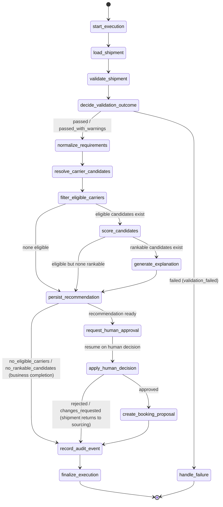

# 07 — Agent Workflow

| Field | Value |
|---|---|
| Status | Approved (Phase 1.7.5 Remediation) |
| Contract version | 2.2 |
| Contract source | [Appendix A](./03-requirements-specification.md#appendix-a--canonical-contracts) |
| Depends on | [03](./03-requirements-specification.md), [05](./05-component-architecture.md), [06](./06-database-design.md) |
| Last updated | 2026-11-25 |
| Audience | Developer, reviewer |

## 1. Purpose

This document specifies the FreightOps AI workflow as a **bounded, durable state machine** implemented with LangGraph. It defines the agent state, the sixteen canonical nodes, conditional edges, tool usage, persistence, retries, the human-in-the-loop interrupt, failure recovery, idempotency, and hard execution bounds.

It intentionally does **not** define an autonomous agent. The graph is fixed at design time; the LLM cannot choose nodes, add tools, or take consequential actions.

## 2. Why a bounded state machine

An "autonomous agent" that receives a goal and freely decides what to do is unpredictable, hard to test, difficult to audit, and poses severe operational risks in freight brokerage. Freight operations involve legal commitments, financial margins, safety regulations, and carrier trust. Instead:

- The **graph** strictly decides the order of steps.
- **Deterministic Python engines** decide eligibility, scores, rate comparisons, and validation gates.
- The **LLM** is restricted solely to text transformation and narration inside bounded operations (intake extraction and recommendation explanation).
- A **human broker** makes all consequential booking decisions.
- **Execution budgets** guarantee deterministic termination.

This design is an *orchestrated workflow agent*. It maintains state, interacts with storage, handles retries, and coordinates multi-step operational logic — but operates under strict structural invariants.

## 3. Workflow engine evaluation and fallback design

### 3.1 LangGraph value and architectural justification (ADR Decision 2)

LangGraph is retained as the workflow orchestration engine for FreightOps AI because:

1. **Native PostgreSQL Checkpointing:** Built-in persistence via `langgraph-checkpoint-postgres` (`AsyncPostgresSaver`) allows every node boundary to be saved durably to PostgreSQL. If the application crashes or restarts, running workflows resume seamlessly from their last checkpoint without custom serialization machinery.
2. **First-Class Human-in-the-Loop Interrupts:** LangGraph provides native `interrupt()` primitives. When human approval is required, execution suspends cleanly, persists state, frees server memory and connections, and yields control. When the broker decides, execution resumes with the decision input.
3. **Execution Bounding:** Native graph recursion limits enforce execution ceilings (`recursion_limit=40`), preventing infinite loops.
4. **Clean Decoupling:** Workflow state is isolated from API request lifecycles and background execution details.

### 3.2 Pure Python state machine fallback

Because the FreightOps AI workflow is a fixed directed acyclic graph (with a single resume interrupt) and does **not** use autonomous LLM tool-calling loops, LangGraph is a convenience rather than an irreplaceable structural dependency.

**Fallback Trigger:** If dependency conflicts arise during Python 3.12 compatibility testing (Phase 1 adoption gate) or if checkpointer serialization introduces unacceptable operational overhead:
- The system will fall back to an internal ~200-line deterministic Python state machine class (`DeterministicWorkflowEngine`).
- The fallback engine uses a Python `dict` dispatcher keyed by node name, updates `workflow_executions.current_node` and `workflow_executions.state` in PostgreSQL before each node, suspends on `request_human_approval`, and resumes upon `POST /api/v1/approvals/{id}/decision`.
- Neither business logic, database tables, nor API contracts change if this fallback is activated.

## 4. LangGraph primer

| LangGraph concept | Meaning in FreightOps AI |
|---|---|
| **StateGraph** | Graph whose nodes read and write a shared state dictionary validated by Pydantic. |
| **Node** | A Python function that executes deterministic logic or LLM calls and returns state updates. |
| **Edge** | An unconditional transition from one node to the next. |
| **Conditional edge** | A router function inspecting state to branch (e.g., validation pass vs fail). |
| **State** | Typed dictionary persisted between nodes. |
| **Checkpointer** | PostgreSQL-backed checkpoint manager storing thread state after each node. |
| **Interrupt** | Native pause returning control to the caller; graph resumes upon approval decision. |

The workflow uses a single graph, one state schema, exactly one interrupt (`request_human_approval`), and no graph recursion in the MVP.

## 5. Canonical workflow state

The state is persisted in `workflow_executions.state` and by the PostgreSQL checkpointer. Field names are part of this document's contract.

| Field | Type | Purpose |
|---|---|---|
| `execution_id` | uuid | Workflow Execution identifier |
| `shipment_id` | uuid | Shipment under processing |
| `trace_id` | string | Correlation for logs and audit |
| `graph_version` | string | Compatibility guard for state schema (e.g., `"2.0"`) |
| `status` | enum | Canonical Workflow Execution status (`queued`, `running`, `waiting_for_human`, `resumption_pending`, `completed`, `failed`, `cancelled`, `timed_out`) |
| `current_node` | node name | Last or active node |
| `validation_result` | object | `{status, run_id, rules_version, issues[], checked_at}` |
| `requirements_snapshot` | object | Normalized requirements profile used by eligibility |
| `candidate_carrier_ids` | uuid[] | Broad candidate set |
| `eligibility_results` | map | `carrier_id → {status, codes[], reasons[]}` |
| `ranked_candidates` | array | Ranked eligible candidates with component scores and rate data |
| `scoring_config_id` / `scoring_config_version` | uuid / int | Active scoring policy used |
| `recommendation_id` | uuid | Persisted recommendation identifier |
| `explanation` | object | `{template, narration, provider, facts[]}` |
| `approval_id` | uuid | Approval created for the recommendation |
| `approval_status` | enum | Mirrors the Approval status |
| `selected_candidate_id` | uuid | Carrier chosen by the human approver |
| `human_decision` | object | `{decision, comment, actor_id, decided_at}` |
| `booking_proposal_id` | uuid | Created booking proposal identifier |
| `error` | object | `{code, message, node, retryable}` |
| `node_execution_count` | int | Budget counter (max 40) |
| `llm_call_count` | int | Budget counter (max 6) |
| `node_attempts` | map | `node → attempts` |
| `idempotency` | map | Keys per side-effecting node |
| `started_at` / `attempt_started_at` | timestamptz | Initial creation time and current continuous attempt start (`cumulative_compute_seconds` tracks active compute across attempts) |
| `outcome` | string | Terminal business outcome stored in `workflow_executions.state` JSONB (`approved`, `rejected`, `changes_requested`, `no_eligible_carriers`, `no_rankable_candidates`, `failed`, `cancelled`, `timed_out`) |

State is validated with a Pydantic model at every node boundary. Unknown fields are rejected.

## 6. Node catalog

Every node is **deterministic orchestration** unless marked otherwise. "LLM" appears only where explicitly noted.

| # | Node | Purpose | Inputs | Outputs / side effects | Idempotency | Retry / timeout |
|---|---|---|---|---|---|---|
| 1 | `start_execution` | Create execution, set budgets, emit `workflow.started` | `shipment_id`, `trace_id`, idempotency key | Execution row, state initialized | Create-or-return by idempotency key | No retry |
| 2 | `load_shipment` | Load shipment aggregate, stops, facilities, requirements; verify status is `validated` or `sourcing` | `shipment_id` | Shipment snapshot, stops, requirements | Read-only | Retry read errors ×2, 2 s timeout |
| 3 | `validate_shipment` | Run deterministic Validation Engine (including required `shipments.equipment_type` and `equipment_type`/requirements compatibility per `FR-040`/`FR-052`), persist validation run record | Shipment snapshot (`equipment_type` + `requirements` JSONB) | `validation_result` (`run_id`, `rules_version`, issues); `validation_runs` row inserted | Engine pure; caller records run with `rules_version` | Retry ×1; 5 s timeout |
| 4 | `decide_validation_outcome` | Conditional branch: pass/warnings vs fail | `validation_result` | Branch decision; shipment status update if failed (`validation_failed`) | Guarded transition | No retry |
| 5 | `normalize_requirements` | Normalize first-class `shipments.equipment_type` (`dry_van`, `reefer`, `flatbed`) and `shipments.requirements` JSONB separately into canonical eligibility profile | `shipments.equipment_type` + `requirements` JSONB | `requirements_snapshot`, gaps list | Pure; safe to repeat | No retry |
| 6 | `resolve_carrier_candidates` | Query Carrier Service for the broad carrier universe: load all carrier records without equipment, service-region, or status pre-filter. Equipment and service-region matching occur in Node 7. Node 6 must not omit a carrier that needs an eligibility result and exclusion reason. | `requirements_snapshot` | `candidate_carrier_ids` | Read-only query | Retry ×2; 5 s timeout |
| 7 | `filter_eligible_carriers` | Apply 7 deterministic hard filters (active status, equipment matching `carrier_equipment_types`, region, availability, insurance, hazmat, temperature); produce canonical reason codes | Candidates + carrier attributes | `eligibility_results` | Pure; safe to repeat | Retry ×1; 5 s timeout |
| 8 | `score_candidates` | Rank eligible candidates using active Scoring Configuration and recorded `carrier_lane_rates` | Eligible candidates, config, lane rates | `ranked_candidates`, component scores | Pure given same data/config | Retry ×1; 5 s timeout |
| 9 | `generate_explanation` | Build deterministic explanation facts; optionally request LLM narration | Recommendation facts | `explanation` (facts + optional narration) | Template always reproducible; narration cacheable by hash | LLM timeout 10 s; **no retry** (fallback to template) |
| 10 | `persist_recommendation` | Write Recommendation (with `workflow_execution_id` FK) + candidates + inline audit atomically | Ranked data, explanation | `recommendation_id`, status `ready`, `no_eligible_carriers`, or `no_rankable_candidates` | Upsert by (shipment, idempotency key) | Retry ×1 on serialization conflict |
| 11 | `request_human_approval` | Create Approval row (`pending`, `workflow_execution_id` FK), freeze compute into `cumulative_compute_seconds`, set `waiting_for_human`, and trigger `interrupt()` | `recommendation_id`, `execution_id` | `approval_id`, state suspended | Pre-interrupt DB insert; post-interrupt pass-through without duplicate insert | No retry |
| 12 | `apply_human_decision` | Validate persisted approval decision returned via resume (`approved`, `rejected`, `changes_requested`) and route workflow only; does not repeat shipment status updates (solely owned by Approval Service transaction: `approved` with `frozen_at = NOW()`, or `sourcing` for `rejected`/`changes_requested`); branch to Node 13 (approved) or Node 14 (rejected/changes_requested) | `human_decision`, approval | Branch decision (`approved` vs `rejected`/`changes_requested`) | Idempotent by approval decision key | No retry |
| 13 | `create_booking_proposal` | Validate fencing (`len(rows) == 1`) & approval (`approved`), freeze/transition shipment (`booking_proposed`), insert internal booking proposal (`INSERT ... ON CONFLICT (approval_id) DO NOTHING`), and insert `booking_proposal.created` audit event in one ACID transaction | approval, shipment, carrier | `booking_proposal_id`, shipment status `booking_proposed`, `booking_proposal.created` audit | Database-enforced idempotency via unique `approval_id`; atomic proposal + audit | Retry ×1; 5 s timeout |
| 14 | `record_audit_event` | Append workflow-level outcome/summary audit event (`workflow.completed` across all execution paths: `approved`, `rejected`, `changes_requested`, `no_eligible_carriers`, `no_rankable_candidates`) with execution metrics in a fenced, DB-idempotent transaction (`uq_audit_events_idempotency_key`); never re-inserts `approval.*` decision events | Outcome, IDs, execution metrics | Audit event row (`workflow.completed`); transitions to Node 15 | Fenced transaction; DB `ON CONFLICT (idempotency_key) DO NOTHING`; no duplicate `approval.*` or `booking_proposal.created` events | Retry ×2 |
| 15 | `finalize_execution` | Conditionally set `approvals.resumed_at = NOW()` (if `approval_id` present), accumulate final compute, update workflow status to `completed`, clear lease, record `outcome`; terminates at `[*]` | Final state | `workflow_executions` = `completed`, `approvals.resumed_at` set (if approval path), lease cleared | Idempotent | Retry ×1 |
| 16 | `handle_failure` | Independent terminal failure sink: record error reason in `workflow_executions.error_message`, set status `failed` or `timed_out`, emit terminal `workflow.failed` audit event directly, and terminate at `[*]` directly. Never routes to Node 14 or 15 and is never overwritten as completed (solves DEF-02) | Error, node, budget | Terminal `failed` or `timed_out` status, `workflow.failed` audit event, no proposal | Idempotent | Retry ×1 |

### 6.1 Note on Node 5 renaming (`normalize_requirements`)
In earlier drafts, Node 5 was misnamed `extract_requirements`. Text-to-structure extraction occurs strictly in the Intake Service **before** the workflow begins (FR-006). Node 5 performs purely deterministic data normalization of the `shipments.requirements` JSONB payload into typed profile structures required by the Eligibility Engine. No LLM call occurs here (F-AGENT-01).

### 6.2 Pre-interrupt and post-interrupt idempotency & Compute Accounting (Node 11 & Node 12)
Under LangGraph `interrupt()` / `Command(resume=...)` semantics, when execution resumes from an interrupt, LangGraph re-executes Node 11 from its beginning and returns the resume value from the corresponding `interrupt(...)` call. Therefore, **both** first execution and resume execution reach `interrupt(...)`, while durable PostgreSQL/checkpoint state ensures the pause transaction, approval creation, and `approval.requested` audit event execute only once:

    Application-managed ACID transaction and LangGraph `interrupt()` protocol (`langgraph` + `langgraph-checkpoint-postgres` exact version pin is an unresolved implementation dependency in `10 §3` to be verified at the `PH-1`/`PH-5` gate; no invented `resume_payload` parameter is used):
    ```python
    def request_human_approval(state: WorkflowState) -> dict:
        # Check durable PostgreSQL approval state + checkpoint state
        existing = db.execute(
            "SELECT id, workflow_execution_id, recommendation_id, status, decision_comment, resumed_at "
            "FROM approvals WHERE workflow_execution_id = :execution_id",
            {"execution_id": state["execution_id"]},
        ).fetchone()

        if existing is None and state.get("approval_id") is None:
            # --- FIRST EXECUTION: fenced pause, pending approval + audit, commit BEFORE interrupt() ---
            with db.begin() as tx:
                wf_res = tx.execute(NODE_11_FENCE_PAUSE_SQL, params)
                if wf_res.rowcount != 1:
                    tx.rollback()
                    raise ExecutionLeaseFencingError("Stale lease, expired attempt window, or exhausted budget at Node 11")

                appr_row = tx.execute(INSERT_PENDING_APPROVAL_SQL, appr_params).fetchone()
                if appr_row is not None:
                    approval_id = appr_row.id
                    audit_res = tx.execute(INSERT_APPROVAL_REQUESTED_AUDIT_SQL, {..., "approval_id": approval_id})
                    if audit_res.rowcount != 1:
                        tx.rollback()
                        raise AuditWriteError("Expected exactly 1 approval.requested audit row")
                else:
                    row = tx.execute(
                        "SELECT id FROM approvals WHERE workflow_execution_id = :execution_id",
                        {"execution_id": state["execution_id"]},
                    ).fetchone()
                    if row is None:
                        tx.rollback()
                        raise IntegrityError("Missing approval row after conflict")
                    approval_id = row.id

                tx.commit()
        else:
            # --- RESUME EXECUTION: reconstruct from durable state; do NOT repeat pause/inserts ---
            approval_id = state.get("approval_id") or (existing.id if existing else None)
            if existing is None or existing.id != approval_id or existing.resumed_at is not None:
                raise InvalidApprovalStateError("Missing, mismatched, or already-resumed approval on Node 11 resume")

            with db.begin() as tx:
                fence_rows = tx.execute(FENCE_CHECK_SQL, params).fetchall()
                if len(fence_rows) != 1:
                    tx.rollback()
                    raise ExecutionLeaseFencingError("Stale lease or exhausted budget on Node 11 resume")
                tx.commit()

        # Both first execution and resume execution MUST reach interrupt() to pause or consume Command(resume=...)
        decision_payload = interrupt({"approval_id": approval_id, "recommendation_id": state["recommendation_id"]})

        # Post-interrupt validation against durable PostgreSQL approval record
        decided = db.execute(
            "SELECT id, workflow_execution_id, recommendation_id, status, decision_comment, resumed_at "
            "FROM approvals WHERE workflow_execution_id = :execution_id",
            {"execution_id": state["execution_id"]},
        ).fetchone()
        expected_status = {"approve": "approved", "reject": "rejected", "request_changes": "changes_requested"}.get(
            (decision_payload or {}).get("action")
        )
        if (
            decided is None
            or decided.id != approval_id
            or decided.workflow_execution_id != state["execution_id"]
            or decided.recommendation_id != state["recommendation_id"]
            or decided.status not in ("approved", "rejected", "changes_requested")
            or decided.resumed_at is not None
            or expected_status != decided.status
        ):
            raise InvalidApprovalStateError("Resumed decision failed durable approval/identity verification")

        return {
            "approval_id": decided.id,
            "human_decision": decided.status,
            "decision_comment": decided.decision_comment,
        }
    ```
    ```sql
    -- NODE_11_FENCE_PAUSE_SQL:
    UPDATE workflow_executions
    SET status = 'waiting_for_human',
        cumulative_compute_seconds = LEAST(900, cumulative_compute_seconds + GREATEST(0, EXTRACT(EPOCH FROM (NOW() - attempt_started_at))::integer)),
        lease_token = NULL,
        lease_owner = NULL,
        lease_expires_at = NULL,
        updated_at = NOW()
    WHERE id = :execution_id
      AND lease_token = :my_current_lease_token
      AND lease_epoch = :my_current_lease_epoch
      AND lease_expires_at > NOW()
      AND NOW() < attempt_started_at + INTERVAL '10 minutes'
      AND (cumulative_compute_seconds + EXTRACT(EPOCH FROM (NOW() - attempt_started_at))::integer) <= 900;
    ```

- **Failure, Lease & Crash-Window Semantics:**
  - *PostgreSQL commit vs. LangGraph checkpoint:* These are separate persistence steps, not one atomic transaction. If the process crashes after `tx.commit()` in First Execution but before LangGraph persists the `interrupt()` checkpoint, `approvals` (`pending`) and `workflow_executions` (`waiting_for_human`) are already durable; undecided `waiting_for_human` rows remain parked indefinitely (`09 §6.8`), while automated re-driving of a pre-interrupt crash without a human decision is an unresolved edge case to verify in `PH-5` integration tests.
  - *Approval exists (`pending`) or workflow not in expected state:* On resume (`Command(resume=...)`), if `existing.status` is still `pending`, `resumed_at IS NOT NULL` (duplicate resume), or IDs/action mismatch, `InvalidApprovalStateError` is raised without advancing to Node 12.
  - *Expired lease or failed fencing:* `tx.rollback()` and `ExecutionLeaseFencingError` before any writes.
  - *Missing checkpoint or irreconcilable DB state:* Marked unresolved for automatic repair (`CheckpointReconciliationError` → failure/operator intervention).
- **Post-interrupt handoff:** Only after `interrupt()` returns and passes durable `approvals` verification does Node 11 return the verified decision to Node 12 (`apply_human_decision`) (F-AGENT-02).

### 6.3 Exact Transaction Boundaries for Side-Effecting Nodes (Nodes 13, 14, 15, 16)
  - **Node 13 (Booking Proposal Creation — Atomic Approval, Freeze, Proposal & Audit Transaction):**
    Application-managed ACID transaction protocol (executes all steps in one transaction; rolls back on any failure):
    ```python
    with db.begin() as tx:
        # 1. Lease/fencing check (must return exactly 1 row)
        fence_rows = tx.execute(FENCE_CHECK_SQL, params).fetchall()
        if len(fence_rows) != 1:
            tx.rollback()
            raise ExecutionLeaseFencingError("Stale lease or exhausted execution budget")

        # 2. Verify approval is in 'approved' state (must return exactly 1 row)
        appr = tx.execute(
            "SELECT id, status FROM approvals WHERE id = :approval_id FOR UPDATE",
            {"approval_id": approval_id},
        ).fetchone()
        if appr is None or appr.status != "approved":
            tx.rollback()
            raise InvalidApprovalStateError("Approval must be in approved status")

        # 3. Freeze & transition shipment inside the same transaction (must update exactly 1 row)
        ship_res = tx.execute(
            "UPDATE shipments SET status = 'booking_proposed', frozen_at = COALESCE(frozen_at, NOW()), updated_at = NOW() "
            "WHERE id = :shipment_id AND status IN ('approved', 'booking_proposed')",
            {"shipment_id": shipment_id},
        )
        if ship_res.rowcount != 1:
            tx.rollback()
            raise StateTransitionError("Shipment not in approved/booking_proposed state")

        # 4. Idempotent booking proposal insert
        inserted = tx.execute(INSERT_PROPOSAL_ON_CONFLICT_SQL, proposal_params).fetchone()
        if inserted is not None:
            proposal_id = inserted.id
            # 5. Insert mandatory booking_proposal.created audit event in the SAME transaction (no duplicate on replay)
            tx.execute(INSERT_BOOKING_PROPOSAL_CREATED_AUDIT_SQL, {..., "booking_proposal_id": proposal_id})
        else:
            existing = tx.execute(
                "SELECT id, status FROM booking_proposals WHERE approval_id = :approval_id",
                {"approval_id": approval_id},
            ).fetchone()
            if existing is None:
                tx.rollback()
                raise IntegrityError("Missing booking proposal after conflict")
            proposal_id = existing.id

        # 6. Commit all operations together
        tx.commit()
    ```
    ```sql
    -- FENCE_CHECK_SQL:
    SELECT lease_epoch FROM workflow_executions
    WHERE id = :execution_id
      AND lease_token = :my_token
      AND lease_epoch = :my_epoch
      AND lease_expires_at > NOW()
      AND NOW() < attempt_started_at + INTERVAL '10 minutes'
      AND (cumulative_compute_seconds + EXTRACT(EPOCH FROM (NOW() - attempt_started_at))::integer) <= 900
    FOR UPDATE;

    -- INSERT_PROPOSAL_ON_CONFLICT_SQL:
    INSERT INTO booking_proposals (id, shipment_id, approval_id, carrier_id, proposal_number, status, snapshot, idempotency_key, created_by, created_at, updated_at)
    VALUES (gen_random_uuid(), :shipment_id, :approval_id, :carrier_id, :proposal_number, 'proposed', :snapshot, :idempotency_key, :user_id, NOW(), NOW())
    ON CONFLICT (approval_id) DO NOTHING
    RETURNING id, status;

    -- INSERT_BOOKING_PROPOSAL_CREATED_AUDIT_SQL:
    INSERT INTO audit_events (event_type, actor_type, actor_id, shipment_id, workflow_execution_id, approval_id, booking_proposal_id, trace_id, payload, created_at)
    VALUES ('booking_proposal.created', 'system', NULL, :shipment_id, :execution_id, :approval_id, :booking_proposal_id, :trace_id, :proposal_audit_payload, NOW());
    ```
  - **Node 14 (Workflow Audit Recording — Database-Enforced Idempotency & Canonical Replay Verification):**
    Application-managed ACID transaction protocol (the Approval Service transaction owns the human decision audit event `approval.granted`, `approval.rejected`, or `approval.changes_requested`; Node 13 atomically records `booking_proposal.created`; Node 14 records exclusively the workflow outcome summary event `workflow.completed` across all execution paths) using `audit_events.idempotency_key` (`uq_audit_events_idempotency_key`):
    - **Canonical Event Identity:** `(idempotency_key, event_type, workflow_execution_id, shipment_id, approval_id, booking_proposal_id)` — `event_type` is always `'workflow.completed'`; `approval_id` is non-null on approval paths (`approved`, `rejected`, `changes_requested`) and explicitly `NULL` (`None`) on `no_eligible_carriers`; `booking_proposal_id` is non-null on `approved` and explicitly `NULL` (`None`) on `rejected`, `changes_requested`, and `no_eligible_carriers`.
    - **Canonical Immutable Payload:** `metrics_json` contains only deterministic immutable fields (`outcome`, `final_shipment_status`, `node_execution_count`, `llm_call_count`, `attempt_count`, `cumulative_compute_seconds`, `recommendation_id`, `error_code`); volatile timestamps (`created_at`) are excluded. `outcome` is one of `'approved'`, `'rejected'`, `'changes_requested'`, or `'no_eligible_carriers'`. Canonicalization sorts keys recursively (`json.dumps(payload, sort_keys=True, separators=(",", ":"), allow_nan=False)`) with explicit `null` values preserved, and verifies SHA-256 digest equality.
    ```python
    def canonical_payload_sha256(payload: dict) -> str:
        canonical = json.dumps(payload, sort_keys=True, separators=(",", ":"), allow_nan=False)
        return hashlib.sha256(canonical.encode("utf-8")).hexdigest()

    with db.begin() as tx:
        # 1. Lease/fencing check (must return exactly 1 row)
        fence_rows = tx.execute(FENCE_CHECK_SQL, params).fetchall()
        if len(fence_rows) != 1:
            tx.rollback()
            raise ExecutionLeaseFencingError("Stale lease or exhausted execution budget")

        # 2. Database-enforced idempotent audit insert (deterministic key per execution: node14:<execution_id>:workflow.completed)
        canonical_outcome_event = "workflow.completed"
        outcome_key = f"node14:{execution_id}:workflow.completed"
        inserted_audit = tx.execute(
            INSERT_OUTCOME_AUDIT_SQL,
            {**audit_params, "canonical_outcome_event": canonical_outcome_event, "idempotency_key": outcome_key},
        ).fetchone()
        if inserted_audit is None:
            # Re-execution after crash before checkpoint advance: verify canonical identity & immutable payload digest
            existing = tx.execute(
                "SELECT id, idempotency_key, event_type, workflow_execution_id, shipment_id, "
                "       approval_id, booking_proposal_id, payload "
                "FROM audit_events WHERE idempotency_key = :idempotency_key",
                {"idempotency_key": outcome_key},
            ).fetchone()
            if (
                existing is None
                or existing.idempotency_key != outcome_key
                or existing.event_type != canonical_outcome_event
                or existing.workflow_execution_id != execution_id
                or existing.shipment_id != shipment_id
                or existing.approval_id != approval_id
                or existing.booking_proposal_id != booking_proposal_id
                or canonical_payload_sha256(existing.payload) != canonical_payload_sha256(metrics_json)
            ):
                tx.rollback()
                raise AuditIdempotencyConflictError(
                    "Existing audit_events row does not match expected canonical identity or immutable payload"
                )

        # 3. Commit
        tx.commit()
    ```
    ```sql
    -- INSERT_OUTCOME_AUDIT_SQL:
    INSERT INTO audit_events (
        event_type, actor_type, actor_id, shipment_id, workflow_execution_id,
        approval_id, booking_proposal_id, trace_id, idempotency_key, payload, created_at
    ) VALUES (
        :canonical_outcome_event, 'system', NULL, :shipment_id, :execution_id,
        :approval_id, :booking_proposal_id, :trace_id, :idempotency_key, :metrics_json, NOW()
    )
    ON CONFLICT (idempotency_key) WHERE idempotency_key IS NOT NULL DO NOTHING
    RETURNING id;
    ```
  - **Node 15 (Finalization):**
    Application-managed ACID transaction protocol validating fencing, lease expiry, attempt deadline, cumulative budget, and conditional `approvals.resumed_at` update:
    ```python
    with db.begin() as tx:
        # 1. Fenced completion update (must affect exactly 1 row)
        wf_res = tx.execute(FINALIZE_WORKFLOW_SQL, params)
        if wf_res.rowcount != 1:
            tx.rollback()
            raise ExecutionLeaseFencingError("Stale lease or exhausted execution budget")

        # 2. Conditional approval resumption timestamp (approval path only; omitted for no_eligible_carriers)
        if approval_id is not None:
            appr_res = tx.execute(
                "UPDATE approvals SET resumed_at = NOW(), updated_at = NOW() "
                "WHERE id = :approval_id AND resumed_at IS NULL",
                {"approval_id": approval_id},
            )
            if appr_res.rowcount != 1:
                tx.rollback()
                raise ApprovalResumptionConflictError("Expected exactly 1 undecided-resumption approval row")

        # 3. Commit only after all required updates succeed
        tx.commit()
    ```
    ```sql
    -- FINALIZE_WORKFLOW_SQL:
    UPDATE workflow_executions
    SET status = 'completed',
        cumulative_compute_seconds = LEAST(900, cumulative_compute_seconds + GREATEST(0, EXTRACT(EPOCH FROM (NOW() - attempt_started_at))::integer)),
        lease_token = NULL, lease_owner = NULL, lease_expires_at = NULL,
        completed_at = NOW(), updated_at = NOW()
    WHERE id = :execution_id
      AND lease_token = :my_token AND lease_epoch = :my_epoch
      AND lease_expires_at > NOW()
      AND NOW() < attempt_started_at + INTERVAL '10 minutes'
      AND (cumulative_compute_seconds + EXTRACT(EPOCH FROM (NOW() - attempt_started_at))::integer) <= 900;
    ```
- **Node 16 (`handle_failure`):** Independent terminal failure sink. Marks execution `failed` (`MAX_ATTEMPTS_EXCEEDED` / node error) or `timed_out` (`MAX_COMPUTE_BUDGET_EXCEEDED`), emits `workflow.failed` in the same ACID transaction, and terminates at `[*]` directly without passing to Node 15 (DEF-02).

## 7. Graph and conditional edges (D-13)



*Diagram D-13 — authoritative workflow graph. Node names are frozen in Appendix A §A.4. Note: handle_failure terminates directly at [*] as an independent sink (DEF-02).*

### 7.1 Conditional-edge rules

1. **`decide_validation_outcome`:**
   - If `status == 'failed'`: transitions to `handle_failure`, updates shipment status to `validation_failed`, outcome = `failed`.
   - If `status == 'passed'` or `status == 'passed_with_warnings'`: transitions to `normalize_requirements`.
2. **`filter_eligible_carriers`:**
   - If eligible candidates exist: transitions to `score_candidates`.
   - If no candidates eligible: transitions directly to `persist_recommendation` (persists recommendation with status `no_eligible_carriers`). From there, routes to `record_audit_event` and `finalize_execution` with `outcome = 'no_eligible_carriers'` (a business completion, not a system failure). No approval request is created.
   - If eligible candidates exist, Node 8 scores all of them. If none is rankable (no usable flat lane rate or no maximum buy ceiling), Node 8 transitions directly to `persist_recommendation` with status `no_rankable_candidates`; every evaluated candidate is still persisted with null rank/total for unrankable candidates. It then routes to `record_audit_event` and `finalize_execution` with `outcome = 'no_rankable_candidates'` (a business completion, not a system failure). No approval request is created.
3. **`apply_human_decision`:**
   - If `decision == 'approved'`: transitions to `create_booking_proposal` (Node 13).
   - If `decision == 'rejected'` or `decision == 'request_changes'`: transitions to `record_audit_event` (Node 14) to record `workflow.completed` (`outcome: rejected` or `outcome: changes_requested`). The Approval Service decision transaction is the sole owner of the immediate shipment status transition (`status = 'sourcing'`); Node 12 only validates the persisted decision and routes the graph without repeating shipment updates. Cleanly unlocks shipment for re-sourcing under D-05.
4. **Failure handling (DEF-02):**
   - Any unhandled exception, node error, or budget exhaustion triggers `handle_failure`. Node 16 acts as an independent terminal sink: it records the error in `workflow_executions.error_message`, transitions status to `failed` or `timed_out`, emits a `workflow.failed` terminal audit event directly, and terminates at `[*]`. It never passes through `finalize_execution` and can never be overwritten as `completed`.

## 8. Human-in-the-loop and resume semantics (D-14)

```mermaid
sequenceDiagram
    participant O as Agent Orchestrator (LangGraph)
    participant AP as Approval Service
    participant DB as PostgreSQL
    participant U as Broker (UI / API)

    Note over O: Node 11: request_human_approval
    O->>AP: request_human_approval(recommendation_id)
    AP->>DB: insert approval (status=pending)
    AP->>DB: update workflow status = waiting_for_human
    O->>O: interrupt() — execution suspends durably
    Note over O: Workflow is paused in PostgreSQL checkpointer

    U->>AP: POST /api/v1/approvals/{approval_id}/decision
    Note over AP,DB: ACID Transaction Boundary
    AP->>DB: update approval (status=approved/rejected/changes_requested; resumed_at=NULL) & shipment status (approved with frozen_at=NOW() if approved; sourcing if rejected/changes_requested)
    AP->>DB: update workflow status = resumption_pending
    AP->>DB: write approval audit event (approval.granted / approval.rejected / approval.changes_requested)
    Note over AP,DB: Transaction Commits
    AP->>DB: acquire execution lease (status=running, lease_token, lease_expires_at=now()+60s)
    AP->>O: graph.invoke(Command(resume=decision))
    Note over O: Node 11 re-enters from start, skips pause/inserts, consumes Command(resume=decision) via interrupt(), validates durable approval
    O->>O: Node 12: apply_human_decision (validates decision and routes workflow only)
    alt approved
        O->>DB: Node 13: fenced ACID tx (verify approved, freeze/update shipment=booking_proposed, INSERT booking_proposal ON CONFLICT DO NOTHING, INSERT booking_proposal.created)
        O->>DB: Node 14: record workflow outcome summary event (workflow.completed, outcome=approved)
    else rejected
        O->>DB: Node 14: record workflow outcome summary event (workflow.completed, outcome=rejected)
    else request_changes
        O->>DB: Node 14: record workflow outcome summary event (workflow.completed, outcome=changes_requested)
    end
    O->>DB: Node 15: finalize_execution (status=completed, resumed_at=NOW(), release lease)
```

*Diagram D-14 — human-in-the-loop interrupt and resume. The workflow is paused durably in PostgreSQL without polling.*

### 8.1 Simplified scheduling and resume semantics (ADR Decision 5 & DEF-05)
1. **No External Task Queue or Scheduler in MVP:** Celery, ARQ, Redis, and APScheduler are explicitly excluded from the MVP.
2. **Event-Driven Resume & Durability Boundary (DEF-05 & Phase 1.7.1):** The human approval decision (`POST /api/v1/approvals/{id}/decision`) is the authoritative event that triggers workflow resumption. The API handler commits the approval decision within an ACID database transaction, setting `approvals.status` and `workflow_executions.status = 'resumption_pending'`. After commit, the application atomically claims an execution lease (`lease_token`, `lease_owner`, `lease_expires_at = NOW() + 60s`) and resumes the graph thread from the checkpointer via `graph.invoke(Command(resume=decision))`. FastAPI background tasks are in-process only and explicitly non-durable across server restarts; true system durability across crashes is guaranteed by PostgreSQL checkpoint persistence and the database lease recovery protocol.
3. **Approval Expiration Policy:** Automatic approval TTL expiry sweeps and background cron jobs are deferred. A pending approval remains pending indefinitely in the operator queue until an authorized human acts. If a decision is submitted after the recommended 24-hour window, the API validates whether the underlying recommendation or lane rates are stale before resuming.

## 9. Tool calling and tool registry

**Design position:** In FreightOps AI, tools are invoked deterministically by **graph nodes**, never chosen by an autonomous LLM. The LLM has **no direct tool-calling capability**. This eliminates the primary vector for prompt injection, uncontrolled agent loops, and unintended financial side effects.

| Tool | Service | Side effect | Validation |
|---|---|---|---|
| `get_shipment` | Shipment Service | Read | `shipment_id` UUID |
| `get_carrier_profile` | Carrier Service | Read | `carrier_id` UUID |
| `get_carrier_lane_rates` | Carrier Service | Read | `carrier_id`, origin/dest regions, equipment |
| `search_carriers` | Carrier Service | Read | equipment, service regions, availability |
| `evaluate_eligibility` | Eligibility Engine | Pure | shipment + carrier snapshot |
| `get_active_scoring_config` | Config Service | Read | active config query |
| `persist_recommendation` | Recommendation Engine | Write | full recommendation schema |
| `create_approval_request` | Approval Service | Write | `recommendation_id`, actor |
| `record_approval_decision` | Approval Service | Write | decision schema |
| `create_booking_proposal` | Booking Proposal Service | Write | `approval_id`, carrier rate snapshot |
| `append_audit_event` | Audit Service | Append | event schema |
| `narrate_explanation` | LLM Gateway | External call (no tools) | fact bundle + response schema |

All tool arguments and results are Pydantic-validated. Write operations require an idempotency key and are only reachable from authorized nodes.

## 10. State persistence and checkpoints

- State is persisted to PostgreSQL after every node transition via `langgraph-checkpoint-postgres`.
- `workflow_executions` stores an operator-facing projection (status, current node, counters, error, outcome).
- **Execution Lease, Fencing Tokens, and Execution Budget Enforcement (DEF-05, Phase 1.7.3 – Phase 1.7.5):**
  - Execution ownership is governed strictly by database leases and monotonically increasing fencing tokens on `workflow_executions` (`lease_token`, `lease_epoch`, `lease_owner`, `lease_expires_at`, `cumulative_compute_seconds`, `max_attempt_count`).
  - **Atomic Lease Acquisition & Budget Guard (`queued`, `resumption_pending`, and expired `running`):**
    ```sql
UPDATE workflow_executions
SET status = 'running',
    cumulative_compute_seconds = CASE
      WHEN status = 'running' THEN LEAST(900, cumulative_compute_seconds + GREATEST(0, EXTRACT(EPOCH FROM (LEAST(NOW(), lease_expires_at) - attempt_started_at))::integer))
      ELSE cumulative_compute_seconds
    END,
    lease_token = gen_random_uuid(),
    lease_epoch = lease_epoch + 1,
    lease_owner = :worker_id,
    lease_expires_at = NOW() + INTERVAL '60 seconds',
    attempt_started_at = NOW(),
    attempt_count = CASE
      WHEN status = 'resumption_pending' THEN GREATEST(1, attempt_count)
      ELSE attempt_count + 1
    END,
    updated_at = NOW()
WHERE id = :execution_id
  AND cumulative_compute_seconds < 900
  AND (
    (status = 'queued' AND attempt_count = 0)
    OR (status = 'resumption_pending' AND attempt_count <= max_attempt_count)
    OR (
      status = 'running'
      AND lease_expires_at < NOW()
      AND attempt_count < max_attempt_count
      AND NOW() < attempt_started_at + INTERVAL '10 minutes'
      AND (cumulative_compute_seconds + GREATEST(0, EXTRACT(EPOCH FROM (LEAST(NOW(), lease_expires_at) - attempt_started_at))::integer)) < 900
    )
  )
RETURNING id, status, lease_token, lease_epoch, attempt_count, cumulative_compute_seconds;
```
  - **Terminal Status and Conditional Atomic Audit Behavior on Limit Exhaustion:**
    Uses a single atomic data-modifying CTE so `workflow.failed` is inserted **only** when `UPDATE workflow_executions` transitions 1 active row (`queued`, `running`, or `resumption_pending`). If the execution already transitioned to another terminal state, 0 rows are returned, 0 audit rows are inserted, and the transaction rolls back:
```sql
BEGIN;

WITH exhausted AS (
  UPDATE workflow_executions
  SET status = CASE
        WHEN cumulative_compute_seconds >= 900
          OR (status = 'running' AND NOW() >= attempt_started_at + INTERVAL '10 minutes')
          OR (status = 'running' AND (cumulative_compute_seconds + GREATEST(0, EXTRACT(EPOCH FROM (LEAST(NOW(), lease_expires_at) - attempt_started_at))::integer)) >= 900)
          THEN 'timed_out'
        ELSE 'failed'
      END,
      error_code = CASE
        WHEN cumulative_compute_seconds >= 900
          OR (status = 'running' AND (cumulative_compute_seconds + GREATEST(0, EXTRACT(EPOCH FROM (LEAST(NOW(), lease_expires_at) - attempt_started_at))::integer)) >= 900)
          THEN 'MAX_COMPUTE_BUDGET_EXCEEDED'
        WHEN status = 'running' AND NOW() >= attempt_started_at + INTERVAL '10 minutes'
          THEN 'MAX_CONTINUOUS_ATTEMPT_EXCEEDED'
        ELSE 'MAX_ATTEMPTS_EXCEEDED'
      END,
      error_message = CASE
        WHEN cumulative_compute_seconds >= 900
          OR (status = 'running' AND (cumulative_compute_seconds + GREATEST(0, EXTRACT(EPOCH FROM (LEAST(NOW(), lease_expires_at) - attempt_started_at))::integer)) >= 900)
          THEN 'Execution aborted: 15-minute cumulative active compute budget exceeded'
        WHEN status = 'running' AND NOW() >= attempt_started_at + INTERVAL '10 minutes'
          THEN 'Execution aborted: 10-minute continuous attempt limit exceeded'
        ELSE 'Execution aborted: maximum execution attempts (3) exhausted'
      END,
      lease_token = NULL,
      lease_owner = NULL,
      lease_expires_at = NULL,
      completed_at = NOW(),
      updated_at = NOW()
  WHERE id = :execution_id
    AND status IN ('queued', 'running', 'resumption_pending')
    AND (
      cumulative_compute_seconds >= 900
      OR (
        status = 'running'
        AND lease_expires_at < NOW()
        AND (
          attempt_count >= max_attempt_count
          OR NOW() >= attempt_started_at + INTERVAL '10 minutes'
          OR (cumulative_compute_seconds + GREATEST(0, EXTRACT(EPOCH FROM (LEAST(NOW(), lease_expires_at) - attempt_started_at))::integer)) >= 900
        )
      )
      OR (status = 'resumption_pending' AND attempt_count > max_attempt_count)
    )
  RETURNING id, shipment_id, status, error_code, attempt_count, cumulative_compute_seconds, trace_id
),
audit_insert AS (
  INSERT INTO audit_events (
      event_type, actor_type, actor_id, shipment_id, workflow_execution_id, trace_id, payload, created_at
  )
  SELECT
      'workflow.failed',
      'system',
      NULL,
      e.shipment_id,
      e.id,
      e.trace_id,
      jsonb_build_object(
        'error_code', e.error_code,
        'attempt_count', e.attempt_count,
        'cumulative_compute_seconds', e.cumulative_compute_seconds
      ),
      NOW()
  FROM exhausted e
)
SELECT id, status, error_code
FROM exhausted;

-- Application transaction protocol:
-- 1. Check returned rows: if len(rows) == 1 -> COMMIT.
-- 2. If len(rows) == 0 (e.g. execution already transitioned to completed/failed/timed_out/cancelled, or lease was reclaimed):
--    ROLLBACK (zero audit rows were inserted by the CTE) and return/raise UnexpectedTerminalTransitionError without emitting a duplicate audit event.
-- 3. If len(rows) > 1: ROLLBACK and raise IntegrityError.
COMMIT;
```
  - **Heartbeat Renewal Protocol:** Every 15–20s (max 30s), active workers verify `lease_expires_at > NOW()`, `NOW() < attempt_started_at + INTERVAL '10 minutes'`, and `(cumulative_compute_seconds + EXTRACT(EPOCH FROM (NOW() - attempt_started_at))::integer) <= 900`.
  - **Transaction Boundaries & Stale-Worker Isolation:** Nodes 13, 14, and 15 validate fencing tokens and 10m/900s bounds inside the same ACID transaction (`§6.3`). Stale workers fail `lease_epoch`/`lease_token` validation and roll back immediately.
- **Application Restart & Crash Recovery Protocol (DEF-05, Phase 1.7.1 – Phase 1.7.5):**
  - **Running executions (pre- and post-approval):** Executions stranded in `status = 'running'` with expired leases (`lease_expires_at < NOW()`) are inspected upon startup via `workflow_execution_id` correlation (`09 §6.8`). If `cumulative_compute_seconds >= 900`, `NOW() >= attempt_started_at + INTERVAL '10 minutes'` (continuous-attempt ceiling exceeded), or `attempt_count >= max_attempt_count`, the conditional `WITH exhausted AS (...)` CTE marks them `timed_out`/`failed` with `workflow.failed` (or rolls back with 0 audit rows if already terminal). Otherwise, the recovery sweep claims the lease (accumulating crashed active compute), increments `attempt_count`, and resumes from the last durable checkpoint.
  - **Stranded approval resumptions:** If the process crashed after an approval decision committed (`approvals.workflow_execution_id = w.id`, `approvals.resumed_at IS NULL`, `w.status = 'resumption_pending'`), startup recovery or client retry atomically claims the lease (without consuming a retry attempt) and resumes LangGraph from Node 11.
  - **Undecided pending human approvals:** Executions in `waiting_for_human` with `approvals.status = 'pending'` remain safely paused indefinitely and are **never** expired or auto-resumed.
- **Stale Idempotency Lease Recovery:** Idempotency keys stranded in `in_progress` past the 60-second lease without an active transaction lock are reclaimed on client retry.
- Checkpoints are keyed by `execution_id`; replay is deterministic given identical underlying records and configuration.

## 11. Retries, budgets, and termination

### 11.1 Retry policy
- **Retry transient failures only:** Network timeouts, temporary database serialization conflicts, and explicitly marked retryable errors.
- **Never retry:** Validation failures, missing approvals, schema violations, authorization rejections, or business rule failures.
- **Backoff (`FR-156` MVP):** Bounded exponential backoff with jitter (e.g., 0.5 s, 1.0 s), capped by `max_attempt_count = 3` and `cumulative_compute_seconds <= 900`.
- Exhausted retries route to `handle_failure`.

### 11.2 Hard execution bounds

| Bound | Default | Purpose |
|---|---|---|
| Max attempts per tool call | 3 | Prevent transient hanging |
| Max LLM calls per execution | 6 | Prevent API cost blowup |
| Max node executions per execution | 40 | Prevent infinite graph cycles |
| Max continuous attempt duration | 10 minutes (excluding human wait) | Continuous attempt bound tracked via `attempt_started_at` |
| Max cumulative compute duration | 15 minutes across all retries | Cumulative active compute ceiling enforced in SQL (`cumulative_compute_seconds <= 900s`) |
| Max execution attempts | 3 attempts | Permitted execution attempts enforced in SQL (`attempt_count < max_attempt_count` on crash retries, `attempt_count <= max_attempt_count` on HITL resumption; `max_attempt_count = 3`) |
| Max concurrent workflows | 10 (single instance) | Prevent DB pool exhaustion |

Exceeding any bound immediately terminates the execution with status `timed_out` or `failed` and emits `workflow.failed`.

## 12. Failure recovery and compensation

| Failure point | Guarantee | Recovery |
|---|---|---|
| Before recommendation persisted | No recommendation exists | Safe to re-trigger workflow |
| After recommendation, before approval | Recommendation `ready`, no approval | Resume node 11 idempotently |
| Approval pending | No proposal exists | Broker decides via UI/API |
| Approval approved, proposal failed | Approval `approved`, no proposal | Retry `create_booking_proposal` with same key |
| Proposal write partially failed | Transaction rolled back | No partial booking proposal |
| After proposal created | Proposal exists | Finalize and audit idempotently |
| Audit write fails | Transaction rolls back | Retry transaction |

**Core Invariants:**
1. A Booking Proposal is **never** created without an `approved` Approval record.
2. There is **never** more than one active Booking Proposal for a given Shipment.
3. If an approved proposal is subsequently declined by the carrier or cancelled by the broker, the Shipment returns to `sourcing` (CRIT-04).

### 12.1 Pure Python State Machine Fallback Status (INC-05)
The pure Python deterministic state machine is strictly an **architectural contingency design pattern**, not an already-implemented, verified, or deployed fallback.
- **Purpose:** In the event that LangGraph's PostgreSQL checkpointer introduces unexpected serialization defects or execution overhead during implementation, the modular design of nodes as pure Python functions allows them to be executed via a standard procedural state machine loop.
- **Contract Boundary:** In MVP, LangGraph with PostgreSQL checkpoint persistence is the primary and official workflow engine. The pure Python fallback remains an unverified architectural mitigation until/unless activated by an explicit architecture decision.

## 13. Idempotency keys

| Operation | Key format |
|---|---|
| Start execution | `workflow:start:{shipment_id}:{request_key}` |
| Persist recommendation | `recommendation:{shipment_id}:{config_version}:{data_hash}` |
| Create approval | `approval:{recommendation_id}` |
| Record decision | `approval-decision:{approval_id}` |
| Create proposal | `proposal:{approval_id}` |
| Terminal audit event | `audit:{execution_id}:{event_type}:{dedupe_suffix}` |

Keys are recorded in the `idempotency_keys` table with status (`in_progress`, `completed`, `failed`). Replays return the cached result.

## 14. Decision ownership

| Decision | Owner | Reference |
|---|---|---|
| Text field extraction | LLM + human correction | [05 §3](./05-component-architecture.md#3-llm-vs-deterministic-boundary-authoritative-matrix) |
| Validation pass/fail | Deterministic Validation Engine | FR-040 – FR-052 |
| Carrier eligibility | Deterministic Eligibility Engine | FR-090 – FR-103 |
| Carrier ranking & scoring | Deterministic Recommendation Engine | FR-120 – FR-134 |
| Rate comparison & scoring | Deterministic Engine + `carrier_lane_rates` | CRIT-03, FR-125 |
| Explanation facts | Deterministic Engine | FR-125 |
| Explanation narration | LLM Gateway (constrained to facts) | FR-125 |
| Approval decision (top-ranked candidate; override Post-MVP) | Human Broker | FR-180 – FR-189 |
| Booking approval | Human Broker | FR-180 – FR-192 |
| Booking proposal creation | Deterministic after approval | FR-200 – FR-207 |

## 15. Observability and audit trail

- Every node logs structured events with `trace_id`, `execution_id`, `shipment_id`, and `current_node`.
- Inline state mutations write audit records within the initiating service transaction.
- Terminal workflow events and summary metrics are recorded in Node 14 (`record_audit_event`).
- Replay verification: Given identical shipment requirements, carrier profiles, lane rates, and scoring configuration, eligibility and candidate ranking are 100% deterministic and reproducible.
