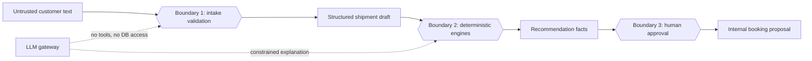
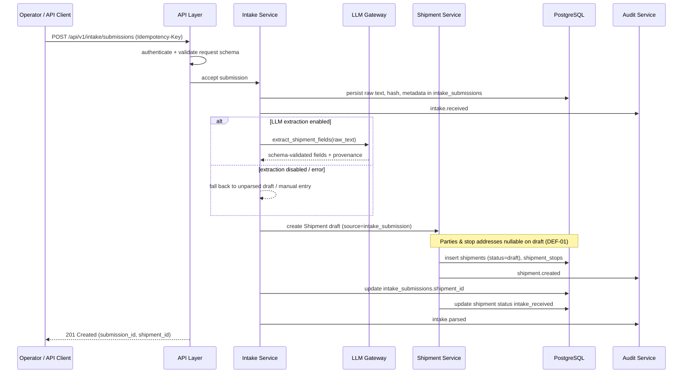
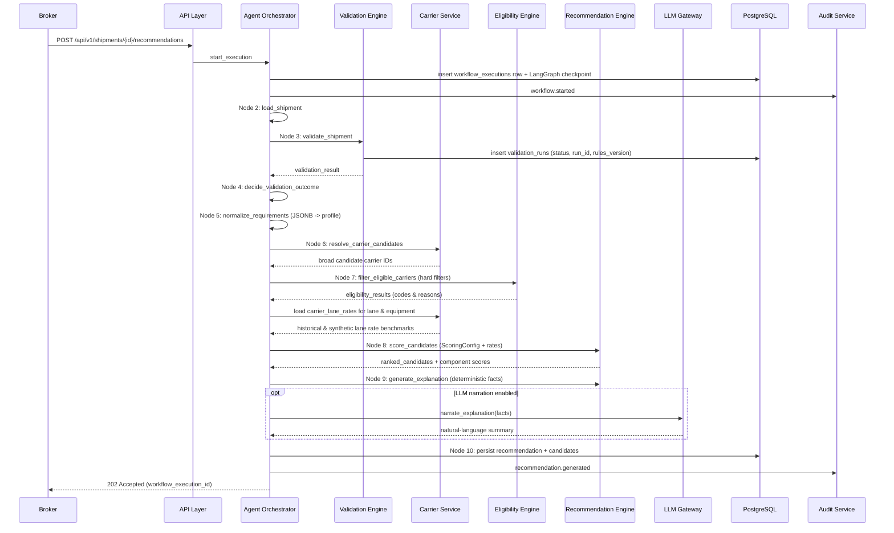
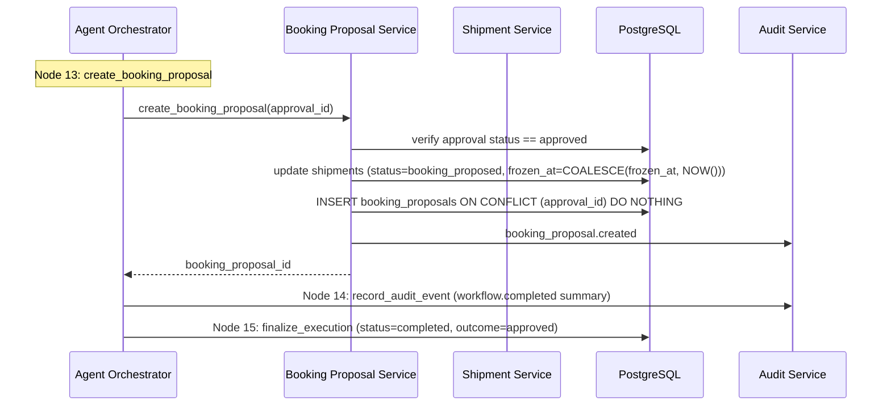
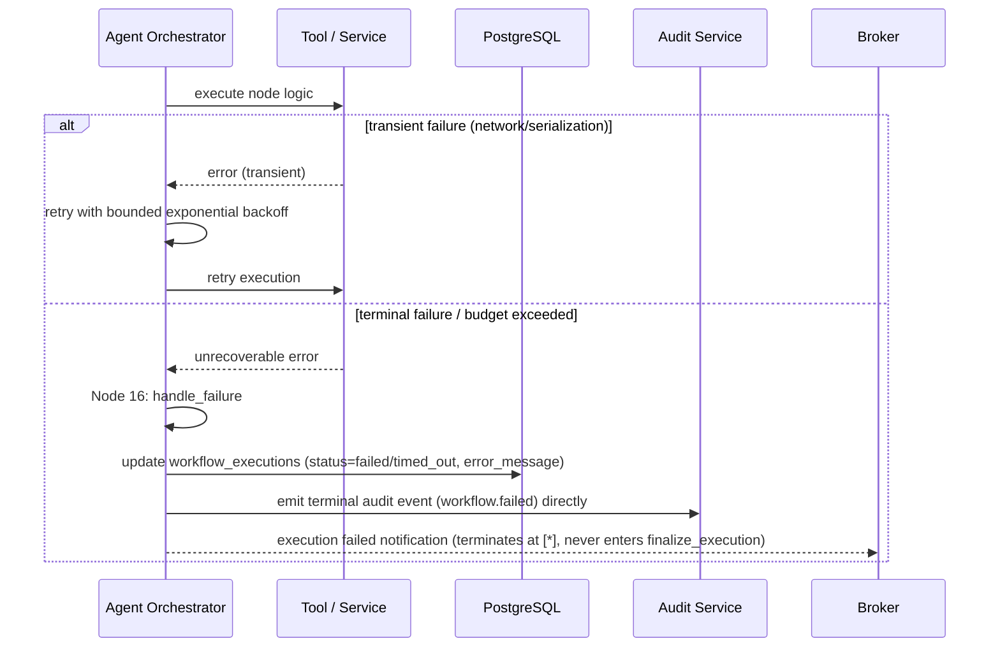

# 08 — Data Flow

| Field | Value |
|---|---|
| Status | Approved (Phase 1.7.5 Remediation) |
| Contract version | 2.2 |
| Contract source | [Appendix A](./03-requirements-specification.md#appendix-a--canonical-contracts) |
| Depends on | [06](./06-database-design.md), [07](./07-agent-workflow.md), [09](./09-api-design.md) |
| Last updated | 2026-11-25 |
| Audience | Developer, reviewer |

## 1. Purpose

This document traces data end-to-end through five canonical operational flows:

| ID | Flow |
|---|---|
| `DF-01` | Customer request → intake → structured Shipment record |
| `DF-02` | Shipment record → eligibility & scoring → carrier recommendation |
| `DF-03` | Recommendation → human approval & workflow resume |
| `DF-04` | Approved proposal → internal booking proposal execution |
| `DF-05` | Workflow failure and recovery |

Each flow defines participants, numbered steps, database tables touched, trust boundaries, failure points, and emitted audit events. Endpoint paths match [09](./09-api-design.md); node names match [07](./07-agent-workflow.md) and Appendix A §A.4.

There is **no email/IMAP flow** in the MVP. Intake arrives via paste or REST API (`ADR-014`; file uploads and standalone manual shipment entry `FR-004` are deferred to Post-MVP).

## 2. Trust boundaries



- **Boundary 1 (Intake Boundary):** Raw customer text is untrusted. Only Pydantic-validated extraction schemas enter the database.
- **Boundary 2 (Eligibility & Scoring Boundary):** Eligibility, carrier lane rates, and candidate ranking are deterministic calculations over database records. LLMs have no access to tools or raw tables.
- **Boundary 3 (Human Consequential Boundary):** No Booking Proposal can exist without an explicit, recorded approval decision from an authorized human broker.

## 3. DF-01 — Customer request to Shipment record

**Goal:** Transform an unstructured freight request into a durable intake submission and a structured Shipment record, allowing missing party references on initial draft.

**Participants:** Operator / API client, API Layer, Intake Service, LLM Gateway (optional), Shipment Service, PostgreSQL, Audit Service.



**Steps:**

1. The client submits raw text via paste or JSON via REST API with an `Idempotency-Key` header.
2. The API Layer authenticates the caller, validates input constraints, and checks for idempotent replays in `idempotency_keys`.
3. The Intake Service computes a SHA-256 hash of the content and checks for existing submissions.
4. Raw text, channel, submitter, and hash are persisted in `intake_submissions` before any parsing occurs.
5. If extraction is enabled, the LLM Gateway generates a schema-validated candidate object containing extracted dates, equipment, locations, and requirements with field-level confidence. Absent fields remain `null`.
6. The Shipment Service creates a Shipment draft:
   - `customer_id`, `origin_facility_id`, and `destination_facility_id` are permitted to be `null` at draft creation to support incomplete incoming requests (CRIT-01).
   - Stop records are inserted into `shipment_stops` with nullable address fields (`name`, `address_line1`, `city`, `state`, `postal_code`) to permit incomplete draft stop persistence (DEF-01). The `ValidationEngine` strictly enforces complete facility/address data and stop sequencing before transitioning to `validated`.
   - Special requirements are persisted in `shipments.requirements` JSONB (F-DB-02).
   - Initial shipment status is `draft`.
7. The intake submission is linked to the created shipment (`submission.shipment_id`).
8. The shipment transitions to status `intake_received`.
9. Audit events (`intake.received`, `shipment.created`, `intake.parsed`) are appended.

**Stores touched:** `intake_submissions`, `shipments`, `shipment_stops`, `facilities`, `idempotency_keys`, `audit_events`.

**Failure points and handling:**

| Failure | Handling |
|---|---|
| Duplicate key/hash | Return existing submission (`200 OK`), no duplicate rows |
| Oversized upload (> 100 kB) | `ERR-009` Payload Too Large, nothing persisted |
| LLM timeout / schema failure | Fall back to manual draft; record `extraction_error`; draft remains editable |
| DB write conflict | Full rollback; client retries with same idempotency key |

## 4. DF-02 — Shipment record to carrier recommendation

**Goal:** Validate the shipment aggregate, normalize requirements, filter eligible carriers deterministically, rank candidates using active scoring weights and recorded lane rates, and persist an explained recommendation.

**Participants:** Operator, API Layer, Agent Orchestrator (LangGraph), Validation Engine, Carrier Service, Eligibility Engine, Recommendation Engine, LLM Gateway (narration only), PostgreSQL, Audit Service.



**Steps:**

1. The broker requests recommendations for a shipment in status `validated` or `sourcing`.
2. `start_execution` initializes `workflow_executions` with execution bounds and records the starting checkpoint.
3. `load_shipment` reads the shipment aggregate, stops, facilities, and `requirements` JSONB.
4. `validate_shipment` runs the deterministic Validation Engine:
   - Verifies required party FKs (`customer_id`, `origin_facility_id`, `destination_facility_id`) are non-null and active.
   - Verifies stop sequencing, pickup/delivery dates, and equipment compatibility.
   - Persists a `validation_runs` record with `run_id`, `rules_version`, and any issues.
5. `decide_validation_outcome` evaluates the result. If invalid, routes to `handle_failure` and updates shipment to `validation_failed`.
6. `normalize_requirements` reads first-class `shipments.equipment_type` (`dry_van`, `reefer`, `flatbed`) and `shipments.requirements` JSONB separately to build the canonical typed eligibility profile (no LLM call).
7. `resolve_carrier_candidates` queries `carriers`, `carrier_equipment_types`, and `carrier_service_regions` for a broad candidate set.
8. `filter_eligible_carriers` applies 7 deterministic hard filters (carrier status, equipment fit via `carrier_equipment_types`, origin region coverage, availability windows, insurance expiration, hazmat authorization, temperature capability) and produces canonical reason codes.
9. `score_candidates` loads recorded `carrier_lane_rates` for the lane and evaluates candidates against the active `scoring_configs` weights (rate competitiveness, lane familiarity, equipment fit, reliability, timing).
10. `generate_explanation` builds deterministic fact summaries; if configured, LLM Gateway formats a narration strictly bounded to those facts.
11. `persist_recommendation` writes the recommendation and ranked candidates atomically, emits `recommendation.generated`, and moves shipment to `recommendation_ready`.

**Stores touched:** `shipments`, `facilities`, `validation_runs`, `carriers`, `carrier_equipment_types`, `carrier_service_regions`, `carrier_availability`, `carrier_lane_rates`, `scoring_configs`, `recommendations`, `recommendation_candidates`, `workflow_executions`, `audit_events`.

## 5. DF-03 — Recommendation to human approval and workflow resume

**Goal:** Present a `ready` recommendation to an authorized broker, pause execution cleanly via LangGraph `interrupt()`, and resume execution directly upon human decision submission.

**Participants:** Agent Orchestrator, Approval Service, Broker (UI / API), PostgreSQL, Audit Service.

```mermaid
sequenceDiagram
    participant O as Agent Orchestrator
    participant AP as Approval Service
    participant B as Broker (UI / API)
    participant DB as PostgreSQL
    participant A as Audit Service

    Note over O: Node 11: request_human_approval
    O->>AP: create_approval_request(recommendation_id)
    AP->>DB: insert approvals (status=pending, recommendation snapshot)
    AP->>A: approval.requested
    O->>DB: update workflow status = waiting_for_human
    O->>O: interrupt() — LangGraph checkpointer persists thread state
    Note over O: Workflow is paused cleanly; no compute held

    B->>AP: GET /api/v1/approvals (operator queue)
    AP-->>B: pending approvals with score breakdowns & reasons
    B->>AP: POST /api/v1/approvals/{id}/decision (decision, comment)
    AP->>AP: validate decision schema, status, role
    AP->>DB: update approvals & shipment status (approved with frozen_at=NOW() if approved; sourcing if rejected/changes_requested)
    AP->>A: approval.granted / approval.rejected / approval.changes_requested
    AP->>O: graph.invoke(Command(resume=decision))
    Note over O: Workflow resumes from PostgreSQL checkpoint
    O->>O: Node 12: apply_human_decision (validates decision and routes workflow only)
    alt approved
        O->>O: route to Node 13 (create_booking_proposal)
    else rejected / changes_requested
        O->>O: route to Node 14 (record_audit_event: workflow.completed)
    end
```

**Steps:**

1. In Node 11 (`request_human_approval`), the orchestrator executes a fenced `UPDATE workflow_executions` (checking `lease_token`, `lease_epoch`, `lease_expires_at > NOW()`, 10m attempt ceiling, and 900s cumulative budget), verifies `rowcount == 1` (else `ROLLBACK` + `ExecutionLeaseFencingError`), idempotently inserts the `pending` Approval and `approval.requested` audit event in the same ACID transaction, commits, and only then invokes `interrupt()`.
2. The orchestrator calls `interrupt()`. LangGraph persists the state to PostgreSQL checkpointer tables and yields control. The workflow row is marked `waiting_for_human`.
3. The broker views the approval queue (`GET /api/v1/approvals`) and inspects candidate rankings, component score breakdowns, rates, and eligibility reasons.
4. The broker submits an authoritative decision via `POST /api/v1/approvals/{id}/decision` (`approve`, `reject`, or `request_changes`).
5. The Approval Service executes within an ACID transaction: validates that the approval is `pending`, immutably records the decision in `approvals` (`approved`, `rejected`, or `changes_requested`; leaving `resumed_at = NULL`), transitions `workflow_executions.status = 'resumption_pending'`, updates `shipments.status` (`approved` with `frozen_at = NOW()` if approved; `sourcing` if rejected or changes requested deterministically), and records the inline audit event (`approval.granted` / `approval.rejected` / `approval.changes_requested`). The Approval Service is the sole owner of the immediate shipment status transition and human decision audit event.
6. Upon transaction commit, the worker atomically acquires an execution lease (`lease_token`, incremented `lease_epoch`, `lease_owner`, `lease_expires_at = NOW() + 60s`, `attempt_started_at = NOW()`) from `resumption_pending` (preserving `attempt_count <= 3` without consuming a failure retry) and enforcing `cumulative_compute_seconds < 900`. Active workers heartbeat every 15–20s verifying `lease_expires_at > NOW()`, `NOW() < attempt_started_at + INTERVAL '10 minutes'`, and `cumulative_compute_seconds + EXTRACT(...) <= 900`, then trigger workflow resumption via `graph.invoke(Command(resume=decision))`.
7. Node 12 (`apply_human_decision`) receives and validates the persisted decision (it does not repeat shipment status updates):
   - If `approved`: branches to Node 13 (`create_booking_proposal`), which advances `shipments.status` to `booking_proposed`, idempotently creates the booking proposal, and records `booking_proposal.created`.
   - If `rejected`: branches to Node 14 (`record_audit_event`), which records `workflow.completed` (`outcome: rejected`); Node 15 marks `approvals.resumed_at = NOW()` and `workflow_executions.status = 'completed'` without creating a proposal. (Shipment was already transitioned to `sourcing` and `approval.rejected` recorded by Approval Service; Node 12 and Node 14 do not duplicate them).
   - If `request_changes`: branches to Node 14 (`record_audit_event`), which records `workflow.completed` (`outcome: changes_requested`); Node 15 marks `approvals.resumed_at = NOW()` and `workflow_executions.status = 'completed'` without creating a proposal. (Shipment was already transitioned to `sourcing` deterministically and `approval.changes_requested` recorded by Approval Service; Node 12 and Node 14 do not duplicate them).
8. **Crash Recovery & Resume Protocol (DEF-05, Phase 1.7.1 & Phase 1.7.3):** If the application process crashes after the approval decision commits but before graph resumption completes, the decision is safely recorded in `approvals` with `resumed_at IS NULL` and `workflow_executions.status = 'resumption_pending'`. A client retry or the startup recovery check discovers this decided approval awaiting resumption, acquires the execution lease via `workflow_execution_id` correlation (`09 §6.8`) and atomic targeting (`06 §3.17`), and resumes the LangGraph thread from its PostgreSQL checkpoint without re-running decision logic or duplicating booking proposals. Undecided pending approvals (`workflow_executions.status = 'waiting_for_human'`, `approvals.status = 'pending'`) are strictly preserved and never expired or auto-resumed.

**Stores touched:** `approvals`, `recommendations`, `recommendation_candidates`, `shipments`, `workflow_executions`, `audit_events`, `idempotency_keys`.

## 6. DF-04 — Approved proposal to booking proposal execution

**Goal:** Create an internal Booking Proposal from an approved recommendation, snapshotting rate and carrier data. No external EDI/API tender occurs in the MVP.

**Participants:** Agent Orchestrator, Booking Proposal Service, Shipment Service, PostgreSQL, Audit Service.



**Steps:**

1. Node 13 (`create_booking_proposal`) executes within a single ACID database transaction (`06 §3.17`, `11 §7.2`):
   - Validates fencing (`SELECT lease_epoch ... FOR UPDATE`, requiring `len(rows) == 1`; else `ROLLBACK` + `ExecutionLeaseFencingError`).
   - Verifies `approvals.status == 'approved'` (`FOR UPDATE`, requiring `len(rows) == 1`).
   - Freezes/transitions the shipment (`status = 'booking_proposed'`, `frozen_at = COALESCE(frozen_at, NOW())`, requiring `rowcount == 1`).
   - Inserts `booking_proposals` (`status = 'proposed'`, `ON CONFLICT (approval_id) DO NOTHING`) with JSONB snapshots of carrier, rate, stop, and approval terms.
   - Inserts the mandatory `booking_proposal.created` audit event inside the **same** Node 13 transaction when the proposal row is inserted (preventing a proposal from ever existing without its audit record, and avoiding duplicates on replay).
   - Commits all operations together; any failure rolls back the entire transaction.
2. Node 14 (`record_audit_event`) validates fencing (`len(rows) == 1`, else `ROLLBACK` + `ExecutionLeaseFencingError`) and records the workflow summary audit event (`workflow.completed`) in its fenced transaction.
3. Node 15 (`finalize_execution`) updates `workflow_executions` (`status = 'completed'`, final `cumulative_compute_seconds`, clears lease fields; requiring `rowcount == 1`), conditionally updates `approvals.resumed_at = NOW()` when `approval_id IS NOT NULL` (requiring `rowcount == 1`), and commits only after both checks succeed.

**Subsequent Carrier Lifecycle Transition (CRIT-04):**
- If the carrier declines the proposal or the broker cancels it before acceptance (`POST /api/v1/booking-proposals/{id}/cancel`), the proposal transitions to `declined` or `cancelled`, and the Shipment returns to status `sourcing` (D-05 transition).

**Stores touched:** `booking_proposals`, `shipments`, `approvals`, `recommendation_candidates`, `audit_events`, `workflow_executions`.

## 7. DF-05 — Workflow failure and recovery

**Goal:** Ensure all unexpected failures, timeouts, and budget exhaustions terminate cleanly without leaving orphaned approvals or partial proposals.



**Failure handling matrix:**

| Failure scenario | System state | Recovery action |
|---|---|---|
| Failure before recommendation | No recommendation exists | Safe to retry recommendation request with new/same key |
| Failure during scoring | Workflow `failed`, no recommendation | Node 16 records failure; fix configuration or data; restart workflow |
| Process crash while `waiting_for_human` (pending) | State safely held in PostgreSQL checkpointer | Stays in `waiting_for_human`; resumes seamlessly when broker submits decision (never expired by startup check) |
| Process crash while `waiting_for_human` (decided) | Approval is `approved`, execution `waiting_for_human` | Startup recovery check detects decided approval, locks execution, resumes LangGraph from checkpoint (DEF-05) |
| Process crash during execution | State held in last node checkpoint | Startup inspects `running` workflows with expired leases; accumulates crashed elapsed compute; resumes only if `attempt_count < 3`, `NOW() < attempt_started_at + INTERVAL '10 minutes'`, and projected `cumulative_compute_seconds < 900`, else runs conditional exhaustion CTE (`timed_out`/`failed` + `workflow.failed`) |
| Approval rejected by broker | Approval `rejected`, no proposal created | Shipment returns to `sourcing`; broker may adjust data and re-run |
| Proposal declined by carrier | Proposal `declined` | Shipment returns to `sourcing` for re-recommendation (CRIT-04) |

## 8. Data classification and access boundaries

| Data entity | Classification | Storage and transmission controls |
|---|---|---|
| Raw intake text | Untrusted customer input | Stored in `intake_submissions`; restricted access; never logged at INFO |
| Contact details | PII | Restricted to authenticated users; redacted in debug logs |
| Carrier lane rates | Commercially sensitive | Stored in `carrier_lane_rates`; access logged in `audit_events` |
| Approval decisions | Audit & legal record | Immutable; protected by database trigger; non-repudiable broker ID |
| Audit events | Immutable event log | Append-only; trigger enforces no UPDATE/DELETE |
| LLM prompts/outputs | Ephemeral operational data | Stored in `llm_invocations` metadata only; inputs/outputs sanitized |
