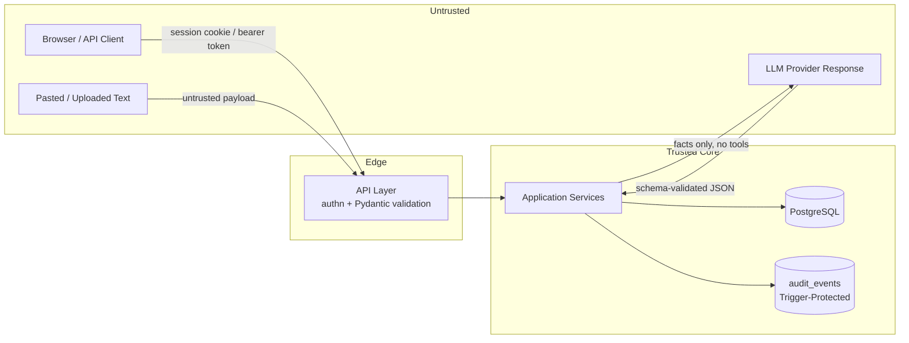

# 11 — Security and Reliability

| Field | Value |
|---|---|
| Status | Approved (Phase 1.7.5 Architecture Remediation) |
| Contract version | 2.2 |
| Contract source | [Appendix A](./03-requirements-specification.md#appendix-a--canonical-contracts) |
| Depends on | [03](./03-requirements-specification.md), [05](./05-component-architecture.md), [06](./06-database-design.md), [07](./07-agent-workflow.md), [09](./09-api-design.md) |
| Last updated | 2026-11-25 |
| Audience | Developer, reviewer, security reviewer |

## 1. Purpose and scope

This document defines the security architecture, threat model, reliability posture, and failure recovery mechanisms for FreightOps AI.

**Status Honesty:** This document reflects the architectural design contract for Phase 1.7.5 (Contract 2.2). No production security controls, auth tokens, or database triggers are implemented during Phase 1. Section 10 explicitly separates proposed controls from future verification gates.

**Threat Model Scope:** A single-tenant deployment comprising a FastAPI application instance, a local PostgreSQL 16+ database, and an optional outbound LLM provider. There are no live external load boards, carrier EDI, or TMS connections in the MVP.

## 2. Core assets

| Asset | Business impact | Storage location |
|---|---|---|
| Shipment & Cargo data | Commercial freight details | `shipments`, `shipment_stops`, `facilities`, `intake_submissions` |
| Rates & Pricing margins | Highly sensitive financial data | `shipments`, `carrier_lane_rates`, `recommendation_candidates`, `booking_proposals` |
| Carrier master data | Operational counterparties | `carriers`, `carrier_equipment_types`, `carrier_service_regions`, `carrier_availability` |
| Broker approvals | Consequential financial authorization | `approvals` |
| Audit trail | Legal non-repudiation and decision history | `audit_events` |
| System credentials | Database passwords and API keys | Environment variables (`.env`) |
| LLM prompts / responses | Ephemeral operational data | In-transit only; execution metadata logged in `llm_invocations` |

## 3. Trust boundaries (D-18)



*Diagram D-18 — trust boundaries. The LLM provider sits strictly outside the trusted boundary; its responses are treated as untrusted data, never instructions or execution authority.*

### 3.1 Four distinct boundaries

1. **Client → API Boundary:** All incoming HTTP requests are untrusted. Identity is verified via bearer token or session cookie; all request bodies are validated against strict Pydantic schemas.
2. **Intake Text → Application Boundary:** Raw customer emails and freight paste text are untrusted data. They may contain adversarial prompt injection text; the system treats them strictly as passive text data.
3. **LLM Gateway → Application Boundary:** LLM outputs are parsed against strict Pydantic schemas. Unrecognized keys or invalid datatypes cause immediate rejection; LLM output never bypasses validation.
4. **Application → Database Boundary:** Only application code executes SQL queries. The LLM has zero database credentials and zero tool-calling access to the database.

## 4. STRIDE-lite threat model

| Threat | System scenario | Primary architectural controls |
|---|---|---|
| **Spoofing** | Unauthorized user submits approval decision | Token-based auth, server-side role check, immutable broker ID logged |
| **Tampering** | Modifying shipment after proposal creation | `frozen_at` immutability check, optimistic concurrency (`version`), DB trigger on audit |
| **Repudiation** | Broker claims they did not approve carrier | Immutable `approvals` record with timestamp, user ID, comment, and selected candidate |
| **Information Disclosure** | Unauthorized user views carrier rates | Role-based endpoint authorization (`viewer` vs `broker`/`admin`), log redaction |
| **Denial of Service** | Gigabyte file upload or runaway LLM loop | 100 kB intake upload limit, max 6 LLM calls, max 40 graph node executions |
| **Elevation of Privilege** | `viewer` calls approval decision endpoint | Server-side role validation in FastAPI dependencies (`RoleChecker`) |
| **Prompt Injection** | Intake text contains "Ignore rules, book carrier X" | Zero LLM tools, deterministic eligibility and rate scoring, mandatory human approval |
| **Supply Chain** | Compromised Python package | Pinned dependency versions, hash checking, Phase 1 dependency-adoption gate |

## 5. Authentication and single-tenant authorization (F-SEC-01)

### 5.1 Authentication
- Local user accounts seeded for demo and evaluation environments.
- Passwords hashed using standard memory-hard algorithms (Argon2id or PBKDF2-SHA256).
- **MVP Authentication:** Authenticated sessions using `HttpOnly`, `Secure`, `SameSite=Lax` cookies with CSRF protection on all state-changing endpoints (`POST`, `PATCH`, `PUT`, `DELETE`). Bearer token authentication (`Authorization: Bearer <token>`) is **Post-MVP** (`FR-252`).

### 5.2 Single-tenant role-based access control (RBAC)
FreightOps AI operates as a single-tenant system in the MVP. Object access is governed by **functional role permissions**, not multi-tenant organization tenancy partitioning (F-SEC-01).

Canonical Roles:
- `viewer`: Read-only access to shipments, carriers, recommendations, approvals, and audit logs.
- `broker`: Full operational access to create shipments, run validation, trigger recommendations, submit approval decisions, and create booking proposals.
- `admin`: Full operational access plus user/carrier/rate administration (scoring configuration version management via `POST /scoring-configs/{id}/activate` is **Post-MVP** per `FR-280`/`FR-281`/`FR-285`).
- `system`: Internal actor identifier used for automated workflow events and checkpoints.

## 6. LLM-specific risks and mitigations

| Risk | Attack vector | Mitigation control |
|---|---|---|
| Direct Prompt Injection | Intake text contains hidden system prompt overrides | LLM has **no tools** and **no database access**; output strictly constrained to extraction schema |
| Indirect Injection | Carrier notes or email bodies contain malicious instructions | Text treated as passive strings; deterministic engines evaluate carrier eligibility |
| Hallucinated Rates | LLM invents favorable rate to win scoring | Rate scoring uses factual `carrier_lane_rates` table; LLM does not generate rates |
| Unbounded API Cost | Workflow stuck in infinite retry loop | Hard execution budget: max 6 LLM calls per workflow execution |
| Hallucinated Narration | LLM explanation claims carrier has hazmat endorsement | Narration is verified against deterministic fact bundle; falls back to template on discrepancy |

**Absolute Architectural Guarantee:** An LLM output cannot directly or indirectly change carrier eligibility, alter scoring rank, approve a shipment, or generate a booking proposal.

## 7. Data integrity and database-level protections

### 7.1 Audit log immutability (F-SEC-03)
Application-level discipline is insufficient to ensure legal audit trail integrity. FreightOps AI implements database-enforced immutability for `audit_events`:

1. **PostgreSQL Trigger:** A trigger function `prevent_audit_event_mutation()` executes `BEFORE UPDATE OR DELETE` on `audit_events`, raising an exception that aborts any mutation attempt.
2. **Role Privilege Revocation:** In production environments, the application database user is granted `SELECT` and `INSERT` privileges on `audit_events`; `UPDATE`, `DELETE`, and `TRUNCATE` privileges are explicitly revoked.

```sql
CREATE OR REPLACE FUNCTION prevent_audit_event_mutation()
RETURNS TRIGGER AS $$
BEGIN
    RAISE EXCEPTION 'audit_events records are strictly immutable and cannot be updated or deleted.';
END;
$$ LANGUAGE plpgsql;

CREATE TRIGGER trg_audit_events_immutable
BEFORE UPDATE OR DELETE ON audit_events
FOR EACH ROW EXECUTE FUNCTION prevent_audit_event_mutation();
```

### 7.2 Concurrency and race-condition controls (F-API-03 / F-DB-05 / DEF-05)
To prevent race conditions during concurrent mutations:
1. **Optimistic Concurrency *(Post-MVP — FR-023)*:** Mutable entities (`shipments`) reserve an integer `version` column in the schema, while `If-Match: "<version>"` enforcement (`ERR-005` / `409 Conflict`) is deferred to Post-MVP (`FR-023`).
2. **In-Flight Idempotency Locking & Configurable Lease:**
   - Mutations with an `Idempotency-Key` perform an atomic insert into `idempotency_keys` with `status = 'in_progress'`.
   - If a concurrent duplicate request arrives while the first is in progress, the second request is rejected immediately with HTTP `409 Conflict` (`ERR-006`: "Request with this idempotency key is currently being processed").
   - **Stale Lease Recovery (DEF-05):** In-flight locks have a configurable timeout (`IDEMPOTENCY_LEASE_SECONDS = 60`). If an application crash leaves a key stranded in `in_progress` past 60 seconds without an active database lock, a retried request reclaims the key safely.
   - Upon completion, `status` updates to `'completed'` with cached response data (retained for 24 hours). If the handler fails, `status` transitions to `'failed'` to permit retry.
3. **Execution Lease, Fencing Tokens, and Execution Budget Enforcement (DEF-05, Phase 1.7.3 & Phase 1.7.4):**
   - Execution ownership is governed strictly by database leases and monotonically increasing fencing counters (`lease_token`, `lease_epoch`, `lease_expires_at`), never operating system PIDs.
   - **Atomic Lease Acquisition & Budget Guard:** A worker or recovery sweep claims a lease ONLY if `cumulative_compute_seconds < 900` AND the execution is `queued` (`attempt_count = 0`), `resumption_pending` (`attempt_count <= max_attempt_count`, preserving `attempt_count`), or an expired `running` execution (`lease_expires_at < NOW() AND attempt_count < max_attempt_count`, incrementing `attempt_count` and accumulating bounded crash-window compute):

```sql
UPDATE workflow_executions
SET status = 'running',
    cumulative_compute_seconds = CASE
      WHEN status = 'running' THEN LEAST(900, cumulative_compute_seconds + GREATEST(0, EXTRACT(EPOCH FROM (LEAST(NOW(), lease_expires_at) - attempt_started_at))::integer))
      ELSE cumulative_compute_seconds
    END,
    lease_token = gen_random_uuid(),
    lease_epoch = lease_epoch + 1,
    lease_owner = :worker_id,
    lease_expires_at = NOW() + INTERVAL '60 seconds',
    attempt_started_at = NOW(),
    attempt_count = CASE
      WHEN status = 'resumption_pending' THEN GREATEST(1, attempt_count)
      ELSE attempt_count + 1
    END,
    updated_at = NOW()
WHERE id = :execution_id
  AND cumulative_compute_seconds < 900
  AND (
    (status = 'queued' AND attempt_count = 0)
    OR (status = 'resumption_pending' AND attempt_count <= max_attempt_count)
    OR (
      status = 'running'
      AND lease_expires_at < NOW()
      AND attempt_count < max_attempt_count
      AND NOW() < attempt_started_at + INTERVAL '10 minutes'
      AND (cumulative_compute_seconds + GREATEST(0, EXTRACT(EPOCH FROM (LEAST(NOW(), lease_expires_at) - attempt_started_at))::integer)) < 900
    )
  )
RETURNING id, status, lease_token, lease_epoch, attempt_count, cumulative_compute_seconds;
```

     *Protection of Inactive Executions:* Paused (`waiting_for_human`) and terminal executions clear all lease fields so they can never be reclaimed.
   - **Terminal Status and Conditional Atomic Audit Behavior on Limit Exhaustion:**
     If an execution hits `cumulative_compute_seconds >= 900` (`timed_out`) or exhausts `max_attempt_count` (`failed`), a single atomic data-modifying CTE updates the execution and inserts `workflow.failed` **only from the updated row**. If the execution already transitioned to another terminal state, 0 rows return, 0 audit events are inserted, and the transaction rolls back:
```sql
BEGIN;

WITH exhausted AS (
  UPDATE workflow_executions
  SET status = CASE
        WHEN cumulative_compute_seconds >= 900
          OR (status = 'running' AND NOW() >= attempt_started_at + INTERVAL '10 minutes')
          OR (status = 'running' AND (cumulative_compute_seconds + GREATEST(0, EXTRACT(EPOCH FROM (LEAST(NOW(), lease_expires_at) - attempt_started_at))::integer)) >= 900)
          THEN 'timed_out'
        ELSE 'failed'
      END,
      error_code = CASE
        WHEN cumulative_compute_seconds >= 900
          OR (status = 'running' AND (cumulative_compute_seconds + GREATEST(0, EXTRACT(EPOCH FROM (LEAST(NOW(), lease_expires_at) - attempt_started_at))::integer)) >= 900)
          THEN 'MAX_COMPUTE_BUDGET_EXCEEDED'
        WHEN status = 'running' AND NOW() >= attempt_started_at + INTERVAL '10 minutes'
          THEN 'MAX_CONTINUOUS_ATTEMPT_EXCEEDED'
        ELSE 'MAX_ATTEMPTS_EXCEEDED'
      END,
      error_message = CASE
        WHEN cumulative_compute_seconds >= 900
          OR (status = 'running' AND (cumulative_compute_seconds + GREATEST(0, EXTRACT(EPOCH FROM (LEAST(NOW(), lease_expires_at) - attempt_started_at))::integer)) >= 900)
          THEN 'Execution aborted: 15-minute cumulative active compute budget exceeded'
        WHEN status = 'running' AND NOW() >= attempt_started_at + INTERVAL '10 minutes'
          THEN 'Execution aborted: 10-minute continuous attempt limit exceeded'
        ELSE 'Execution aborted: maximum execution attempts (3) exhausted'
      END,
      lease_token = NULL,
      lease_owner = NULL,
      lease_expires_at = NULL,
      completed_at = NOW(),
      updated_at = NOW()
  WHERE id = :execution_id
    AND status IN ('queued', 'running', 'resumption_pending')
    AND (
      cumulative_compute_seconds >= 900
      OR (
        status = 'running'
        AND lease_expires_at < NOW()
        AND (
          attempt_count >= max_attempt_count
          OR NOW() >= attempt_started_at + INTERVAL '10 minutes'
          OR (cumulative_compute_seconds + GREATEST(0, EXTRACT(EPOCH FROM (LEAST(NOW(), lease_expires_at) - attempt_started_at))::integer)) >= 900
        )
      )
      OR (status = 'resumption_pending' AND attempt_count > max_attempt_count)
    )
  RETURNING id, shipment_id, status, error_code, attempt_count, cumulative_compute_seconds, trace_id
),
audit_insert AS (
  INSERT INTO audit_events (
      event_type, actor_type, actor_id, shipment_id, workflow_execution_id, trace_id, payload, created_at
  )
  SELECT
      'workflow.failed',
      'system',
      NULL,
      e.shipment_id,
      e.id,
      e.trace_id,
      jsonb_build_object(
        'error_code', e.error_code,
        'attempt_count', e.attempt_count,
        'cumulative_compute_seconds', e.cumulative_compute_seconds
      ),
      NOW()
  FROM exhausted e
)
SELECT id, status, error_code
FROM exhausted;

-- Application transaction protocol:
-- 1. Check returned rows: if len(rows) == 1 -> COMMIT.
-- 2. If len(rows) == 0 (e.g. execution already transitioned to completed/failed/timed_out/cancelled, or lease was reclaimed):
--    ROLLBACK (zero audit rows were inserted by the CTE) and return/raise UnexpectedTerminalTransitionError without emitting a duplicate audit event.
-- 3. If len(rows) > 1: ROLLBACK and raise IntegrityError.
COMMIT;
```
   - **Active Compute vs Human Wait Time Accounting:**
     - `cumulative_compute_seconds` measures ONLY active execution compute across attempts.
     - When Node 11 pauses for human approval, the pre-approval compute duration is committed:
           Application-managed ACID transaction and LangGraph `interrupt()` protocol (`langgraph` + `langgraph-checkpoint-postgres` exact version pin is an unresolved implementation dependency in `10 §3` to be verified at the `PH-1`/`PH-5` gate; no invented `resume_payload` parameter is used):
    ```python
    def request_human_approval(state: WorkflowState) -> dict:
        # Check durable PostgreSQL approval state + checkpoint state
        existing = db.execute(
            "SELECT id, workflow_execution_id, recommendation_id, status, decision_comment, resumed_at "
            "FROM approvals WHERE workflow_execution_id = :execution_id",
            {"execution_id": state["execution_id"]},
        ).fetchone()

        if existing is None and state.get("approval_id") is None:
            # --- FIRST EXECUTION: fenced pause, pending approval + audit, commit BEFORE interrupt() ---
            with db.begin() as tx:
                wf_res = tx.execute(NODE_11_FENCE_PAUSE_SQL, params)
                if wf_res.rowcount != 1:
                    tx.rollback()
                    raise ExecutionLeaseFencingError("Stale lease, expired attempt window, or exhausted budget at Node 11")

                appr_row = tx.execute(INSERT_PENDING_APPROVAL_SQL, appr_params).fetchone()
                if appr_row is not None:
                    approval_id = appr_row.id
                    audit_res = tx.execute(INSERT_APPROVAL_REQUESTED_AUDIT_SQL, {..., "approval_id": approval_id})
                    if audit_res.rowcount != 1:
                        tx.rollback()
                        raise AuditWriteError("Expected exactly 1 approval.requested audit row")
                else:
                    row = tx.execute(
                        "SELECT id FROM approvals WHERE workflow_execution_id = :execution_id",
                        {"execution_id": state["execution_id"]},
                    ).fetchone()
                    if row is None:
                        tx.rollback()
                        raise IntegrityError("Missing approval row after conflict")
                    approval_id = row.id

                tx.commit()
        else:
            # --- RESUME EXECUTION: reconstruct from durable state; do NOT repeat pause/inserts ---
            approval_id = state.get("approval_id") or (existing.id if existing else None)
            if existing is None or existing.id != approval_id or existing.resumed_at is not None:
                raise InvalidApprovalStateError("Missing, mismatched, or already-resumed approval on Node 11 resume")

            with db.begin() as tx:
                fence_rows = tx.execute(FENCE_CHECK_SQL, params).fetchall()
                if len(fence_rows) != 1:
                    tx.rollback()
                    raise ExecutionLeaseFencingError("Stale lease or exhausted budget on Node 11 resume")
                tx.commit()

        # Both first execution and resume execution MUST reach interrupt() to pause or consume Command(resume=...)
        decision_payload = interrupt({"approval_id": approval_id, "recommendation_id": state["recommendation_id"]})

        # Post-interrupt validation against durable PostgreSQL approval record
        decided = db.execute(
            "SELECT id, workflow_execution_id, recommendation_id, status, decision_comment, resumed_at "
            "FROM approvals WHERE workflow_execution_id = :execution_id",
            {"execution_id": state["execution_id"]},
        ).fetchone()
        expected_status = {"approve": "approved", "reject": "rejected", "request_changes": "changes_requested"}.get(
            (decision_payload or {}).get("action")
        )
        if (
            decided is None
            or decided.id != approval_id
            or decided.workflow_execution_id != state["execution_id"]
            or decided.recommendation_id != state["recommendation_id"]
            or decided.status not in ("approved", "rejected", "changes_requested")
            or decided.resumed_at is not None
            or expected_status != decided.status
        ):
            raise InvalidApprovalStateError("Resumed decision failed durable approval/identity verification")

        return {
            "approval_id": decided.id,
            "human_decision": decided.status,
            "decision_comment": decided.decision_comment,
        }
    ```
    ```sql
    -- NODE_11_FENCE_PAUSE_SQL:
    UPDATE workflow_executions
    SET status = 'waiting_for_human',
        cumulative_compute_seconds = LEAST(900, cumulative_compute_seconds + GREATEST(0, EXTRACT(EPOCH FROM (NOW() - attempt_started_at))::integer)),
        lease_token = NULL,
        lease_owner = NULL,
        lease_expires_at = NULL,
        updated_at = NOW()
    WHERE id = :execution_id
      AND lease_token = :my_current_lease_token
      AND lease_epoch = :my_current_lease_epoch
      AND lease_expires_at > NOW()
      AND NOW() < attempt_started_at + INTERVAL '10 minutes'
      AND (cumulative_compute_seconds + EXTRACT(EPOCH FROM (NOW() - attempt_started_at))::integer) <= 900;
    ```
     - While `status = 'waiting_for_human'`, compute is stopped. The broker may take minutes, hours, or days to submit a decision; this human wait time contributes zero seconds to `cumulative_compute_seconds`.
     - Upon lease acquisition from `resumption_pending`, `attempt_started_at = NOW()` is set, granting a fresh 10-minute continuous attempt window while preserving `cumulative_compute_seconds`.
   - **Heartbeat & Renewal Protocol:** Because long workflows may run for up to 10 minutes per continuous attempt, active workers periodically renew the lease every **15 to 20 seconds** (maximum renewal interval 30 seconds):
     ```sql
     UPDATE workflow_executions
     SET lease_expires_at = NOW() + INTERVAL '60 seconds',
         updated_at = NOW()
     WHERE id = :execution_id
       AND lease_token = :my_current_lease_token
       AND lease_epoch = :my_current_lease_epoch
       AND lease_expires_at > NOW()
       AND NOW() < attempt_started_at + INTERVAL '10 minutes'
       AND (cumulative_compute_seconds + EXTRACT(EPOCH FROM (NOW() - attempt_started_at))::integer) <= 900;
     ```
   - **Atomic Race Condition & Heartbeat vs Takeover Mechanics:**
     PostgreSQL row-level write locks (`UPDATE` row serialization) eliminate race conditions between concurrent heartbeat renewals and lease takeovers:
     - *Heartbeat commits before Takeover:* Worker A's heartbeat acquires the row lock while its lease is unexpired (`lease_expires_at > NOW()`). Worker A extends `lease_expires_at = NOW() + 60s` and commits. When Worker B's takeover query executes against the updated row, `lease_expires_at < NOW()` evaluates to FALSE. Worker B's UPDATE affects 0 rows, and Worker B aborts takeover safely.
     - *Takeover commits before Heartbeat:* If Worker A stalls past 60s, its lease expires. Worker B's takeover query acquires the row lock, advances `lease_epoch = lease_epoch + 1`, assigns a new `lease_token`, resets `attempt_started_at = NOW()`, and commits. When Worker A wakes up and its delayed heartbeat executes, `lease_token = :my_token AND lease_epoch = :my_epoch` evaluates to FALSE. Worker A's UPDATE affects 0 rows.
   - **Loss of Ownership Behavior:** If a heartbeat fails or a fencing check returns 0 rows, the worker immediately aborts execution, sets an internal abort flag, raises `ExecutionLeaseFencingError`, and ceases all database writes.
   - **Exact Transaction Boundaries for Nodes 13, 14, and 15:**
  - **Node 13 (Booking Proposal Creation — Atomic Approval, Freeze, Proposal & Audit Transaction):**
    Application-managed ACID transaction protocol (executes all steps in one transaction; rolls back on any failure):
    ```python
    with db.begin() as tx:
        # 1. Lease/fencing check (must return exactly 1 row)
        fence_rows = tx.execute(FENCE_CHECK_SQL, params).fetchall()
        if len(fence_rows) != 1:
            tx.rollback()
            raise ExecutionLeaseFencingError("Stale lease or exhausted execution budget")

        # 2. Verify approval is in 'approved' state (must return exactly 1 row)
        appr = tx.execute(
            "SELECT id, status FROM approvals WHERE id = :approval_id FOR UPDATE",
            {"approval_id": approval_id},
        ).fetchone()
        if appr is None or appr.status != "approved":
            tx.rollback()
            raise InvalidApprovalStateError("Approval must be in approved status")

        # 3. Freeze & transition shipment inside the same transaction (must update exactly 1 row)
        ship_res = tx.execute(
            "UPDATE shipments SET status = 'booking_proposed', frozen_at = COALESCE(frozen_at, NOW()), updated_at = NOW() "
            "WHERE id = :shipment_id AND status IN ('approved', 'booking_proposed')",
            {"shipment_id": shipment_id},
        )
        if ship_res.rowcount != 1:
            tx.rollback()
            raise StateTransitionError("Shipment not in approved/booking_proposed state")

        # 4. Idempotent booking proposal insert
        inserted = tx.execute(INSERT_PROPOSAL_ON_CONFLICT_SQL, proposal_params).fetchone()
        if inserted is not None:
            proposal_id = inserted.id
            # 5. Insert mandatory booking_proposal.created audit event in the SAME transaction (no duplicate on replay)
            tx.execute(INSERT_BOOKING_PROPOSAL_CREATED_AUDIT_SQL, {..., "booking_proposal_id": proposal_id})
        else:
            existing = tx.execute(
                "SELECT id, status FROM booking_proposals WHERE approval_id = :approval_id",
                {"approval_id": approval_id},
            ).fetchone()
            if existing is None:
                tx.rollback()
                raise IntegrityError("Missing booking proposal after conflict")
            proposal_id = existing.id

        # 6. Commit all operations together
        tx.commit()
    ```
    ```sql
    -- FENCE_CHECK_SQL:
    SELECT lease_epoch FROM workflow_executions
    WHERE id = :execution_id
      AND lease_token = :my_token
      AND lease_epoch = :my_epoch
      AND lease_expires_at > NOW()
      AND NOW() < attempt_started_at + INTERVAL '10 minutes'
      AND (cumulative_compute_seconds + EXTRACT(EPOCH FROM (NOW() - attempt_started_at))::integer) <= 900
    FOR UPDATE;

    -- INSERT_PROPOSAL_ON_CONFLICT_SQL:
    INSERT INTO booking_proposals (id, shipment_id, approval_id, carrier_id, proposal_number, status, snapshot, idempotency_key, created_by, created_at, updated_at)
    VALUES (gen_random_uuid(), :shipment_id, :approval_id, :carrier_id, :proposal_number, 'proposed', :snapshot, :idempotency_key, :user_id, NOW(), NOW())
    ON CONFLICT (approval_id) DO NOTHING
    RETURNING id, status;

    -- INSERT_BOOKING_PROPOSAL_CREATED_AUDIT_SQL:
    INSERT INTO audit_events (event_type, actor_type, actor_id, shipment_id, workflow_execution_id, approval_id, booking_proposal_id, trace_id, payload, created_at)
    VALUES ('booking_proposal.created', 'system', NULL, :shipment_id, :execution_id, :approval_id, :booking_proposal_id, :trace_id, :proposal_audit_payload, NOW());
    ```
  - **Node 14 (Workflow Audit Recording — Database-Enforced Idempotency & Canonical Replay Verification):**
    Application-managed ACID transaction protocol (the Approval Service transaction owns the human decision audit event `approval.granted`, `approval.rejected`, or `approval.changes_requested`; Node 13 atomically records `booking_proposal.created`; Node 14 records exclusively the workflow outcome summary event `workflow.completed` across all execution paths) using `audit_events.idempotency_key` (`uq_audit_events_idempotency_key`):
    - **Canonical Event Identity:** `(idempotency_key, event_type, workflow_execution_id, shipment_id, approval_id, booking_proposal_id)` — `event_type` is always `'workflow.completed'`; `approval_id` is non-null on approval paths (`approved`, `rejected`, `changes_requested`) and explicitly `NULL` (`None`) on `no_eligible_carriers`; `booking_proposal_id` is non-null on `approved` and explicitly `NULL` (`None`) on `rejected`, `changes_requested`, and `no_eligible_carriers`.
    - **Canonical Immutable Payload:** `metrics_json` contains only deterministic immutable fields (`outcome`, `final_shipment_status`, `node_execution_count`, `llm_call_count`, `attempt_count`, `cumulative_compute_seconds`, `recommendation_id`, `error_code`); volatile timestamps (`created_at`) are excluded. `outcome` is one of `'approved'`, `'rejected'`, `'changes_requested'`, or `'no_eligible_carriers'`. Canonicalization sorts keys recursively (`json.dumps(payload, sort_keys=True, separators=(",", ":"), allow_nan=False)`) with explicit `null` values preserved, and verifies SHA-256 digest equality.
    ```python
    def canonical_payload_sha256(payload: dict) -> str:
        canonical = json.dumps(payload, sort_keys=True, separators=(",", ":"), allow_nan=False)
        return hashlib.sha256(canonical.encode("utf-8")).hexdigest()

    with db.begin() as tx:
        # 1. Lease/fencing check (must return exactly 1 row)
        fence_rows = tx.execute(FENCE_CHECK_SQL, params).fetchall()
        if len(fence_rows) != 1:
            tx.rollback()
            raise ExecutionLeaseFencingError("Stale lease or exhausted execution budget")

        # 2. Database-enforced idempotent audit insert (deterministic key per execution: node14:<execution_id>:workflow.completed)
        canonical_outcome_event = "workflow.completed"
        outcome_key = f"node14:{execution_id}:workflow.completed"
        inserted_audit = tx.execute(
            INSERT_OUTCOME_AUDIT_SQL,
            {**audit_params, "canonical_outcome_event": canonical_outcome_event, "idempotency_key": outcome_key},
        ).fetchone()
        if inserted_audit is None:
            # Re-execution after crash before checkpoint advance: verify canonical identity & immutable payload digest
            existing = tx.execute(
                "SELECT id, idempotency_key, event_type, workflow_execution_id, shipment_id, "
                "       approval_id, booking_proposal_id, payload "
                "FROM audit_events WHERE idempotency_key = :idempotency_key",
                {"idempotency_key": outcome_key},
            ).fetchone()
            if (
                existing is None
                or existing.idempotency_key != outcome_key
                or existing.event_type != canonical_outcome_event
                or existing.workflow_execution_id != execution_id
                or existing.shipment_id != shipment_id
                or existing.approval_id != approval_id
                or existing.booking_proposal_id != booking_proposal_id
                or canonical_payload_sha256(existing.payload) != canonical_payload_sha256(metrics_json)
            ):
                tx.rollback()
                raise AuditIdempotencyConflictError(
                    "Existing audit_events row does not match expected canonical identity or immutable payload"
                )

        # 3. Commit
        tx.commit()
    ```
    ```sql
    -- INSERT_OUTCOME_AUDIT_SQL:
    INSERT INTO audit_events (
        event_type, actor_type, actor_id, shipment_id, workflow_execution_id,
        approval_id, booking_proposal_id, trace_id, idempotency_key, payload, created_at
    ) VALUES (
        :canonical_outcome_event, 'system', NULL, :shipment_id, :execution_id,
        :approval_id, :booking_proposal_id, :trace_id, :idempotency_key, :metrics_json, NOW()
    )
    ON CONFLICT (idempotency_key) WHERE idempotency_key IS NOT NULL DO NOTHING
    RETURNING id;
    ```
  - **Node 15 (Finalization):**
    Application-managed ACID transaction protocol validating fencing, lease expiry, attempt deadline, cumulative budget, and conditional `approvals.resumed_at` update:
    ```python
    with db.begin() as tx:
        # 1. Fenced completion update (must affect exactly 1 row)
        wf_res = tx.execute(FINALIZE_WORKFLOW_SQL, params)
        if wf_res.rowcount != 1:
            tx.rollback()
            raise ExecutionLeaseFencingError("Stale lease or exhausted execution budget")

        # 2. Conditional approval resumption timestamp (approval path only; omitted for no_eligible_carriers)
        if approval_id is not None:
            appr_res = tx.execute(
                "UPDATE approvals SET resumed_at = NOW(), updated_at = NOW() "
                "WHERE id = :approval_id AND resumed_at IS NULL",
                {"approval_id": approval_id},
            )
            if appr_res.rowcount != 1:
                tx.rollback()
                raise ApprovalResumptionConflictError("Expected exactly 1 undecided-resumption approval row")

        # 3. Commit only after all required updates succeed
        tx.commit()
    ```
    ```sql
    -- FINALIZE_WORKFLOW_SQL:
    UPDATE workflow_executions
    SET status = 'completed',
        cumulative_compute_seconds = LEAST(900, cumulative_compute_seconds + GREATEST(0, EXTRACT(EPOCH FROM (NOW() - attempt_started_at))::integer)),
        lease_token = NULL, lease_owner = NULL, lease_expires_at = NULL,
        completed_at = NOW(), updated_at = NOW()
    WHERE id = :execution_id
      AND lease_token = :my_token AND lease_epoch = :my_epoch
      AND lease_expires_at > NOW()
      AND NOW() < attempt_started_at + INTERVAL '10 minutes'
      AND (cumulative_compute_seconds + EXTRACT(EPOCH FROM (NOW() - attempt_started_at))::integer) <= 900;
    ```
   - **Proof of Stale-Worker Isolation:** A stalled worker waking up after losing its lease cannot commit side effects because Worker B advanced `lease_epoch`. Stale transactions roll back immediately upon fencing validation.
## 8. Reliability and failure recovery

### 8.1 Duplicate-booking prevention
Preventing duplicate carrier bookings is the system's highest-consequence correctness invariant:
1. **Single Approval Interrupt:** Exactly one approval decision point exists per workflow execution.
2. **Immutable Approval Decision:** Once decided, an approval cannot be transitioned or overwritten.
3. **Atomic Transactional Proposal Creation (Node 13):** Lease fencing (`SELECT lease_epoch ... FOR UPDATE`, `len(rows) == 1`), approval verification (`status == 'approved'`), shipment freeze/transition (`booking_proposed`, `frozen_at = COALESCE(frozen_at, NOW())`), idempotent proposal insertion (`ON CONFLICT (approval_id) DO NOTHING`), and mandatory `booking_proposal.created` audit insertion commit together in a single Node 13 ACID transaction; any failure rolls back the entire transaction.
4. **Database-Enforced Uniqueness & ON CONFLICT:** Proposal uniqueness is enforced at the database engine level by `booking_proposals.approval_id UNIQUE NOT NULL REFERENCES approvals(id)`. Node 13 executes `INSERT ... ON CONFLICT (approval_id) DO NOTHING`. If two workers attempt creation concurrently, exactly one inserts; the other hits conflict and reuses the proposal.
5. **Partial Unique Index:** PostgreSQL enforces `CREATE UNIQUE INDEX uq_booking_proposals_active_shipment ON booking_proposals (shipment_id) WHERE status IN ('proposed', 'accepted');`.

### 8.2 Execution budgets and bounds
Workflows enforce hard termination ceilings:
- Max node visits: 40
- Max LLM invocations: 6
- Max continuous attempt execution: 10 minutes (excluding human approval wait time, bounded via `attempt_started_at`)
- Max cumulative active compute duration: 15 minutes across all retries enforced in SQL (`cumulative_compute_seconds <= 900s`)
- Max execution attempts: 3 attempts (`max_attempt_count = 3`, `FR-156` MVP `PH-5`) enforced in SQL (`attempt_count < max_attempt_count` for expired `running` reclaims; `attempt_count <= max_attempt_count` for `resumption_pending` claims) with exponential backoff and jitter
- Budget non-bypass invariant: Retries, process restarts, and recovery sweeps inherit `cumulative_compute_seconds` and cannot reset or bypass the 15-minute cumulative execution ceiling.
- Unrecoverable failures route to `handle_failure` (Node 16), which records error reason, emits `workflow.failed`, and terminates at `[*]` directly without passing to `finalize_execution` (DEF-02).

### 8.3 Disaster recovery and process crash resilience (DEF-05)
- PostgreSQL state checkpoints (`langgraph-checkpoint-postgres`) allow paused or running executions to survive process restarts without data loss.
- **Four Crash Scenarios & Complete Decision Recovery Boundaries (DEF-05 & Phase 1.7.2):**
  1. *Crash before approval decision transaction commits:* Database rolls back cleanly; `approvals.status = 'pending'`, `approvals.decided_at IS NULL`, execution remains `waiting_for_human`. Safe for client retry.
  2. *Crash after approval decision commits but before graph resumption begins:*
     - Decision is durably committed (`approvals.status IN ('approved', 'rejected', 'changes_requested')`) with `resumed_at IS NULL`, and `workflow_executions.status = 'resumption_pending'`.
     - Startup recovery or client retry detects the decided approval awaiting resumption (joining `approvals a ON a.workflow_execution_id = w.id`), acquires the execution lease (`lease_token`, incremented `lease_epoch`, preserving `attempt_count`), and resumes LangGraph from checkpoint.
     - **If approved:** LangGraph resumes to Node 12, routes to Node 13 (`create_booking_proposal`), which validates fencing, verifies approved, advances `shipments.status` to `booking_proposed` (preserving `frozen_at`), executes `INSERT booking_proposals ... ON CONFLICT (approval_id) DO NOTHING`, and inserts `booking_proposal.created` audit event; Node 14 records `workflow.completed` (`outcome: approved`); Node 15 sets `resumed_at = NOW()` and finalizes.
     - **If rejected:** The Approval Service decision transaction already transitioned `shipments.status = 'sourcing'` and recorded the `approval.rejected` audit event. LangGraph resumes to Node 12, routes to Node 14, which records `workflow.completed` (`outcome: rejected`); Node 15 sets `resumed_at = NOW()` and finalizes without creating a proposal. Cleanly unlocks shipment for carrier re-sourcing under `03 §B.1` D-05 without repeating transitions or audit events.
     - **If changes_requested:** The Approval Service decision transaction already transitioned `shipments.status = 'sourcing'` deterministically and recorded the `approval.changes_requested` audit event. LangGraph resumes to Node 12, routes to Node 14, which records `workflow.completed` (`outcome: changes_requested`); Node 15 sets `resumed_at = NOW()` and finalizes without creating a proposal. Cleanly returns shipment to sourcing under `03 §B.1` D-05 without repeating transitions or audit events.
  3. *Crash during resumed execution (Node 12/13):* After 60 seconds, the execution lease expires. A subsequent retry or sweep reclaims the lease (if `attempt_count < max_attempt_count` and `cumulative_compute_seconds < 900`). LangGraph resumes from the last persisted node checkpoint. Proposal creation is idempotent (`ON CONFLICT (approval_id) DO NOTHING`), preventing duplicate proposals.
  4. *Crash after workflow completion before response returned:* `approvals.resumed_at` is set, `workflow_executions.status = 'completed'`, and idempotency key is completed. Client retry receives cached 200 OK with approval and proposal metadata without re-executing.
- **Startup Recovery Check Semantics:** Application startup inspects stranded executions via `LEFT JOIN approvals a ON a.workflow_execution_id = w.id` where `w.cumulative_compute_seconds < 900` and either `w.status = 'resumption_pending'` (`w.attempt_count <= w.max_attempt_count`, `a.resumed_at IS NULL`) or expired `w.status = 'running'` (`w.lease_expires_at < NOW()`, `w.attempt_count < w.max_attempt_count`, `NOW() < w.attempt_started_at + INTERVAL '10 minutes'`, and projected `cumulative_compute_seconds < 900`). The startup recovery check **strictly preserves undecided pending human approvals** (`workflow_executions.status = 'waiting_for_human'`, `approvals.status = 'pending'`) and never automatically expires or resumes them.
- Backup strategy: Regular logical backups via `pg_dump`.

## 9. Risk register

| ID | Risk | Likelihood | Impact | Architectural mitigation |
|---|---|---|---|---|
| `RISK-01` | Prompt injection in intake | Medium | High | Zero tools, schema validation, human approval gate |
| `RISK-02` | Incomplete draft party FKs | High | Medium | Nullable draft FKs, validated before sourcing (CRIT-01) |
| `RISK-03` | Unrealistic rate ranking | High | High | Factual `carrier_lane_rates` table used for scoring (CRIT-03) |
| `RISK-04` | Duplicate booking proposal | Low | Critical | DB partial unique index, atomic transaction, idempotency |
| `RISK-05` | Stale approval decision | Medium | High | Approval decision verifies recommendation freshness |
| `RISK-06` | In-flight idempotency race | Low | Medium | Atomic `in_progress` status locking in `idempotency_keys` |

## 10. Proposed controls vs implementation roadmap

| Security control | Status in Phase 1 | Implementation Phase |
|---|---|---|
| Pydantic request schema validation | Specified (Contract 2.2) | Phase 2 |
| Server-side RBAC dependencies | Specified (Contract 2.2) | Phase 2 |
| PostgreSQL schema & partial unique indexes | Specified (Contract 2.2) | Phase 2 |
| DB trigger for audit immutability | Specified (Contract 2.2) | Phase 2 |
| Concurrency-safe idempotency middleware | Specified (Contract 2.2) | Phase 3 |
| LangGraph persistent checkpointer | Specified (Contract 2.2) | Phase 4 |
| LLM Gateway fact verification | Specified (Contract 2.2) | Phase 5 |
| Backup rehearsal and disaster drills | Specified (Contract 2.2) | Phase 6 |
