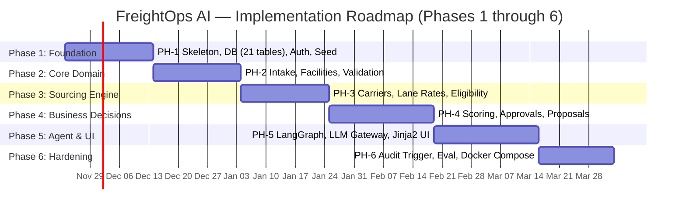

# 13 — Development Roadmap

| Field | Value |
|---|---|
| Status | Approved (Phase 1.7.5 Remediation) |
| Contract version | 2.2 |
| Contract source | [Appendix A](./03-requirements-specification.md#appendix-a--canonical-contracts) |
| Depends on | [03](./03-requirements-specification.md), [10](./10-technology-decisions.md), [12](./12-evaluation-strategy.md) |
| Last updated | 2026-11-25 |
| Audience | Developer, reviewer |

## 1. Purpose

This roadmap sequences FreightOps AI development into demonstrable, testable phases for a single developer building a production-style portfolio project. It assigns all 156 functional requirements into prioritized categories (95 MVP, 49 Post-MVP, 5 Future, 7 Merged/Removed), defines phase deliverables, and establishes a frozen MVP cut line.

**Effort estimates are planning assumptions, not commercial commitments.** They reflect part-time developer hours targeting high code quality, automated test coverage, and rigorous documentation fidelity.

## 2. Sequencing principle: deterministic core before agent layer

The system architecture prioritizes building the **deterministic core before introducing agent orchestration**:

1. **Contracts and Foundation (PH-0):** Freeze schema and API contracts.
2. **Persistence and Auth (PH-1):** Database schema (21 tables), migrations, authentication, RBAC.
3. **Intake and Validation (PH-2):** Unstructured text capture, draft creation, deterministic validation engine.
4. **Carriers and Eligibility (PH-3):** Carrier master data, lane rate benchmarks, deterministic hard filters.
5. **Scoring, Recommendations, and Approvals (PH-4):** Versioned scoring weights, candidate ranking, human approval model, booking proposals.
6. **Agent Orchestration and UI (PH-5):** LangGraph bounded state machine (16 nodes), checkpointer, LLM gateway, Jinja2 + HTMX UI.
7. **Hardening, Audit, and Evaluation (PH-6):** Audit trigger, structured logging, evaluation harness, Docker Compose deployment.

*Architectural Rationale:* Orchestrating broken or untested business logic with an AI agent creates debugging ambiguity. Building deterministic engines first ensures that each workflow node executes a verified, unit-tested component.

## 3. Phase overview

| Phase | Theme | Effort (assumption) | Deliverable / Exit Demo |
|---|---|---|---|
| `PH-0` | Architecture revision & contract freeze | 1–2 weeks | Contract 2.2 documentation set |
| `PH-1` | Skeleton, persistence, auth, seed | 2–3 weeks | Running FastAPI + PostgreSQL; user login; seed data |
| `PH-2` | Intake, facilities, validation | 2–3 weeks | Paste intake to draft shipment; deterministic validation |
| `PH-3` | Carriers, lane rates, eligibility | 2–3 weeks | Carrier status/rate fixtures, recorded lane rates, 7 hard-filter exclusions |
| `PH-4` | Scoring, recommendations, approvals, proposals | 3–4 weeks | Candidate ranking, approval queue, booking proposal |
| `PH-5` | Agent orchestration, LLM gateway, UI | 3–4 weeks | End-to-end LangGraph execution, browser approval |
| `PH-6` | Audit, hardening, evaluation | 2–3 weeks | DB immutability trigger, evaluation runner, Docker Compose |

**Total Estimated Schedule:** 15–22 weeks part-time (approx. 4–5 months).

## 4. Phase details

### PH-0 — Architecture revision & contract freeze (current)
- **Objective:** Resolve all findings from the independent architecture review (`docs/14-architecture-review.md`) and freeze Contract 2.2 across all architectural specifications.
- **Deliverables:** Revisions to documents `01` through `13`, `README.md`, `docs/README.md`, and creation of `docs/15-architecture-revision-log.md`.
- **Definition of Done:** Zero inconsistencies across enums, table names (21 tables), workflow nodes (16 canonical nodes), and API paths; verbatim cut line synchronized across `03`, `04`, and `13`.

### PH-1 — Skeleton, persistence, auth, seed
- **Objective:** Establish the modular monolith structure, PostgreSQL database with 21 tables, authentication, and synthetic data seeding.
- **Features:**
  - FastAPI application structure (`api`, `services`, `domain`, `infrastructure`).
  - Target Python 3.12 compatibility verification (ADR-017).
  - SQLAlchemy 2.x models and baseline Alembic migration for 21 tables:
    - Consolidated `facilities` entity (ADR-019).
    - `shipments` with `requirements jsonb` (ADR-020) and nullable draft party FKs (CRIT-01).
    - `carrier_lane_rates` table for rate scoring (CRIT-03).
    - `idempotency_keys` table with `status` (`in_progress`, `completed`, `failed`) (F-API-03).
  - Local authentication: session cookies with CSRF protection (bearer tokens deferred to Post-MVP via `FR-252`); password hashing (Argon2id/bcrypt).
  - Single-tenant RBAC (`admin`, `broker`, `viewer`).
  - Synthetic data seeder for demo customers, facilities, carriers, and lane rates.
- **Requirements (16):** FR-020, FR-021, FR-022, FR-024, FR-025, FR-026, FR-027, FR-069, FR-250, FR-251, FR-253, FR-254, FR-256, FR-257, FR-282, FR-283.

### PH-2 — Intake, facilities, validation
- **Objective:** Convert unstructured intake text into structured shipment drafts and run deterministic validation rules.
- **Features:**
  - Intake REST endpoints (`POST /api/v1/intake/submissions`) supporting pasted text and structured JSON (file uploads deferred to Post-MVP per INC-02).
  - Raw content hashing and idempotency detection.
  - Facilities management API (`/api/v1/facilities`).
  - Deterministic Validation Engine implementing booking readiness rules (stop sequencing, commodity, weight, equipment constraints).
  - Validation runs persistence returning `validation_run_id` and `rules_version` (F-API-02).
  - Severity gating: `critical`/`error` block sourcing; `warning` is non-blocking.
- **Requirements (15):** FR-001, FR-003, FR-005, FR-007, FR-009, FR-010, FR-040, FR-041, FR-042, FR-043, FR-044, FR-046, FR-049, FR-051, FR-052.

### PH-3 — Carriers, lane rates, eligibility
- **Objective:** Manage carrier master data, maintain recorded lane rates, and apply deterministic hard eligibility filters.
- **Features:**
  - Synthetic carrier profiles, equipment types, service regions, and availability windows (interactive Carrier CRUD deferred to Post-MVP).
  - `carrier_lane_rates` management (`flat_rate`, `rate_per_mile`, `source = 'synthetic'`) with unique active rate per lane/equipment (DEF-04).
  - Deterministic Eligibility Engine enforcing 7 canonical hard filters (equipment, region, availability, status, insurance, hazmat, temperature).
  - Canonical ineligibility reason codes and `insufficient_data` distinction.
- **Requirements (15):** FR-061, FR-062, FR-073, FR-090, FR-091, FR-092, FR-093, FR-094, FR-095, FR-096, FR-097, FR-098, FR-099, FR-100, FR-101.

### PH-4 — Scoring, recommendations, approvals, proposals
- **Objective:** Rank eligible carriers using active scoring weights and lane rates, execute human approvals, and create internal booking proposals.
- **Features:**
  - Single validated active scoring configuration loaded from seed fixtures (interactive versioning/activation APIs deferred to Post-MVP).
  - Candidate composite scoring and component breakdowns (rate competitiveness, lane familiarity, equipment fit, reliability, capacity timing).
  - Recommendation persistence and template-based explanations.
  - Approval service: `pending` creation, role enforcement, immutable decision recording.
  - Booking proposal creation with frozen data snapshot; partial unique index enforcement (at most one active proposal per shipment).
  - Re-sourcing transition: proposal cancellation or carrier decline resets shipment to `sourcing` (CRIT-04).
- **Requirements (25):** FR-032, FR-120, FR-121, FR-122, FR-123, FR-124, FR-125, FR-127, FR-132, FR-134, FR-180, FR-182, FR-183, FR-184, FR-185, FR-186, FR-189, FR-200, FR-201, FR-202, FR-203, FR-204, FR-207, FR-208, FR-209.

### PH-5 — Agent orchestration, LLM gateway, UI
- **Objective:** Integrate the 16-node LangGraph bounded state machine with persistent checkpointer, provider-agnostic LLM gateway, and server-rendered approval screens.
- **Features:**
  - Provider-agnostic `LLMGateway` with mock provider for zero-cost testing.
  - Intake text extraction with field confidence and provenance.
  - LangGraph workflow execution with 16 canonical nodes (Node 5: `normalize_requirements`).
  - PostgreSQL state checkpointer (`AsyncPostgresSaver`) and execution bounds (max 40 nodes, max 6 LLM calls).
  - Human approval interrupt and event-driven resume via `POST /approvals/{id}/decision` (ADR Decision 5).
  - Pure Python deterministic state machine designated as architectural contingency pattern (INC-05).
  - Jinja2 + HTMX server-rendered approval queue and detail screens.
- **Requirements (17):** FR-006, FR-014, FR-150, FR-151, FR-152, FR-153, FR-154, FR-155, FR-156, FR-157, FR-158, FR-159, FR-161, FR-164, FR-168, FR-181, FR-286.

### PH-6 — Audit, hardening, evaluation
- **Objective:** Implement database-enforced audit immutability, observability, synthetic evaluation harness, and Docker Compose deployment.
- **Features:**
  - Database trigger `prevent_audit_event_mutation()` enforcing append-only immutability on `audit_events` (F-SEC-03).
  - Structured JSON logging with trace IDs and PII redaction.
  - Health check endpoint (`GET /api/v1/health`).
  - Evaluation harness running test corpora `DS-01` through `DS-06` and verifying release gates.
  - Dockerfile and `docker-compose.yml` for local containerized deployment.
- **Requirements (7):** FR-220, FR-221, FR-222, FR-224, FR-225, FR-226, FR-230.

## 5. Phase to requirement matrix

The 95 MVP Must requirements are mapped to their implementation phases below (reflecting the Phase 1.7.4 scope challenge and Phase 1.7.5 Decision A1 promotion of `FR-156` to MVP):

| Requirement Block | PH-1 | PH-2 | PH-3 | PH-4 | PH-5 | PH-6 | MVP Count |
|---|---|---|---|---|---|---|---|
| **Intake (FR-001–014)** | — | 001, 003, 005, 007, 009, 010 | — | — | 006, 014 | — | 8 |
| **Shipment (FR-020–032)** | 020, 021, 022, 024, 025, 026, 027 | — | — | 032 | — | — | 8 |
| **Validation (FR-040–052)** | — | 040, 041, 042, 043, 044, 046, 049, 051, 052 | — | — | — | — | 9 |
| **Carriers (FR-060–073)** | 069 | — | 061, 062, 073 | — | — | — | 4 |
| **Eligibility (FR-090–103)** | — | — | 090, 091, 092, 093, 094, 095, 096, 097, 098, 099, 100, 101 | — | — | — | 12 |
| **Recommendation (FR-120–134)** | — | — | — | 120, 121, 122, 123, 124, 125, 127, 132, 134 | — | — | 9 |
| **Orchestration (FR-150–168)** | — | — | — | — | 150, 151, 152, 153, 154, 155, 156, 157, 158, 159, 161, 164, 168 | — | 13 |
| **Approvals (FR-180–192)** | — | — | — | 180, 182, 183, 184, 185, 186, 189 | 181 | — | 8 |
| **Proposals (FR-200–209)** | — | — | — | 200, 201, 202, 203, 204, 207, 208, 209 | — | — | 8 |
| **Audit & Obs (FR-220–231)** | — | — | — | — | — | 220, 221, 222, 224, 225, 226, 230 | 7 |
| **Access Control (FR-250–260)** | 250, 251, 253, 254, 256, 257 | — | — | — | — | — | 6 |
| **Config & Seed (FR-280–287)** | 282, 283 | — | — | — | 286 | — | 3 |

*(Total MVP Must items across all functional areas: 95 core requirements, providing comprehensive and coherent functional coverage across the 16-node workflow, 21-table database, and 23-operation MVP REST API).*

### Scope Summary Matrix
- **MVP Must Deliver:** 95 requirements (60.9%)
- **Post-MVP Backlog:** 49 requirements (31.4%)
- **Future Backlog:** 5 requirements (3.2%)
- **Merged / Removed:** 7 requirements (4.5%)
- **Total Functional Requirements:** 156 (100.0%)

## 6. Development timeline (D-20)

*Diagram D-20 — implementation sequence. Dependencies are strictly sequential.*

## 7. Deferred backlog and activation triggers

| Deferred capability | Why deferred from MVP | Activation trigger |
|---|---|---|
| Live carrier EDI / TMS / Load boards | Proprietary APIs, partner credentials required | Signed commercial pilot agreement |
| Email parsing (IMAP / webhooks) / OCR | Operational polling overhead, credential exposure | Brokerage customer requires email inbox ingestion |
| Live market rate feeds | Licensing costs; third-party data dependency | Access to licensed DAT / FreightWaves API |
| Automated carrier tendering | Financial commitment risk without human oversight | Established carrier trust and automated SLA policy |
| Machine learning rankers | Lacks labelled operational decision dataset | ≥ 1,000 real broker booking decisions logged |
| Dedicated vector databases | Relational queries satisfy all filtering requirements | Unstructured SOP / contract knowledge retrieval |
| Multi-tenant organization isolation | Single-tenant portfolio project model | Multi-tenant SaaS offering |
| Celery / ARQ / Redis / APScheduler | Unnecessary operational overhead for single developer | Asynchronous long-running batch workers required |
| Transactional outbox dispatcher | No external brokers or asynchronous consumers | Outbound microservice messaging required |
| Automatic approval TTL expiry sweeps | Simplified event-driven resume on operator decision | SLA-enforced automatic expiration required |

## 8. Schedule and implementation risks

| Risk | Likelihood | Impact | Architectural mitigation |
|---|---|---|---|
| Python 3.12 library wheel issues | Low | High | Phase 1 dependency-adoption gate; fall back to tested versions |
| LangGraph serialization complexity | Medium | Medium | Architecture designates drop-in pure Python state machine as contingency pattern (INC-05) |
| Scope creep into external APIs | Medium | High | Frozen MVP cut line; external APIs strictly in deferred backlog |
| UI development time sink | High | Medium | Approval-only UI; server-rendered Jinja2 + HTMX without build pipeline |

## 9. MVP cut line (verbatim)

The following is copied verbatim from [03 §1.3](./03-requirements-specification.md#13-mvp-vs-postponed-verbatim-cut-line) and [04 §10](./04-system-architecture.md#10-mvp-vs-postponed-verbatim-cut-line). If any divergence occurs, `03 §1.3` is the authoritative source.

> **In MVP**
>
> - Target runtime: Python 3.12 (standardized; unverified planned packages subject to Phase 1 adoption gate)
> - Local user accounts, session cookie login with CSRF protection, RBAC with `admin`, `broker`, `viewer` (bearer token auth deferred to Post-MVP via FR-252)
> - Facilities master data CRUD (consolidating physical shippers and receivers into `facilities`)
> - Intake via pasted unstructured text and REST API; intake submission persisted with parse metadata (manual entry deferred to Post-MVP via FR-004)
> - Shipment read/update before approval, first-class `equipment_type` (`dry_van`, `reefer`, `flatbed`), multi-stop pickup and delivery stops (`shipment_stops`), and structured requirements stored as validated `jsonb`
> - Unresolved/nullable customer, facility, and `equipment_type` references on draft intake shipments, resolved prior to validation
> - Deterministic validation engine with severity gating and a validation results endpoint returning `validation_run_id` and `rules_version`
> - Synthetic carrier fixtures, equipment types, service regions, availability windows, and synthetic lane rates (`carrier_lane_rates`); interactive carrier CRUD deferred to Post-MVP (FR-060, FR-063–065)
> - Deterministic hard-eligibility filtering (7 canonical filters) with canonical reason codes
> - Rule-based configurable scoring baseline with top-N recommendations, score breakdowns, and factual rate competitiveness
> - Template-based explanations; LLM narration behind the gateway with automatic template fallback
> - Single LangGraph workflow with bounded transient retries (FR-156), durable PostgreSQL checkpoints, and exactly one human approval interrupt
> - Simplified workflow execution: human decision resumes the graph; automatic TTL sweeps and outbox workers deferred
> - Re-sourcing state transition: declined or cancelled booking proposals return shipment to `sourcing` rather than terminal cancellation
> - Jinja2 + HTMX approval screens supporting approve, reject, and request changes; candidate selection override deferred to Post-MVP (FR-190, FR-191)
> - Booking proposal records with frozen JSONB snapshots (no external tender or confirmation)
> - Append-only audit events with database-level immutability enforcement and correlation IDs
> - PostgreSQL persistence and Alembic migrations
> - Structured JSON logs, request/trace IDs, unauthenticated health endpoint
> - pytest unit/integration tests and an evaluation harness skeleton
> - Dockerfile and Docker Compose for app + database (development)
> - Synthetic seed data only (facilities, customers, carriers, lane rates, shipments)
> - Target scope: 95 prioritized requirements (Contract 2.2 / Phase 1.7.5 Remediation)
>
> **Deferred (Post-MVP and Future)**
>
> - Manual shipment entry without intake (FR-004) and pre-validation extraction review screen (FR-011)
> - Interactive carrier profile and attribute CRUD endpoints (FR-060, FR-063, FR-064, FR-065) and operator carrier list UI (FR-068)
> - Scoring configuration versioning and activation APIs (FR-280, FR-281, FR-285)
> - Bearer token API authentication (FR-252)
> - Broker candidate selection override on approval (FR-190, FR-191)
> - Multi-user optimistic locking on shipments (FR-023) and separate warning review flow (FR-045)
> - Secondary query endpoints and redundant metadata (FR-008, FR-031, FR-205, FR-255)
> - Scoring nuance penalties and config lineage tracking (FR-128, FR-129)
> - Redundant re-validation, exclusion formatting, and rate rules (FR-048, FR-050, FR-067, FR-102, FR-126, FR-133)
> - Automatic approval TTL expiration sweeps and background worker schedulers (Celery/ARQ/APScheduler)
> - Transactional outbox event dispatcher and message brokers
> - Real carrier, load-board, TMS, EDI, or telematics integrations
> - Plain text and JSON file uploads (Post-MVP); inbound email ingestion (.eml parsing, IMAP polling, inbound webhooks) and document OCR (Future)
> - External rate feeds, live market benchmarks, automated pricing, or automated tendering
> - ML ranking, vector databases (Pinecone/pgvector), Sentence Transformers, scikit-learn models
> - Multi-tenant organization isolation and fine-grained object-level ACLs
> - Kubernetes, autoscaling, service mesh
> - Dedicated observability backend (OpenTelemetry Collector, Prometheus, Grafana)
> - SSO/OAuth/MFA and separation-of-duties enforcement
> - Notifications and outbound email
> - React SPA or mobile application
> - High-availability clustering and automated failover
> - Fraud detection and automated double-brokering checks

## 10. Definition of done for the MVP release

The MVP is complete and ready for portfolio presentation when:

1. A pasted freight request becomes a validated shipment draft with zero invented values.
2. A single operator action triggers the LangGraph workflow, executing the 16 canonical nodes and pausing cleanly at the approval interrupt.
3. An authorized broker approves the recommendation in the browser; the workflow resumes durably from the PostgreSQL checkpointer.
4. Approval creates exactly one internal booking proposal with an immutable data snapshot.
5. Declining or cancelling an unaccepted proposal resets the shipment to `sourcing` for re-recommendation.
6. Rate scoring uses factual `carrier_lane_rates` benchmarks rather than model hallucinations.
7. Audit events cannot be updated or deleted through any database user or application path (trigger enforced).
8. All blocking evaluation gates (`EV-02`, `EV-03`, `EV-04`, `EV-06`, `EV-07`, `EV-11`, `EV-12`) pass 100% on synthetic test corpora.
9. `docker compose up` brings up the application and database reproducibly from a clean clone.
10. All documentation accurately reflects the implemented reality.
